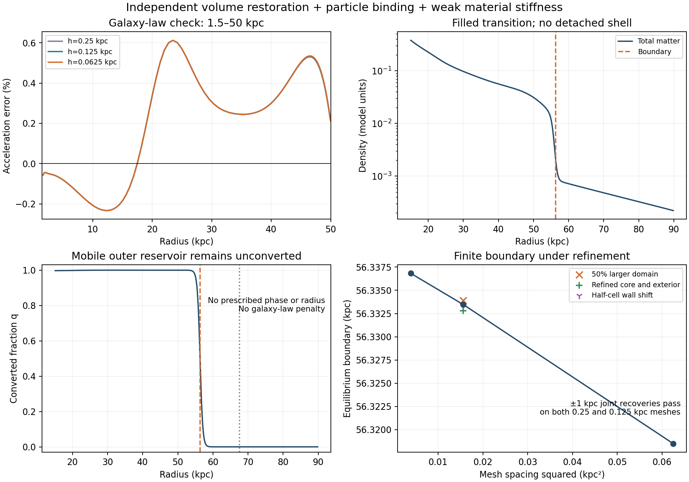

# Finite boundary with joint material redistribution: conditional working branch

A new combined effective energy produces a materially filled, restoring finite
boundary with approximately 0.61% maximum galaxy-law error on 1.5--50 kpc. The
boundary converges under interface, core and exterior refinement, returns after
joint +/-1 kpc species displacements, and survives a larger freely adjusted
reservoir. This addresses the previously observed boundary drift in this
spherical benchmark. It does not establish an exact law, a microscopic theory,
cosmological formation, universality across galaxies or an observational fit.

## What holds the boundary and moves matter

Keep the previously tested nonlinear response, gravity, phase barrier/stiffness
and F pressure, and add

    E_add = integral r^2 q(B-epsilon rho) dr
            + (kappa/2) integral r^2 [d sqrt(rho)/dr]^2 dr.

The constant positive volume cost B supplies inward phase pressure, the constant
per-T-particle binding epsilon favors inward converted mass, and weak material
stiffness prevents a cavity. All derivatives enter the same joint solve. There
is no prescribed boundary, imposed dark density, law-fitting penalty, supplied
interface charge, density activation gate or extra constant surface stress.
The volume and binding terms are new constitutive postulates. The material
stiffness is the previously tested interaction, now with an independent
restoring term rather than being asked to pin the wall by itself.

At fixed enclosed T mass the thin-wall restoring force is

    F_R = 2 A M^2 R/(R^2-M)^2 - B R^2,
    A = 2 ell sqrt(2 beta C)/pi^2.

It has a unique finite stable root for B>0. This analytic result alone does not
establish the joint equilibrium. For the numerical state, the constrained
Hessian after relaxing both mass and phase gives the actual radial local
stiffness. Independent finite displacements test recovery beyond that quadratic
calculation. See [DERIVATION.md](DERIVATION.md) for every species potential,
material force and restoring-force calculation.

Parameters for the working branch: Mb=6e10 Msun, baryonic Plummer b=3 kpc,
a0=9.3603e-11 m/s^2, total dark mass 5.364 Mb, C=.95, beta 4, ell=2.12132034 kpc,
K_F=30, B=.001, epsilon=.3, material length 0.25 kpc. Dimensionless energy is
measured in Mb*a0*rM, rM=9.45225971 kpc. These constants are feasibility inputs,
not independently derived universal coefficients. The barrier was increased
while keeping ell*sqrt(beta) fixed to narrow the wall without increasing its
leading surface energy.

## Measured joint equilibrium

All rows below use unrestricted mass and phase variables with fixed total
mass. The requested law window is 1.5--50 kpc, including interpolated endpoints.
The mass budget for an exact law is 4.80157935 Mb inside 50 kpc. Values below are
computed from the finished states, not from the thin-wall approximation.

| Check | Boundary (kpc) | Maximum law error | Relaxed stiffness (Eunit/kpc²) |
|---|---:|---:|---:|
| Wall h=.25 | 56.31850126 | 0.612130% | 0.000427891394 |
| Wall h=.125 | 56.33346440 | 0.612202% | 0.000426758835 |
| Wall h=.0625 | 56.33682072 | 0.612220% | 0.000426421515 |
| 50% larger domain | 56.33391650 | 0.612101% | 0.000426854118 |
| Doubled core and exterior cells | 56.33279457 | 0.610592% | 0.000426624344 |
| Half-cell wall shift | 56.33327147 | 0.612202% | 0.000429792024 |

The finest wall mesh shifts the radius by 0.00336 kpc relative to h=.125; the
preceding halving shifted it by 0.01496 kpc. Increasing the domain from 663.95
to 995.92 kpc shifts R by 0.000452 kpc. Refining the core and exterior together
changes R by -0.000670 kpc; a half-cell shift changes it by-0.000193 kpc. These
results control the earlier large radius drift without prescribing a radius.
The shifted-grid stiffness differs by about 0.7%, so its many displayed digits
are not a continuum-accuracy claim.

On h=.125, mass inside 50 kpc is 4.81336638 Mb, compared with the exact-law
budget 4.80157935 Mb. The error at 50 kpc is+0.203%; the maximum 0.612% occurs
elsewhere in the declared window. There are no empty transition cells, the
density decreases monotonically from 15 kpc through 1.2 R, and the old 17--43 kpc
gap contains 2.72609642 Mb. This is material support, not a tiny numerical floor.
Beyond 1.2 R there is 0.11470142 Mb of mobile reservoir with mass-weighted T
fraction 1.43e-15. Its phase and density are not fixed externally. The remaining
mass outside 50 lies in the populated transition and nearer reservoir.

Both +/-1 kpc conservative species displacements return to their original
boundary on both h=.25 and h=.125 meshes. The largest final radius discrepancy
is 1.01e-8 kpc, within solver precision, and final energies agree to 5.4e-15
Eunit. These recovery residuals are not physical accuracy estimates or actual
time evolutions. The relaxed boundary stiffness is approximately 4.27e-4
Eunit/kpc², so the local fully relaxed force is `F_R=-k_rel deltaR+O(deltaR²)`.

The full phase Hessian, including phase endpoint variables, is positive on the
active fixed-mass radial tangent at h=.125: minimum eigenvalue 9.73e-8 in the
stated coordinates, with material cells below 1e-8 Mb excluded. The full-force
Hessian finite-difference errors are at most 2.49e-7; local species-potential
checks are at most 2.56e-11. The density KKT residual is below 2.3e-10 on every
final mesh/domain state, and projected phase/log-mass gradients below 1e-8.
Total mass is preserved to roundoff and the response remains on its physical
u<1 branch. Small floor-mass directions, nonspherical modes and dynamic
stability remain outside these certificates.

The all-F phase-seed Hessian agrees with the independently derived local
coefficient to 4.3e-16 relative error and is positive in the outer reservoir.
This seed diagnostic uses the candidate density; it is not an independent
all-F hydrostatic initial state or a simulation of formation.



## Routes closed or qualified in this turn

The original coarse-wall force quadrature has up to 86.7% relative error in the
manufactured comparison. Fixed physical wall spacing reduces it to 0.1895%
at 2 kpc and 0.0475% at 1 kpc. No force-sign reversals were observed in that
benchmark; it does not prove all old drift was numerical.

A constant area stress supplies inward force but by itself leaves insufficient
inward mass. Density-gated chemical binding can give a sub-percent apparent
law, but displaced solves find another lower-energy radius. Its density
chemical potential overshoots in the activation band, creating an unwanted
preferred-density shell. Adding stiffness of that activation field is not a
successful repair. Global stiffness alone again trades material support
against bulk-law error. The successful combination separates boundary
pressure, inward binding and weak material support, then narrows the phase
transition at fixed leading wall tension.

## Reproducibility and record status

Each run has an immutable contract, input hashes, limits, stdout/stderr and a
manifest. Failed and timed-out attempts are retained. A valid manifest means
the record is authentic, not that its physical claim passed. Completed result
files must still be interpreted using force residuals and the stated checks.
`MANIFEST_AUDIT.json` validates all 26 records. Raw inherited model labels
are qualified by `MODEL_METADATA_CORRECTION.json`; the working energy includes
material stiffness even though the parent L field is zero. Final physical evidence is in
BR-19--21,23,25; BR-26 extracts and plots those finished results.

From the repository root, for example:

```sh
python 3 gradient_coupling_2026_10_24/launch.py boundary_resolution_2026_10_25/latent_audit_checked_contract.json boundary_resolution_2026_10_25/reproduce_audit boundary_resolution_2026_10_25/latent_audit_checked.py
```

Use a fresh output directory. Longer verification contracts BR-20,21,25 were
run with the bounded computation-audit runner and a 600-second limit; their
manifest records the exact command, inputs, software and limits. Other runs
use 300 seconds. See [HANDOFF.md](HANDOFF.md) for continuation constraints.

| Claim | Run | Status | Interpretation |
|---|---|---|---|
| BR-1 | `run_screen` | failed | Actual-grid transfer bug; stops before physics. |
| BR-2 | `run_checked` | failed | One area-stress trial saved; derivative step too large for declared threshold. |
| BR-3 | `run_benchmark` | completed | Independent continuum wall-force benchmark. |
| BR-4 | `run_resolved` | completed | Area-stress trials: finite walls, law still poor. |
| BR-5 | `run_chemical` | completed | Density-gated binding feeds inner mass; broad wall still wrong. |
| BR-6 | `run_compact` | timeout | Partial thin-wall screen; zero-stiffness candidate saved before timeout. |
| BR-7 | `run_verify` | timeout | Displaced recovery exposes lower-energy neighboring boundary. |
| BR-8 | `run_hessian` | completed | Positive local Hessian did not guarantee finite recovery. |
| BR-9 | `run_regularized` | timeout | Gated binding plus coupled stiffness; partial recoveries, residuals too large. |
| BR-10 | `run_independent` | timeout | Ordinary stiffness with gated binding; displaced lower-energy state. |
| BR-11 | `run_virial` | completed | Independent homology/virial component identities; not continuum equilibrium. |
| BR-12 | `run_critical` | failed | Deliberately stopped after unconverged base; no physical recovery claim. |
| BR-13 | `run_force_finish` | completed | Mass converged but phase-tail active set omitted true directions. |
| BR-14 | `run_density_field` | completed | Phase active set fixed; density-field trial still missed tiny negative-KKT cells. |
| BR-15 | `run_complete_density` | completed | Mass active set fixed; density-field trial develops unwanted shell and poor law. |
| BR-16 | `run_latent` | failed | Nonfinite gas AD Hessian at pure T; numerical representation failure. |
| BR-17 | `run_latent_smooth` | completed | Equivalent smooth gas; volume energy pins but alone trades cavity against law. |
| BR-18 | `run_latent_stiff` | completed | Weak material support fills volume-bound branch; broad phase still has ~2% error. |
| BR-19 | `run_latent_thin` | completed | Narrower wall at fixed leading tension yields filled sub-percent candidate. |
| BR-20 | `run_latent_verify` | completed | Two-mesh joint displaced recovery, positive Hessian and relaxed stiffness. |
| BR-21 | `run_latent_domain` | completed | Third wall mesh and larger free domain pass. |
| BR-22 | `run_latent_audit` | failed | Scalar array-reporting bug stops audit; no physical conclusion. |
| BR-23 | `run_latent_audit_checked` | completed | Corrected full-phase Hessian, species-force and seed-coefficient audits pass. |
| BR-24 | `run_report` | failed | Reporting assumed Hessian in raw checkpoint; aggregation-key error. |
| BR-25 | `run_latent_global` | completed | Core/exterior refinement and half-cell mesh shift pass. |
| BR-26 | `run_report_checked` | completed | Corrected extraction and scientific figure. |
