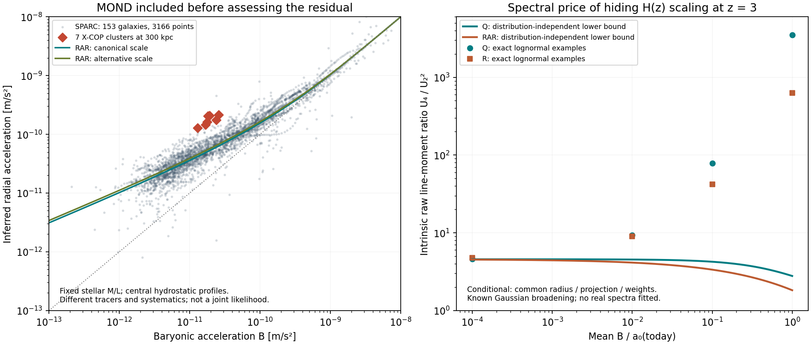

# Fresh gravity Astra campaign

**Latest: [Stage 3 — independent precision audit, cluster constraints and dynamics](stage_03/README.md).**
Three agent lanes and a joint-inference calculation are complete. The audit
corrects a support qualification, the cluster analysis tests coupled thermal
calibrations and continuity, and a conservative scalar construction exposes
the dynamical input still missing. The complete theory remains open.

**Earlier: [AFG-004–008 — geometry, instrument response and scale identifiability](stage_02/README.md).**
The second stage removes the common-geometry restriction, derives an optimized
measurement estimator, constructs an exact scale/broadening ambiguity and
extends the calculation separately to the exponential RAR branch.

**Checkpoint AFG-003, 2026-09-27: a new derivation chain and a spectral test;
the complete gravity objective remains open.**

This lane starts from Zimmerman's scale and static gravity relations and derives
forward from them. It does not borrow another theory as its mechanism. Existing
observations and the inherited framework remain explicitly identified. No
literature-wide novelty claim is made. Work is confined to this folder; the
concurrent `campaign_fresh_gravity/` campaign is untouched.

## The result worth taking forward

**Unresolved structure can disguise evolution in a mean acceleration, but under
a controlled observation model it must leave a measurable line-shape signal.**

From the core algebraic law g²=B²+a₀B, we obtain an exact moment invariant and
a distribution-independent bound. If the true scale grows as H(z), yet the
mean is made to resemble constant a₀, then at z=3 and mean B=0.01a₀(today):

| Static branch | Minimum intrinsic raw moment ratio U₄/U₂² |
|---|---:|
| Algebraic a₀-line | 4.530 |
| Exponential RAR | 4.135 |

These are different kernels, so they have separate proofs. The test requires
common or forward-modelled geometry, matching baryonic/emission weights and
calibrated line broadening. It is **not a prediction of an observed kurtosis
without those controls**. No real spectra were fitted.

The lognormal construction can in fact conceal the mean signal; it is not
ruled out algebraically. At z=3, mean B=0.01a₀(today), its exact Q/R examples
need source coefficients of variation 21.89/21.05 and predict U₄/U₂² of
9.275/9.003. This is a concrete hypothesis with a cost that can be tested.

## Empirical baseline, with MOND already included

* **153 SPARC galaxies, 3166 radial points:** fixed stellar M/L and the stated
  quality/inclination cuts; RAR residual RMS is 0.1771 dex canonical and
  0.1779 dex alternative. These are descriptive residuals, not likelihoods.
* **Seven X-COP clusters with their own stellar profiles, 21 radial points:**
  all require a positive additional equivalent source under each Q/R/M
  normalization. At 300 kpc, the RAR branch requires median total source
  6.00 times the measured baryons canonical, or 5.56 times alternative.
  These are **MOND-inverted source requirements**, not Newtonian missing masses.
  Using each cluster's redshift with H(z) scaling changes those medians to
  5.93 and 5.48; the low-redshift residual remains.
* At matched baryonic acceleration, the 300-kpc cluster points sit about
  0.481 dex above the galaxy discrepancy medians. Different tracer reductions
  and unmodelled nuisance covariance prevent treating this as a significance.

The baseline does not make the cluster problem disappear. It specifies what a
new mechanism or a calibrated measurement explanation must supply.



## Framework kept explicit

Primary: latest standing's vacuum/pressure normalization,
a₀=κc√(GρΛ), with both 9.3619e-11 and 1.1279e-10 m/s².
Separately calculated comparison: a₀(z)=a₀(0)E(z). The older H law and latest
vacuum law are not silently combined. κ is adopted, not newly derived.
Q, RAR and the inherited monotone-phantom radial branch M remain separate.

## Where the work lives

* [Target, assumptions and calculation contract](CONTRACT.md)
* [Five linked derivations, including the distribution-free bound](DERIVATIONS.md)
* [Self-audit, limitations and next executable handoff](AUDIT_AND_NEXT.md)
* [First empirical and synthetic results](run_002/results.json)
* [Every cluster inverse-source calculation](run_002/cluster_inverse_budget.csv)
* [Finite-transition calculations](run_transition_001/results.json)
* [Independent bound checks and false-rule controls](run_bounds_001/results.json)

Three completed bounded computation records validate with input/output hashes.
The initial failed serialization run is preserved as `run_001`; it is not
scientific evidence. No commit, external publication or shared standing edit
was made in this lane.

## Reproduce

For the empirical/synthetic run, choose a new directory name:

```bash
/opt/homebrew/Caskroom/miniconda/base/bin/python -B campaign_fresh_gravity_astra/run.py run_reproduction
```

The other scripts accept an existing empty output directory through `--out`;
their exact commands, environments and bounds are recorded in their manifests.
Use the installed computation-audit validator with `--root` to check provenance.
Those manifests record execution success, not empirical acceptance of gravity.
