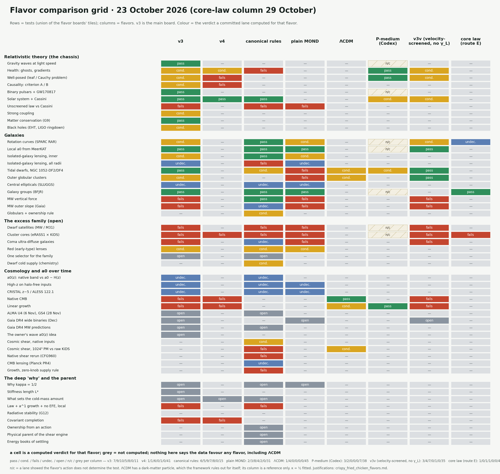
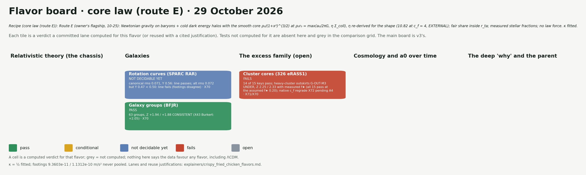

# The Crispy Fried Chicken flavor boards

*23 October 2026. The main board stays v3's ([`crispy_fried_chicken_status_board.md`](crispy_fried_chicken_status_board.md), [`img/status_board.png`](img/status_board.png)). These pages put the same tests to four other flavors, and the grid sets all five side by side. A cell is a computed verdict for that flavor; grey = not computed; nothing here says the data favour any flavor, including ΛCDM.*

Boards: [v4](img/status_board_v4.png) · [canonical rules](img/status_board_canonical_rules.png) · [plain MOND](img/status_board_plain_mond.png) · [ΛCDM](img/status_board_lcdm.png) · [P-medium (Codex)](img/status_board_pmedium.png) · [v3v](img/status_board_v3v.png) · [core law (route E)](img/status_board_core_law.png). The v3 board is [`img/status_board.png`](img/status_board.png). All are drawn by [`make_flavor_boards.py`](make_flavor_boards.py), which imports v3's tiles from [`make_status_board.py`](make_status_board.py) and leaves that board and its image untouched.

## The flavors (one-line recipes)

| flavor | recipe |
|---|---|
| v3 | General relativity plus a preferred cosmic time (Khronon) and one extra field giving the simple MOND law (AQUAL, external-field effect included, κ fitted), switched off within L★ ≥ 22 pc by a stiffness that acts only where D·P ≥ 0, plus fitted cold dust; no settling or supply rules. |
| v4 | AeST (Skordis–Złośnik) with C1's capped free function (static limit = the law μ = x/(1+x)) plus the same stiffness term γ_L; AeST's own dust; κ fitted. Not the best theory: ill-posed where the aether twists (I1). |
| canonical rules | The pre-covariant framework (THEORY_CANONICAL v2; DSF-21's stiffened action): the law on baryons (QUMOND phantom, ν_mono / algebraic) plus cold-energy rules for settling, catchment supply, round enclosed mass, capture and ownership; κ fitted. |
| plain MOND | AQUAL with μ = x/(1+x) on baryons, external-field effect included; no screening, no dust, no cosmology; κ = ½ fitted. |
| ΛCDM | GR + Λ + cold dark matter particles (6 fitted cosmological parameters; halos from simulations). It has a dark-matter particle, which this framework's owner rules out for the framework itself; a reference only. |
| P-medium (Codex) | Newtonian Poisson on baryons + a cold particle medium that also feels a saturating polarization P and a stiffening scalar χ (Codex's reduced preferred-frame action); ℓ₀ = 0.44 kpc fitted to growth. |
| core law (route E) | Route E (the owner's 10-25 flagship): Newtonian gravity on baryons + cold dark energy halos with the smooth core ρ₀/(1+x²)^(3/2) at ρ₀r₀ = max(a₀/2πG, η Σ_coll), η re-derived for the shape (10.82 at c_f = 4, EXTERNAL); fair share inside r_ta; measured stellar fractions; no law force. κ fitted. |
| v3v (velocity-screened, no γ_L) | Literal Blanchet–Skordis Khronon (J_x, BS K(Q) dust) + covector P, with NO γ_L stiffness. Moving subsystems hold phantom only within 2GM_b/V² (velocity screening). κ fitted; no L★. |

ΛCDM is a reference column only. It has a dark-matter particle, which this framework's owner rules out for the framework itself.

## How a cell gets a colour

- **Only from a lane that computed that flavor.** The registry `LANES` says which flavors each lane computed, and where that is stated.
- **Reuse needs a cited reason.** A verdict computed for another flavor, or for the Newtonian limit, is reused only when a lane's README or a THEORY_V3_DRAFT row shows that the computation is the same. Each reuse is listed below with its file and line.
- **Never better than the lane's own verdict.** `VERDICTS` records each lane's verdict with the file and line that states it. A cell may be worse, never better.
- **Greens need verification.** A green needs a `VERIFIED_GREEN_F` entry: the lane, its result commit, and a rerun or an independent reproduction. The canonical rules are the exception: they keep the greens that the 23 October afternoon board already drew.
- **Some rows stay grey by rule.** Plain MOND has no cosmology, so its cosmology rows stay grey. ΛCDM rows that would need galaxy-formation, feedback or halo modelling the record never ran stay grey; they are never filled from literature claims.
- **The v3 column is the main board.** The main generator's own check must still pass, and v3's recipe line is the main board's own.
- **n/c is not grey.** n/c ("not computable") means a lane showed that the flavor's action does not determine the test. It is a finding, cited like any verdict. Grey means nobody computed it.
- **Checks.** `--selftest` runs 31 broken cases, and every one is caught. They cover reuse, cross-flavor borrowing, unjustified ΛCDM cells (including a ΛCDM cell reused from a framework-law lane) and greens without evidence. `--mutate` strips one reuse justification, and the checks must fail.

## Counts

The grid has 50 rows.

| flavor | pass | conditional | fails | not decidable | open | n/c (not computable) | grey (not computed) |
|---|---|---|---|---|---|---|---|
| v3 | 7 | 9 | 10 | 5 | 8 | 0 | 11 |
| v4 | 1 | 1 | 6 | 0 | 1 | 0 | 41 |
| canonical rules | 6 | 5 | 9 | 7 | 8 | 0 | 15 |
| plain MOND | 2 | 3 | 8 | 4 | 2 | 0 | 31 |
| ΛCDM | 1 | 4 | 0 | 0 | 0 | 0 | 45 |
| P-medium (Codex) | 3 | 2 | 0 | 0 | 0 | 7 | 38 |
| v3v (velocity-screened, no γ_L) | 3 | 4 | 7 | 0 | 1 | 0 | 35 |
| core law (route E) | 1 | 0 | 1 | 1 | 0 | 0 | 47 |

## v4

**Recipe:** AeST (Skordis–Złośnik) with C1's capped free function (static limit = the law μ = x/(1+x)) plus the same stiffness term γ_L; AeST's own dust; κ fitted. Not the best theory: ill-posed where the aether twists (I1).

| tile | colour | what the lane found | evidence lanes |
|---|---|---|---|
| Health: ghosts, gradients | 🟨 conditional | no ghost at linear order on the Y = 0 vacuum (H3); C5's negative-energy mode is the dust's Jeans mode; growth rate bounded; γ_L gives no causal cone (open) | H3, H1, C5 |
| v4 well-posedness | 🟥 fails | ILL-POSED where the aether twists, i.e. in every non-symmetric bound system; well posed only on aether-orthogonal slices; no healthy completion | I1 |
| Causality: criterion A / B | 🟥 fails | A violated; where the aether twists, relayed signals can close loops in time, so B fails in principle (loop gains 4 ms–3.9 s around the Galaxy) | I1 |
| Solar system + Cassini (screened) | 🟩 pass | capped F: Q₂ ≤ 7e-8 of Park's bound (static solve); the Sun in the Galaxy's field has no well-posed slice (I1) | H1 |
| Cluster cores (326 eRASS1) | 🟥 fails | CANNOT supply the core excess: AeST's static dust has the wrong radial shape; best profile χ² 27.7–39.6 vs line 11.07 (law alone 27.3–41.8) | H2 |
| Linear growth, v4 AeST | 🟥 fails | Newtonian term survives on large scales for any F (H1), but on FRW v4 runs away for the Cosh dust shape: P/P_ΛCDM 1e2–1e41 by 10 h/Mpc (C7) | C7, H1, H3 |
| Native CMB (C7 patched CLASS) | 🟥 fails | Cosh at its physical g = 0.75: plik-lite Δχ² +119 vs the ΛCDM refit, H₀ 55.6; SZ21's benchmarks match only at g = 1 | C7 |
| Covariant completion | 🟥 fails | trilemma: screening needs γ_L; γ_L is well posed only with an untwisted aether, which v4 is not (I1); no screening without γ_L tolerates a twist (M1 R2) | I1, M1 |
| What sets the cold-mass amount | ⬜ open | Ω_c is fitted in an AeST-type completion: the dust density is an initial datum (I₀), independent of a₀ and Λ | C2 |

## canonical rules

**Recipe:** The pre-covariant framework (THEORY_CANONICAL v2; DSF-21's stiffened action): the law on baryons (QUMOND phantom, ν_mono / algebraic) plus cold-energy rules for settling, catchment supply, round enclosed mass, capture and ownership; κ fitted.

| tile | colour | what the lane found | evidence lanes |
|---|---|---|---|
| Health: ghosts, gradients | 🟥 fails | DSF-21's A33 form has η > 0, which C5 shows is ill-posed; the rules themselves have no action (CFG678) | C5 |
| Solar system + Cassini (screened) | 🟩 pass | the stiffened DSF-21 action passes Cassini by 1e7–1e9 at L* = 24–90 pc, in all four Galactic fields | D7d |
| Unscreened law vs Cassini | 🟥 fails — fails (unscreened form) | the canonical law, unscreened, fails the Hees 2σ line at every turn-off scale (D7b); no unscreened form passes both Q₂ and SPARC (D7c) | D7b, D7c |
| Rotation curves (SPARC RAR) | 🟩 pass | algebraic law: rms 0.101 / 0.099 dex, one global Υ | CFG695, CFG919 |
| Local a0 from MeerKAT | 🟩 pass | 0.9–1.4e-10, matches SPARC (ν_mono) | CFG301, CFG309 |
| Isolated-galaxy lensing, inner | 🟩 pass | catchment supply suffices ≤ 0.31 Mpc; blue lenses A 1.016 (isolated law, no EFE); FRAGILE under window shifts (CFG840) | CFG804, CFG829, CFG840, CFG902 |
| Isolated-galaxy lensing, all radii | 🟥 fails — fails (frozen; not robust) | frozen fail; F2: the Δχ² +100 is the catchment edge's, and the 'isolated' sample leaks hosts (not robust) | CFG902, CFG903, F2 |
| Tidal dwarfs, NGC 1052-DF2/DF4 | 🟨 conditional | Newtonian if they captured no cold energy (capture route); host EFE untested | CFG936, CFG939 |
| Globulars + ownership rule | 🟨 conditional | owned clusters at Newton: ~1.6σ; 3 of 4 populations | CFG332, CFG333 |
| Central ellipticals (SLUGGS) | 🟦 not decidable yet | ~3σ with measured tracers (ν_mono) | CFG528b |
| Galaxy groups (BFJR) | 🟩 pass | consistent supply closes (census edge); EFE unchecked | CFG540, CFG543 |
| MW vertical force (round rule) | 🟩 pass | the round rule beats the MOND phantom disc 32/32; within +4 of an NFW's χ² in only 6–9 of 16 cells; K_z scale length missed (baryon model) | CFG516 |
| MW outer slope (Gaia) | 🟦 not decidable yet | 3–5σ steeper (round rule, ν_mono, no EFE) | CFG532b, CFG533 |
| Dwarf satellites vs screened law | 🟥 fails | pre-infall retention (PAPER36) FAILS on native inputs: +0.92 / +0.89 dex; it closes only with ΛCDM's subhalo mass put in by hand | G2 |
| Dwarf cold supply (chemistry) | 🟨 conditional | catchment supply; P1's MDF test confirms it for the median, not 2σ-robust; supply is not a binding mechanism | E6, P1 |
| Cluster cores (318 eRASS1) | 🟥 fails | the expelled-share rule fails the full 318 (middle tercile ×~1.6, Z ≈ +4); F1: the settled c* = 0.40 profile fixes the core only by breaking 1.2–3 Mpc | CFG815, CFG687, F1 |
| Coma ultra-diffuse galaxies | 🟦 not decidable yet | +0.33 dex over the isolated law; Coma's field not applied (ν_mono) | CFG933, CFG948 |
| Red (early-type) lenses | 🟨 conditional | an IMF α–σ relation removes it (EFE-free law) | CFG926 |
| One selector for the family | ⬜ open | excesses graded over the EFE-free ν_mono law | CFG914, CFG919, CFG921, CFG928 |
| a0(z): native band vs a0 ~ H(z) | 🟦 not decidable yet | own BAO ruler band; data cannot decide yet | CFG689, PAPER38 |
| High-z on halo-free inputs | 🟦 not decidable yet | RC100 on the flat line (ν_mono) | CFG303 |
| CRISTAL z~5 / ALESS 122.1 | 🟦 not decidable yet | stress tests: not robust (ν_mono) | CFG307, CFG308 |
| Cosmic shear, native inputs | 🟨 conditional | theory-v2 engine: KiDS CONSISTENT on both footings; the engine has no parent (CFG947) | CFG909, CFG654-A2, CFG654-A3 |
| Cosmic shear, 1024³ PM vs raw KiDS | 🟥 fails | settling rules + census supply: 19–25 % too much power at k 0.3–1; Δχ² +68.7 vs S0, EXCLUDED (canonical footing); F3: it belongs to the settling rules | CFG596, F3 |
| Native shear rerun (CFG960) | 🟥 fails | SCT-M engine: SC1x FAILS, KiDS EXCLUDED, Δχ² +47.28 | CFG960 |
| CMB lensing (Planck PR4) | 🟦 not decidable yet | SAFE; CONSISTENT only under post-hoc A1; low power | CFG917, CFG927 |
| Growth, zero-knob supply rule | 🟥 fails | the settling engine's excess grows with grid resolution (0.040 / 0.077 / 0.163 at 128³–512³, G1) | CFG555, CFG556, F3, G1 |
| ALMA U4 (6 Nov), GS4 (28 Nov) | ⬜ open | the governing plan's verdict kernel is ν_mono; expected unscorable | CFG806-U4, CFG809, CFG942 |
| Gaia DR4 MW predictions | ⬜ open | sealed 10-10 for the round rule (ν_mono, QUMOND phantom disc, no EFE) | CFG553 |
| Why kappa = 1/2 | ⬜ open — open: fitted | fitted, 0.417 ± 0.095 (routes with ν_mono and algebraic laws) | CFG493, CFG894 |
| What sets the cold-mass amount | ⬜ open — open: fitted | 5.364 an input; the sourcing fraction u has no mechanism (D6) | CFG886, D6 |
| Ownership from an action | ⬜ open | the label sector has no action | CFG945, CFG950, CFG953 |
| Law + a^1 growth + no EFE, local | 🟥 fails | no-go: a local field giving the deep law must carry an EFE (CFG946); the class-A engine has no non-local causal parent (CFG947) | CFG946, CFG947, CFG941, CFG944 |
| Physical parent of the shear engine | ⬜ open | 3 tried: LDT, SCT fail clusters; no kinetic parent | CFG951, CFG954, CFG955 |
| Energy books of settling | ⬜ open | not conserved; a repair needs new physics | CFG932, CFG935 |

## plain MOND

**Recipe:** AQUAL with μ = x/(1+x) on baryons, external-field effect included; no screening, no dust, no cosmology; κ = ½ fitted.

| tile | colour | what the lane found | evidence lanes |
|---|---|---|---|
| Unscreened law vs Cassini | 🟥 fails | AQUAL μ = x/(1+x), no screening: Cassini Q₂ 2.44–4.59× / 2.85–5.19× the Hees 2σ line | E2 |
| Rotation curves (SPARC RAR) | 🟨 conditional | one Υ per galaxy, EFE solved: rms 0.054 / 0.054 dex; median Υ 0.52 / 0.44; χ² line fails both | P4 (reused from v3: P4) |
| Local a0 from MeerKAT | 🟩 pass | 1.31e-10 vs SPARC same recipe 1.21e-10 (+0.032 dex) | P4 (reused from v3: P4) |
| Isolated-galaxy lensing, inner | 🟨 conditional | blue A 0.88 / 0.81 at the primary field; decided by hot CGM and M★ | S2 (reused from v3: S2) |
| Isolated-galaxy lensing, all radii | 🟦 not decidable yet | spectroscopic isolation: N too small (needs ~22–26k lenses) | P2 (reused from v3: P2) |
| Tidal dwarfs, NGC 1052-DF2/DF4 | 🟥 fails | static AQUAL in the host field: TDGs −0.59 / −0.62 dex, DF2/DF4 −1.66 / −1.74 ln below the law; no dust, so no dust-free escape | P4 (reused from v3: P4) |
| Outer globulars: L* floor | 🟥 fails | the unscreened law (L★ = 0) is excluded in all 18 cells (Δχ² 4.9–22.8) | D10 |
| Central ellipticals (SLUGGS) | 🟦 not decidable yet | tension 3.1σ (ν₁ kernel) | S4 (reused from v3: S4) |
| Galaxy groups (BFJR) | 🟩 pass — pass (isolated) | isolated: +0.010 / −0.010 dex (Z ±0.31); above the law if g_e ≥ 0.03 a₀ | P4 (reused from v3: P4) |
| MW vertical force (AQUAL disc) | 🟥 fails | K_z,1.1 92.3 / 96.9 vs 66.4 ± 2.2; χ² 178 / 251 vs a line of 67.5; every baryon model | P4 (reused from v3: P4) |
| MW outer slope (Gaia) | 🟥 fails | SHAPE EXCLUDED: slope −0.126 / −0.114 vs −0.325, Z −4.37 / −4.62 | S3 (reused from v3: S3) |
| Dwarf satellites (AQUAL, host EFE) | 🟥 fails | L★ = 0 with the host field solved: +1.130 / +1.075 dex above the law | S1 |
| Cluster cores (326 eRASS1) | 🟥 fails | the law on baryons: A_MID 1.68–1.85 / 1.54–1.70, Z ≈ +5–6 | F1 (reused from v3: F1) |
| Coma ultra-diffuse galaxies | 🟥 fails | L★ = 0 in Coma's field: +1.12 / +1.08 dex, z_sys 4.28 / 4.11 | S1 |
| Red (early-type) lenses | 🟨 conditional | inventory 1.31 / 1.20 short; + CFG667 + IMF α–σ → 1.02 / 0.93 | S2 (reused from v3: S2) |
| High-z on halo-free inputs | 🟦 not decidable yet | all six CFG303 classes unchanged with ν₁ | S4 (reused from v3: S4) |
| CRISTAL z~5 / ALESS 122.1 | 🟦 not decidable yet | NOT ROBUST / NOT DISCRIMINATING with ν₁ | S4 (reused from v3: S4) |
| Gaia DR4 wide binaries (Dec) | ⬜ open | law-first AQUAL γ_v 1.167 / 1.199 at 20 kAU; Gaia DR4 decides | E2 |
| Why kappa = 1/2 | ⬜ open — open: fitted | fitted; AQUAL discs give κ_Λ 0.499 ± 0.116, κ_crit 0.413 ± 0.096 | S3 (reused from v3: S3) |

## ΛCDM

**Recipe:** GR + Λ + cold dark matter particles (6 fitted cosmological parameters; halos from simulations). It has a dark-matter particle, which this framework's owner rules out for the framework itself; a reference only.

| tile | colour | what the lane found | evidence lanes |
|---|---|---|---|
| Native CMB (plik-lite refit) | 🟩 pass — pass (reference refit) | ΛCDM refit to plik-lite: χ² 582.3 for 613 bins (6 fitted parameters); reproduced with low-ℓ TT/EE by C7 and Q6 (χ² 1003.47) | C2, C7, Q6 |
| Linear growth (dust limit, ΛCDM refit) | 🟨 conditional — consistent (linear only); green withheld | S₈ 0.845 / 0.814 (record / native H₀) vs raw KiDS, linear k ≤ 0.3 h/Mpc: CONSISTENT; green withheld, no rerun on record | F3, Q6 |
| Cosmic shear, 1024³ PM vs raw KiDS | 🟨 conditional — marginal (p 0.014) | S0 arm (GR + Newtonian dust, ΛCDM-inherited ICs): χ² 144.3 on 104 KiDS points, p 0.014; no baryonic feedback; L100 box | CFG596 |
| Tidal dwarfs (Newton) | 🟨 conditional | TDGs at Newton, as ΛCDM's DM-free TDGs: +0.055 ± 0.114 dex (U1), +0.08 ± 0.10 (G2); why DF2/DF4 lack DM needs formation modelling not run | U1, G2 (reused from newton: U1) |
| Outer globulars (Newton) | 🟨 conditional | Newton is D10's best fit (Δχ² ≤ 2.5 vs every L★); assumes outer globulars carry no DM, as ΛCDM expects | D10 (reused from newton: D10) |

## P-medium (Codex)

**Recipe:** Newtonian Poisson on baryons + a cold particle medium that also feels a saturating polarization P and a stiffening scalar χ (Codex's reduced preferred-frame action); ℓ₀ = 0.44 kpc fitted to growth.

| tile | colour | what the lane found | evidence lanes |
|---|---|---|---|
| Gravity waves at light speed | n/c (not computable) | no tensor sector: gravity is instantaneous Poisson | Y1 |
| Binary pulsars + GW170817 | n/c (not computable) | no tensor sector; baryons source no P or χ radiation | Y1 |
| Health: ghosts, gradients | 🟩 pass — pass (reduced action) | reduced action: every mode Jeans-bounded (max rate / √(4πGρ) = 1.000000 over 2000 backgrounds, k to 1e8) | Y1 |
| Leaf problem well-posed | 🟩 pass — pass (reduced action) | reduced action: FRW modes damped, never above dust; no covariant completion; global mean subtraction | Y1 |
| Solar system + Cassini | 🟨 conditional | ambient cold medium: worst gate ratio 7.4e-4; a bound zero-dispersion atmosphere would fail (2.2e4× the bound) | Y1 |
| Rotation curves (SPARC RAR) | n/c (not computable) | no galaxy law (the RAR depends on the cold distribution); history-free branch fails: rms 0.24 dex | Y1 |
| Local a0 from MeerKAT | n/c (not computable) | no galaxy law; same argument as the RAR, not recomputed | Y1 |
| Galaxy groups (BFJR) | n/c (not computable) | no galaxy law; same argument as the RAR, not recomputed | Y1 |
| Tidal dwarfs, NGC 1052-DF2/DF4 | 🟨 conditional | TDGs derived cold-free: Newton +0.055 ± 0.114 dex (pass); DF2/DF4 cold-free only as a formation history | Y1 |
| Dwarf satellites (MW / M31) | n/c (not computable) | cold-free Newton +2.00 / +1.99 dex fails; cold cores can bind, but their masses are free, one per system | Y1 |
| Cluster cores | n/c (not computable) | no static prediction independent of the cold distribution (cold-free Newton: A_MID 9.8) | Y1 |
| Linear growth | 🟩 pass | σ₈ / dust limit 0.9991 (from a = 1e-3), 0.967 (1e-4); a WDM-like cutoff at k ~ 1–6 h/Mpc is flagged | Y1 |

## v3v (velocity-screened, no γ_L)

**Recipe:** Literal Blanchet–Skordis Khronon (J_x, BS K(Q) dust) + covector P, with NO γ_L stiffness. Moving subsystems hold phantom only within 2GM_b/V² (velocity screening). κ fitted; no L★.

| tile | colour | what the lane found | evidence lanes |
|---|---|---|---|
| Health: ghosts, gradients | 🟨 conditional | no γ_L ⇒ H4's bounded branch; H5 lobes benign; O1 open item: the khronon-wind line caustic behind moving masses | H4, H5, O1 |
| Leaf problem well-posed | 🟨 conditional | no γ_L ⇒ H4's bounded branch; H5 lobes benign; O1 open item: the khronon-wind line caustic behind moving masses | H4, H5, O1 |
| Cassini (velocity-screened) | 🟨 conditional — conditional (estimate) | estimate: Sun's r_cap 0.037 / 0.028 AU; residual tide ≤ 5.3e-32 s⁻², ~1e-5 of Park | O1 |
| Rotation curves (SPARC RAR) | 🟨 conditional | isolated galaxies keep the phantom; one Υ per galaxy: rms 0.054 / 0.054 dex; χ² line fails both | P4 (reused from v3: P4) |
| Local a0 from MeerKAT | 🟩 pass | 1.31e-10 vs SPARC same recipe 1.21e-10 (+0.032 dex) | P4 (reused from v3: P4) |
| Tidal dwarfs, NGC 1052-DF2/DF4 | 🟩 pass | formed moving through the host's khronon, so dust-free → Newtonian: TDGs +0.055 ± 0.114 dex (U1 B0); no knob | O1, U1 |
| Outer globulars: L* floor | 🟩 pass — pass (PROXY speeds) | r_cap ≤ 0.25 pc (PROXY 167 km/s), ≤ 5.35 pc at 36 km/s vs r_hl 16–28 pc; Newton within Δχ² 2.47 of best in all 18 D10 cells | O1, D10 |
| MW vertical force (AQUAL disc) | 🟥 fails | K_z,1.1 92.3 / 96.9 vs 66.4 ± 2.2; χ² 178 / 251 vs a line of 67.5 | P4 (reused from v3: P4) |
| MW outer slope (Gaia) | 🟥 fails | SHAPE EXCLUDED: slope −0.126 / −0.114 vs −0.325, Z −4.37 / −4.62 | S3 (reused from v3: S3) |
| Dwarf satellites (MW / M31) | 🟥 fails | dust-free under velocity screening: +2.00 / +1.99 dex (U1 B0); +1.88 ROBUST (Z2) | O1, U1 |
| Coma ultra-diffuse galaxies | 🟥 fails | +1.41 dex, z_sys 5.4 | O1, U1 |
| Cluster cores | 🟥 fails | the law on baryons: A_MID 1.68–1.85 / 1.54–1.70, Z ≈ +5–6 | F1 (reused from v3: F1) |
| Native CMB (patched CLASS) | 🟥 fails | literal K: no radiation era; plik-lite Δχ² vs ΛCDM +13891 at the cap, +18.7 at μ_K 2542 | Q6 (reused from v3: Q6) |
| Linear growth | 🟥 fails | Boltzmann σ₈ 0.061 at the BS cap; 5 % growth needs μ_K > 2542 | Q6 (reused from v3: Q6) |
| Gaia DR4 wide binaries (Dec) | ⬜ open | Newtonian prediction (same sign as v3s's sealed one); DR4 decides | O1 |

## Reused verdicts

| flavor | row | taken from | justification (file and line) |
|---|---|---|---|
| plain MOND | Rotation curves (SPARC RAR) | P4 (v3) | P4 README L22, L36: values at L★ 24 and 90 pc agree (L★ 90 moves the SPARC rms < 0.0002), so screening is inert at these radii; L108: no μ_K²ψ (dust) term. P4's v3 is AQUAL μ = x/(1+x) + EFE on baryons = plain MOND |
| plain MOND | Local a0 from MeerKAT | P4 (v3) | P4 README L22, L108: screening inert, no dust term |
| plain MOND | Galaxy groups (BFJR) | P4 (v3) | P4 README L22, L108: screening inert, no dust term |
| plain MOND | MW vertical force | P4 (v3) | P4 README L19, L22, L108: every L★ and EFE; no dust term |
| plain MOND | Tidal dwarfs, NGC 1052-DF2/DF4 | P4 (v3) | P4 README L20, L22, L108: static AQUAL in the host field, no dust term (U1's dust-free reading is v3's own) |
| plain MOND | Isolated-galaxy lensing, inner | S2 (v3) | S2 README L39: screening l_g/R ≤ 2e-4 (unscreened); L3, L83: no μ_K²ψ term |
| plain MOND | Red (early-type) lenses | S2 (v3) | S2 README L39, L83: unscreened, no μ_K²ψ term |
| plain MOND | Isolated-galaxy lensing, all radii | P2 (v3) | P2 README L116: no dust term; N0 AUDIT L98: F2's (and P2's) v3 is its own AQUAL μ = x/(1+x) solver |
| plain MOND | MW outer slope (Gaia) | S3 (v3) | S3 README L50: the galaxy is unscreened at every radius; L52, L152: the μ_K² term is not solved |
| plain MOND | Why kappa = 1/2 | S3 (v3) | S3 README L50, L152: AQUAL discs unscreened, no dust term |
| plain MOND | Cluster cores (eRASS1 × KiDS) | F1 (v3) | THEORY_V3_DRAFT L66: F1 is the law on baryons (AQUAL); N0 AUDIT L108: v3's μ_K²ψ term not included |
| plain MOND | Central ellipticals (SLUGGS) | S4 (v3) | S4 README L170-L180: a kernel-only swap to ν₁ with no screening, ownership or dust in the R4 scripts |
| plain MOND | High-z on halo-free inputs | S4 (v3) | S4 README L170-L187: kernel-only swap to ν₁ |
| plain MOND | CRISTAL z~5 / ALESS 122.1 | S4 (v3) | S4 README L170-L188: kernel-only swap to ν₁ |
| v3v (velocity-screened, no γ_L) | Rotation curves (SPARC RAR) | P4 (v3) | P4 README L22, L36: L★ 24 vs 90 pc identical (screening acts only inside l_g ≤ 0.45 pc, S3 README L50), and O1 README L124: L★ = 0 lies inside P4's window, so γ_L is inert; O1 README L109: isolated galaxies keep the phantom (V_rel ≈ 0.03 km/s) |
| v3v (velocity-screened, no γ_L) | Local a0 from MeerKAT | P4 (v3) | P4 README L22, L36 and O1 README L124: γ_L / L★ inert at these radii; O1 README L109: isolated galaxies keep the phantom |
| v3v (velocity-screened, no γ_L) | MW vertical force | P4 (v3) | P4 README L19, L22: every L★; S3 README L50: l_g ≤ 0.45 pc, the Galaxy is unscreened at every radius, so γ_L is inert; O1 README L109: an isolated host keeps its phantom |
| v3v (velocity-screened, no γ_L) | MW outer slope (Gaia) | S3 (v3) | S3 README L50: l_g ≤ 0.45 pc, the Galaxy is unscreened at every radius (γ_L inert); O1 README L109: an isolated host keeps its phantom |
| v3v (velocity-screened, no γ_L) | Cluster cores (eRASS1 × KiDS) | F1 (v3) | THEORY_V3_DRAFT L73: L★ screening never touches cluster scales (ℓ_g ~ 1e-3–1e-2 pc), so γ_L is inert; L66: F1 is the law on baryons |
| v3v (velocity-screened, no γ_L) | Native CMB | Q6 (v3) | Q6 README L172: γ_L is not in the patch ((kL★)² ≤ 8e-7); Q7 README L97: γ_L does not enter linear growth |
| v3v (velocity-screened, no γ_L) | Linear growth | Q6 (v3) | Q6 README L172: γ_L is not in the patch ((kL★)² ≤ 8e-7); Q7 README L97: γ_L does not enter linear growth |
| ΛCDM | Tidal dwarfs, NGC 1052-DF2/DF4 | U1 (newton) | U1 README L135: B0 is the dust-free Newtonian prediction for the 19 TDGs; G2 README L25: data +0.08 ± 0.10 dex vs Newton. ΛCDM's tidal dwarfs carry no dark matter, so its prediction is the same Newtonian computation |
| ΛCDM | Outer globular clusters | D10 (newton) | D10 README L18: Newton row (Δχ²_Newton ≤ 2.5; 9000 Newton solves, L55). ΛCDM's outer globulars carry no dark matter, so its prediction is that Newtonian row |

## Greens and how each is verified

- **v3:** the main board's own guard checks them (tidal dwarfs through `VERIFIED_GREEN`, U1).
- **v4, Solar system + Cassini:** H1, result 1654b84f78; reproduced by the coordinator (THEORY_V3_DRAFT §1b L21: lanes H1-H3 all reproduced).
- **plain MOND, Local a0 from MeerKAT:** P4, result 6c0249a8bc; coordinator rerun 2026-10-23: P4 identical except peak RSS.
- **plain MOND, Galaxy groups (BFJR):** P4, result 6c0249a8bc; coordinator rerun 2026-10-23: P4 identical except peak RSS.
- **P-medium (Codex), Health: ghosts, gradients:** Y1, result 55aed1b71c; coordinator rerun 2026-10-23: reproduced, identical.
- **P-medium (Codex), Well-posed (leaf / Cauchy problem):** Y1, result 55aed1b71c; coordinator rerun 2026-10-23: reproduced, identical.
- **P-medium (Codex), Linear growth:** Y1, result 55aed1b71c; coordinator rerun 2026-10-23: reproduced, identical.
- **v3v (velocity-screened, no γ_L), Tidal dwarfs, NGC 1052-DF2/DF4:** O1, result ecbb964b0e; coordinator rerun identical; with U1 (54ee83e54e; coordinator rerun: main 15/16, A2 6/6).
- **v3v (velocity-screened, no γ_L), Outer globular clusters:** O1, result ecbb964b0e; coordinator rerun identical.
- **v3v (velocity-screened, no γ_L), Local a0 from MeerKAT:** P4, result 6c0249a8bc; coordinator rerun 2026-10-23: P4 identical except peak RSS.
- **ΛCDM, Native CMB:** C2, result 5e93769089; the ΛCDM refit is reproduced independently by C7 K1 (README L161: 1003.48 vs C2's 1003.20) and Q6 (README L21: 1003.47).
- **Canonical rules:** the six greens are the 23 October afternoon board's own (SPARC RAR, MeerKAT, inner lensing, groups, MW vertical force by the round rule, screened Cassini by the stiffened DSF-21 action, D7d).
- **Withheld: ΛCDM, Linear growth.** F3's own verdict is CONSISTENT, but F3's dust-limit KiDS comparison has no rerun on record, so the cell is drawn conditional and labelled.

## What stays grey, and why

- **v4, rotation curves.** H1 shows that v4's static law is the law exactly (THEORY_V3_DRAFT §1b says it 'passes the RAR'). But the AQUAL-disc SPARC solve that made v3's RAR conditional (P4) was not run for v4. By N0's yardstick, an algebraic-law fit is not a computation for an AQUAL theory, so the cell is grey.
- **v4, everything else not listed.** The galaxy, satellite and lensing tests were never run with AeST's equations.
- **Canonical rules, the relativistic chassis tiles.** These are GW speed, binary pulsars, strong coupling, black holes, lapse, structural order, radiative stability and the chassis growth tile. They tested the 2026-09 filtered C-H/K chassis, which CFG678 scores as a separate candidate; the rules themselves have no action. They stay grey here and are listed in the archive of the main board.
- **Plain MOND, cosmology and the relativistic sector.** It has neither. The unscreened Cassini row is its own computation (E2).
- **ΛCDM, GR's weak- and strong-field rows.** These are Cassini, planets, binary pulsars, GW speed and black holes. No lane on record scored GR's own value against the data. The lanes score departures from GR against published bounds, so these rows stay grey.
- **ΛCDM, the galaxy rows.** These are the SPARC RAR's tightness, MeerKAT's a₀, groups, the MW disc and slope, SLUGGS, high-z, Coma, clusters, lensing and red lenses. Each would need galaxy-formation or halo modelling the record never ran against the same data.
  - CFG516 used an NFW halo for the MW's K_z only as an ungraded reference: K_z,1.1 75.2 against the measured 66.4 ± 2.2 (CFG516 README L71-L75).
  - Older ΛCDM controls exist on other samples and statistics: CFG23 (KiDS NFW halos, χ² 173.7), CFG67 (KiDS early/late split, χ² 6.5 / 7), CFG79 / CFG84 (X-ray ellipticals) and CFG86 (SLACS). They are not mapped onto these rows, because their data are not the rows' data.
- **ΛCDM, tidal dwarfs and outer globulars.** These are drawn **conditional**. ΛCDM's TDGs and outer globulars carry no dark matter, so its prediction is the Newtonian row the record computed (U1 and G2 for the TDGs, D10 for the globulars). Two things are assumed: that the globulars carry no dark matter, and that DF2/DF4 lost theirs. Showing either needs formation modelling the record never ran.
- **ΛCDM, dwarf satellites: grey (coordinator review).** G2's Moster+NFW route is PAPER36 eq. 1, M_dark = M_ph + f_ex(1 − f_b) M_NFW (G2 README L45): the framework's phantom plus a fraction of an NFW halo, scored under the framework's law. It is not ΛCDM's prediction, which would be Newtonian dynamics in a tidally evolved subhalo, and the record never computed that. A ΛCDM cell may now reuse only the Newtonian limit, and only lanes with a cited ΛCDM/GR arm (`LCDM_ARMS`: C2, C7, Q6, F3, CFG596) may be registered for ΛCDM.
- **P-medium (Codex), everything not on its board.** Lane Y1 (results 55aed1b71c, reproduced by the coordinator) scored ten board tests. The rest are grey. Y1's n/c rows are: GW speed and binary pulsars (no tensor sector); SPARC RAR (no galaxy law; the history-free branch fails at rms 0.24 dex); MeerKAT and groups (the same argument, not recomputed); satellites (core masses free); and cluster cores (no static prediction).
- **v3v (velocity-screened, no γ_L).** Its own cells come from O1 §3 (ecbb964b0e) with H4 and H5. A reused v3 verdict needs a cited line showing γ_L does not enter (the guard requires it). Grey: groups (O1 L112: members DEPEND on whether the group's khronon is held); the strong-field rows (P3's regular holes and strong coupling depend on L★; only the static exterior, P3 L25, is γ_L-free); lensing, SLUGGS, high-z and the rest, which were never shown to be γ_L-free. BBN (Q6, γ_L-free per Q6 L172) has no grid row, because the main board refused that tile. Outer globulars take O1's own class (PASS, PROXY speeds); Cassini is drawn conditional because O1 calls it an estimate.
- **Canonical rules, CFG960.** It is counted under the canonical rules, as the coordinator classed it; N0 labels it the SCT-M engine (domains, conversion of cold energy into phantom bodies, census baryons; AUDIT L52-L53, L116).

## core law (route E) (added 29 October 2026)

**Recipe:** Route E, the owner's 25 October flagship: Newtonian gravity on baryons plus cold dark energy halos.
- **Halo shape:** the smooth core ρ₀/(1+x²)^(3/2).
- **Core rule:** ρ₀r₀ = max(a₀/2πG, η Σ_coll), with η re-derived for the shape (10.82 at c_f = 4, EXTERNAL).
- **Normalization:** fair share inside r_ta.
- **Stars:** measured stellar fractions.
- **No law force.** κ fitted.

Only three rows are computed for this flavor; every other row is grey.

| row | colour | lane | why |
|---|---|---|---|
| Rotation curves (SPARC RAR) | not decidable | X70 (README L9–L12) | canonical passes the line (rms 0.071, Υ 0.56); alt has rms 0.072 but Υ 0.47 < 0.50 — the footings disagree. SPARC does not use f★. |
| Galaxy groups (BFJR) | pass | X70 (README L18) | 63 groups, Z +1.94 / +1.88 CONSISTENT. Green verified: X71's f★ = 0.20 run reproduces X70 (645c914b14), and X72's K1 reproduces X71's groups Z to 1e-9 (1a60d81204). |
| Cluster cores (eRASS1 × KiDS) | fails | X71 (README L7–L13) | with measured f★, 14 of 15 keys pass. G-OUT-M3 (heavy-cluster outskirts) is UNDER at Z 2.25 / 2.33. All 15 pass at the assumed f★ = 0.20 (X70). |

- **Pending:** X72 (frozen ba337e221c), the regrade with native c_f from the X48 A4 zooms.
- **Closed routes for this flavor's floor:** X47, X65–X68 and the phantom ceiling, in `rebuild_2026_10_22/X65_X67_POSTMORTEM.md`.
- **Not a main board.** The main board stays v3s. Moving the main board to route E would mean recomputing every tile for it (owner rule 10-23), and that is the owner's call.

---

κ = ½ is fitted. The footings, 9.3603e-11 and 1.1312e-10 m/s², are never pooled. The framework adds no dark-matter particle; the ΛCDM column has one and is a reference. The theory is not closed. A cell is a computed verdict for that flavor; grey = not computed; nothing here says the data favour any flavor, including ΛCDM.
