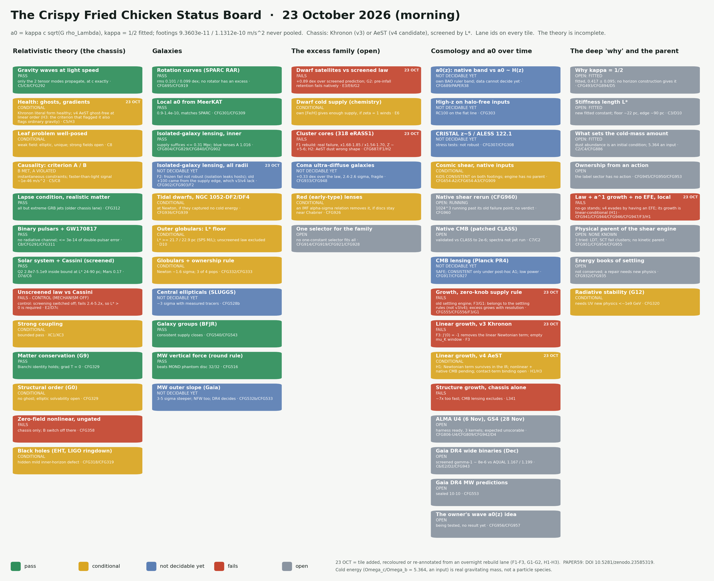
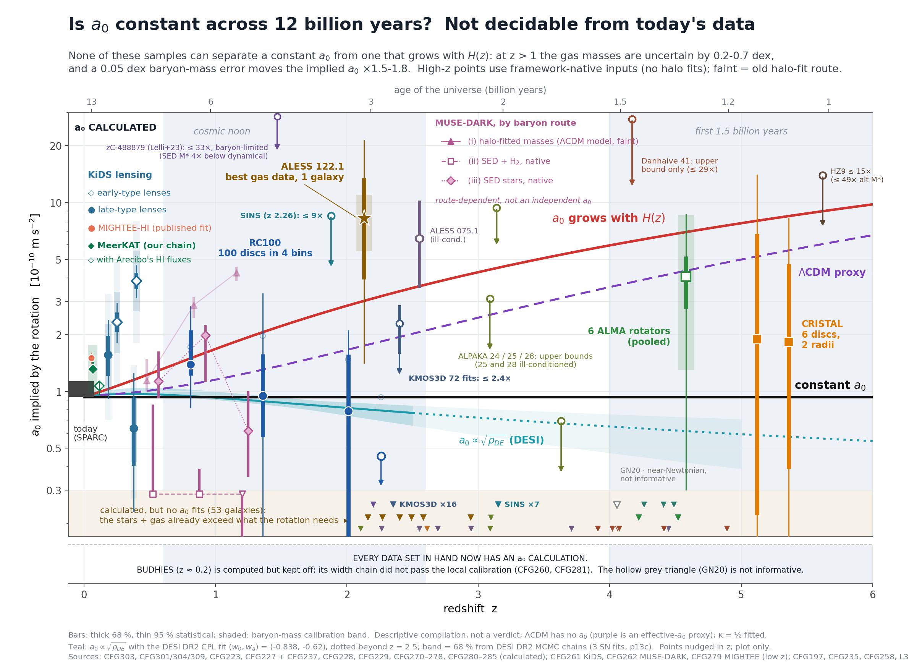

# The Crispy Fried Chicken Status Board

*Where the theory stands, as of 23 October 2026 (morning). The theory is not complete. The tile picture below shows the 23 October morning state; earlier pictures are kept as [`img/status_board_2026-10-22.png`](img/status_board_2026-10-22.png) (22 October evening) and [`img/status_board_2026-10-21.png`](img/status_board_2026-10-21.png).*

The theory makes one claim: the acceleration scale where galaxies stop obeying Newton, a₀, is set by the density of dark energy.

```
a₀ = κ · c · √(G ρ_Λ),   κ = ½   →   a₀ = 9.36 × 10⁻¹¹ m/s²
```

The ½ is **fitted**, not derived; the current measurement is κ = 0.417 ± 0.095 (CFG493). Every number is quoted on two footings, 9.3603 × 10⁻¹¹ and 1.1312 × 10⁻¹⁰ m/s², and the two are never pooled. The framework also needs a cold component, "cold energy", with Ω_c/Ω_b = 5.364 (an input). It is real gravitating mass, not a particle species; no dark-matter particle is added.



## How to read it

The picture is the 23 October morning state, drawn by [`make_status_board.py`](make_status_board.py); tiles marked **23 OCT** were added, recoloured or re-annotated from an overnight rebuild lane (listed in the next section). The generator refuses any green, and any recolour not listed with its evidence lane. Each tile is one test. The colour restates a verdict recorded in the campaign LEDGER ([`campaign_fresh_gravity/LEDGER.md`](../campaign_fresh_gravity/LEDGER.md)) or in the dated notes of [`THEORY_CANONICAL_2026-10-18.md`](../campaign_fresh_gravity/THEORY_CANONICAL_2026-10-18.md), and the lane IDs on each tile point to the scripts that produced it. Verdicts come from committed scripts with pass/fail rules frozen *before* the data were read, plus a control that is deliberately broken and must fail. Where a colour depends on a rule added afterwards (post hoc), the tile says so.

| colour | meaning |
|---|---|
| 🟩 **pass** | the theory meets the test within the stated errors |
| 🟨 **conditional** | passes, but only under a stated assumption that is not yet proved |
| 🟦 **not decidable yet** | today's data cannot tell the theory from its rival |
| 🟥 **fails** | the theory misses the test, and audits from the raw data confirm the miss |
| ⬜ **open** | not yet answered, or waiting on data |

## What changed overnight (23 October)

Every item is a committed lane in [`rebuild_2026_10_22/`](../rebuild_2026_10_22/BRIEF.md). The v4 candidate (AeST plus the same stiffness term and the exact-law free function) is §1b of [`THEORY_V3_DRAFT.md`](../covariant_push_2026_10_22/THEORY_V3_DRAFT.md). PAPER59 (the covariant theory) is published: DOI [10.5281/zenodo.23585319](https://doi.org/10.5281/zenodo.23585319). One tile changed colour; nothing turned green.

- **Cluster cores stay 🟥, now a real failure.** Rebuilt from the raw eRASS1 × KiDS data, the core excess is 1.68–1.85× (canonical) / 1.54–1.70× (alt) over the law, Z ≈ +5–6 (F1). AeST's own dust has the wrong radial shape to supply it (H2).
- **Isolated-galaxy lensing, all radii: 🟥 → 🟦 not decidable yet** (F2). The frozen failure is not robust: the strict "isolated" sample still leaks satellites' hosts, and the old Δχ² of +100 came from the supply edge, which v3 and v4 do not have.
- **Growth under the zero-knob supply rule stays 🟥** for the old settling engine. The excess belongs to the settling rules, not to v3 or v4 (F3), and it grows with grid resolution (G1).
- **New tile: linear growth, v3 Khronon 🟥.** J′(0) = −1 removes the linear Newtonian term, and the window for the K(Q) mass is empty (F3).
- **New tile: linear growth, v4 AeST 🟨.** The Newtonian term survives on large scales for any free function (H1). Pending: nonlinear behaviour and the native CMB. Open: the contact-term binding between about 1 Mpc and 4 kpc (H3).
- **Health stays 🟨.** v4 is ghost-free at linear order; the criterion that flagged it also flags ordinary self-gravitating dust (H3).
- **Dwarf satellites stay 🟥.** Pre-infall retention fails on native inputs; it closes only with a ΛCDM-processed subhalo mass put in by hand (G2).
- **"Law + a¹ growth + no external-field effect" stays 🟥**: the no-go stands. v4 evades it by having an external-field effect, and its growth is conditional at linear order (H1).

## What changed since 21 October (doors push, audit wave, covariant push; 22 October)

Every item below is a committed lane whose script the coordinator reran and reproduced. Full statement:
[`covariant_push_2026_10_22/THEORY_V3_DRAFT.md`](../covariant_push_2026_10_22/THEORY_V3_DRAFT.md).
Papers: PAPER58 v1.1, DOI [10.5281/zenodo.23579379](https://doi.org/10.5281/zenodo.23579379); PAPER59 (the covariant theory) in draft.

- **Column 1 (chassis) has a new candidate, and a healthy one.** The relativistic theory is now the Blanchet–Skordis
  Khronon theory (arXiv:2404.06584) in its literal form, plus the covector P and one stiffness term −(γ_L/2)(D·P)².
  - Its static limit is AQUAL with μ = x/(1+x), exactly (E2, C4). The field equation is AQUAL, not QUMOND: earlier
    lanes that used QUMOND understated the unscreened Cassini failure.
  - It is conditionally healthy (no ghost, no gradient instability; only the two tensor modes propagate, at c) and its
    leaf problem is well posed (C5, C8). DSF-21's A33 with a P kinetic term (η > 0) is **ill-posed** and is dropped.
  - Cost: P and the khronon are instantaneous constraints. That meets the owner's criterion B and **violates criterion A
    (v ≤ c)** by a real but unmeasurably small signal (C8). Binary pulsars and GW170817 do not constrain it.
  - The stiffness term and the J that gives μ = x/(1+x) are additions to the published theory (C1, C3, C4).
- **Control tile (22 October, evening):** the red "Unscreened law vs Cassini" tile is labelled a *control*: it is the same test with the screening switched off, and its failure shows L★ > 0 is required. It is not a failure of the screened theory, whose Cassini tile is green.
- **🟩 Cassini and the planets pass for the screened theory**: Q₂ is 2.8×10⁷–5.1×10⁹ inside Hees and Park; at
  L★ = 24 pc Mars sees 0.17 of its bound (C6, D7d). The **unscreened** law fails Cassini by 2.4–5.2× (E2), and no
  unscreened member of the record's law family passes both Cassini and SPARC (D7c).
- **🟨 Globulars → L★ floor, measured with the field solved**: L★ ≥ 21.7 pc (canonical) / 22.9 pc (alt) with the SPS
  M/L prior; 3–24 pc across M/L priors (D10). The unscreened law is excluded in every case.
- **Dwarf satellites** (the tile stays 🟥; the cold-supply tile is 🟨): +0.89 dex above the screened prediction (not +2.15 dex above Newton, E3). The theory's
  dynamics cannot fix a satellite's cold supply; the satellites' own chemistry says it is there, conditional on wind
  metallicity and no pre-enrichment (E6).
- **Gaia DR4 (December 2026) is now a clean decider**: screened γ_v − 1 ≈ 8×10⁻⁶ vs law-first (AQUAL) 1.167 / 1.199;
  scored on the whole catalogue under the owner's σ_sys rule (pre-DR4 note, amendment A3).
- **ALMA**: addendum E adds the n = 1 and n = 2 laws as labelled parallel readings (harness ready, MOCK-tested); both
  discs are expected to be unscorable (D4).
- **Native CMB**: a patched CLASS (AeST sector) is built and validated against pristine CLASS to 2×10⁻⁶ (C7); spectra
  not yet run. It tests the dust sector and G_cosmo/G_N only — a₀ is absent from the CMB at linear order (C2).
- **Native shear (CFG960)**: the memory fix (amendment A6) worked; the 1024³ canonical run is past its old failure
  point. No verdict yet.
- **Column 5**: κ is not derived — no horizon construction gives ½ without hand-picking it, and the "thermal" Z/4π is
  Milgrom's relation, a postulate (D5, A75). The dust abundance is an initial condition (C2, C4). L★ is a new fitted
  constant (C3). The skew-sign test of n = 1 vs n = 2 is retired (D1).
- **The picture, tile by tile (22 October evening).** No tile changed colour: no committed 22 October lane passes or fails
  a tile that the 21 October board scored differently, and nothing was turned green. Tiles added (new colour on the board)
  or re-annotated (colour kept), each with its lane:
  - Column 1, re-annotated to the Khronon literal form: gravity waves at c 🟩 (C5, C8); health 🟨 (C5); leaf problem
    well-posed 🟨, weak field only (C8); binary pulsars + GW170817 🟩 (C8); Solar System + Cassini, screened 🟩 (D7d, C6;
    C6's own frozen rule reads UNDECIDED on one float-rounding check).
  - Column 1, added: causality 🟨 "criterion B met, criterion A violated" (C5, C8); unscreened law vs Cassini 🟥 (E2, D7c).
  - Column 2, added: outer globulars, L★ floor 🟨 (D10). The older globulars + ownership tile is kept.
  - Column 3: the Local Group dwarfs tile is re-scored against the screened prediction and **stays 🟥** (E3, E6): +0.89 dex
    above it, and both lanes find no mechanism in the record that packs the cold energy inside the half-light radius.
    Added: dwarf cold supply from the satellites' own chemistry 🟨, conditional on ζ = 1 winds and no pre-enrichment (E6).
  - Column 4, added: native shear rerun ⬜ running (CFG960); native CMB ⬜, validated, spectra pending (C7, C2).
    Re-annotated: ALMA ⬜, harness ready, expected unscorable (D4); Gaia DR4 wide binaries ⬜, screened γ_v − 1 ≈ 8×10⁻⁶ vs
    AQUAL 1.167 / 1.199 (C6, E2, D2).
  - Column 5: κ ⬜ fitted (D5); new tile L★ ⬜ fitted (C3, D10); cold-mass amount ⬜, dust abundance an initial condition (C2, C4).
  - **Still 🟥, being re-examined by the rebuild lanes F1–F3** ([`rebuild_2026_10_22/`](../rebuild_2026_10_22/BRIEF.md)):
    cluster cores (F1), isolated-galaxy lensing at all radii (F2), growth under the zero-knob supply rule (F3), and the
    no-go "law + a¹ growth + no external-field effect" (F1–F3). No rebuild verdict exists yet.
- **Corrected in the record**: the native H₀ is 67.2–68.6 (the ordinary Hubble tension), not 55–57.5 (C2; PAPER58 v1.1).

## What changed since 9 October

- **Cosmic shear moved from "context only" (blue) to conditional (yellow).** Run from the framework's own early-universe inputs, the structure-formation engine is CONSISTENT with raw KiDS-1000 on both footings (CFG654-A2, CFG654-A3). The class is robust; the size of the lead is amplitude-driven (CFG909).
- **The condition is the engine's missing parent.** The engine behind the shear pass has no known physical parent (CFG941, CFG944, CFG946, CFG947, CFG950–CFG955). Two new tiles in column 5 say so.
- **Dwarfs and cluster cores turned red.** The old "Andromeda + Local Volume dwarfs" pass, the old "Milky Way ultra-faint dwarfs" conditional and the old "clusters, Bullet Cluster" pass are replaced by the excess family (new column 3): dwarfs and cluster cores fail (CFG919, CFG922, CFG929). Coma's ultra-diffuse galaxies cannot be decided yet (CFG933, CFG948), and red lenses are conditional on their stellar IMF (CFG926).
- **Isolated-galaxy lensing (KiDS) was split in two.** The inner shortfall that made the old tile blue is repaired by the catchment supply (CFG804, CFG902), so the inner tile passes. At all radii the prediction falls short, and the framework's two-halo term closes only part of the gap, so that tile fails (CFG902, CFG903).
- **New conditional tile:** tidal dwarfs and NGC 1052-DF2/DF4 sit at the Newtonian expectation (CFG936, CFG939).
- **a₀(z) uses the framework's own BAO ruler now** (CFG689). It is still blue: the data cannot decide yet.
- **Gaia DR4 kill line restated** (owner decision, 21 October; CFG943). The DR4 tile stays open.
- **ALMA scoring fixed before the data:** the original frozen plans govern, and one disc excludes no model (owner decision, 20 October; CFG942).
- **Other new tiles:** CMB lensing (blue, CFG917), one selector for the excess family (open), the energy books of settling (open, CFG932, CFG935) and the owner's wave a₀(z) idea (open, CFG956, CFG957).
- **κ** is quoted at its current measured value, 0.417 ± 0.095 (CFG493); it is still fitted.
- **Unchanged:** column 1 and every galaxy tile not named above.

## Column 1 · The relativistic theory (the "chassis")

*Unchanged since 9 October.* This is the full field theory underneath the law: general relativity plus a preferred time direction (a "khronon"). It has to behave like Einstein's gravity wherever Einstein's gravity has been tested.

- **Passes:**
  - gravitational waves travel at exactly light speed;
  - realistic matter keeps the equations well behaved;
  - binary pulsars, with a 490,000× margin;
  - solar-system tests;
  - matter is exactly conserved (G9).
- **Conditional:**
  - well-posedness, in two forms (high-frequency and full nonlinear);
  - strong coupling;
  - structural order (G0): no runaway "ghost" mode, but solvability in the strongly nonlinear regime is unproved;
  - **black holes.** EHT shadows and LIGO ringdowns are matched to better than one part in 10⁹. A *moving* black hole keeps a hidden, Planck-scale defect on its innermost horizon. A 2019 paper's standard would count that as fatal; the owner's reading of it is still pending.

- **Fails, for the ungated chassis only: zero-field nonlinear dependence (G5/G10).** This 1-D test runs the bare relativistic chassis with the law switched on everywhere, including the smooth, expanding cosmic background, where the field is near zero. In that setting the sensitivity to tiny perturbations does not level off at the larger perturbation on the finest grid (N = 2047, CFG358, a knife-edge call). **It does not test candidate B, your live model:** there the law is switched off outside bound halos, so it never acts on that background. Candidate B's full action does not exist yet, so for B this is untested, not passed. This sits alongside the ungated chassis's growth failure in Column 4.

## Column 2 · Galaxies

- **Passes:**
  - **rotation curves.** On raw SPARC the weighted scatter about the law is 0.101 / 0.099 dex, with one global mass-to-light ratio (CFG695). No rotating system carries an excess (CFG919);
  - a₀ measured locally with MeerKAT, 0.9–1.3 × 10⁻¹⁰ (PAPER40);
  - **lensing of isolated galaxies, inside 0.31 Mpc.** The catchment supply suffices with no free parameter (CFG804; rerun with declared units, CFG902; still with the two-halo term, CFG903). Isolated blue (late-type) lenses at the dwarfs' own accelerations sit on the law, A = 1.016 ± 0.086. Under its robustness rule that result is fragile, so read it as "within ~0.1 dex" (CFG829, CFG840);
  - galaxy groups (CFG540/543);
  - the Milky Way's vertical force: round cold energy beats MOND's flattened phantom disc in 32 of 32 cells (CFG516). This separates the theory from MOND, and Gaia DR4 tests it directly.
- **Fails: lensing of isolated galaxies at all radii.** Beyond ~0.4 Mpc the predicted signal falls short (Δχ² +100.1 canonical after a unit fix, CFG902). The framework's own two-halo term closes 57–59% of the gap, but not under stricter isolation (CFG903, PARTIAL).
- **Conditional: tidal dwarfs and NGC 1052-DF2/DF4.** They sit below the law, at the Newtonian expectation (the six tidal dwarfs at −0.69 dex, CFG936). The framework puts them there only by giving them no cold energy. A system that moves through the settled medium faster than its own baryonic escape speed captures none (derived, CFG939). That matches, but the prediction rests on each system's label (debris or primordial), not on an out-of-sample test (CFG936).
- **Conditional: globulars and the ownership rule** (CFG332/333), unchanged.
- **Conditional: Local Group timing.** The earlier 13.5σ miss came mostly from treating the orbit as radial with measurement errors only. With Andromeda's sideways motion it drops to about 2–3σ, and a derived shared cold-energy supply between the two galaxies removes most of the rest. About 4σ remains on the old straight-line statistic (CFG522).
- **Tension: the four central ellipticals (SLUGGS).** With each galaxy's measured globular-cluster profile and orbits, the gap is about +0.07 dex on average, 2.8–3.5σ statistical only (CFG528b). Heavier stars, hot gas and the cold-energy edge all fail to close it. It is not a foreground effect.
- **Not decidable yet (DR4): the Milky Way's outer slope.** At census baryons the law fits the speeds, but Gaia's 15–27 kpc decline is 3–5σ steeper than the law (CFG532b). A standard dark-matter halo fails the same test (3.4σ). The result rests on a disputed distance scale, and Cepheids stay flat. In external galaxies seen through their gas, the law predicts outer slopes with no bias (153 SPARC galaxies, CFG533), so the tension is specific to the Milky Way: how we measure it from inside, or its current disturbance. DR4 fixes the distance scale.

## Column 3 · The excess family (new)

Every system with an excess over the law is pressure-supported, and no rotating system has one. Pressure support alone does not set the amount (CFG919). The family is **open**: the record has no mechanism for it.

- **Fails: Local Group dwarfs.** The 83 Local Volume dwarfs (Milky Way and Andromeda satellites, field dwarfs and ultra-faints) sit +0.37 / +0.33 dex above the law (CFG919).
  - The excess is not an estimator artefact, and an external-field effect would only raise it (CFG925).
  - Satellites of the two hosts carry it alike (CFG843).
  - With the framework's own cold-energy supply, the Milky Way's ultra-faints stay at the bare law, +0.325 / +0.304 dex short of what they show (CFG930).
- **Fails: cluster cores.** Raw KiDS lensing stacked on 318 eRASS1 clusters sits at 1.91 / 1.75 times the law inside ~1 Mpc. The outskirts (1.2–3 Mpc) match the law, but the outer signal scales with gas mass the way Newton does, not the way the law does (CFG687).
  - The baryon census cannot supply the core excess (CFG922).
  - No small reframing removes it. It is real mass the law does not supply (CFG929).
  - Treating cluster cold energy as untethered fits at its primary corner, but only at 6 of 40 corners (fragile). It is CDM-like cluster physics (CFG949).
  - The Bullet Cluster's sub-cluster core is undecided under the rules tested (CFG916, CFG951).
- **Not decidable yet: Coma's ultra-diffuse galaxies.** They sit +0.33 dex above the law, at 2.4–2.6σ in a fragile test (CFG933). The framework allows them at most the law itself, and today's data cannot separate the two (CFG948, control-limited). A purely Newtonian reading is excluded at 5.45σ (CFG948).
- **Conditional: red (early-type) lenses.** Their excess is not caused by neighbours (CFG912). A literature IMF α–σ relation removes it on both footings, provided disc galaxies stay near a Chabrier IMF. That condition is untested, so this may be a stellar-population effect, not cold energy (CFG926).
- **Open: one selector for the whole family.** No one-constant rule reproduces dwarfs, red lenses and cluster cores together: not a density threshold, a kinematic measure, velocity-space capture or late binding (CFG914, CFG919, CFG921). After the IMF correction, one velocity-scale selector fits the galaxy-scale facts but fails the clusters. That re-grade was post-hoc-motivated (CFG928).

## Column 4 · Cosmology, and does a₀ change over cosmic time?

The framework's a₀ follows the dark-energy density. With the framework's own BAO ruler (native sound horizon 147.07 Mpc), DESI BAO plus Pantheon+ give a₀(z)/a₀(0) = 0.91 [0.76, 1.03] at z = 1, 0.94 [0.71, 1.12] at z = 1.5 and 0.91 [0.33, 1.21] at z = 2.33. That is close to a flat line, while the rival a₀ ∝ H(z) gives 1.76, 2.35 and 3.49 (CFG689). Constant dark energy is not rejected (1.97σ). BAO cannot separate the framework from ΛCDM.



*The chart (1 October) shows the flat line; the native band of CFG689 sits on or just below it.*

- **Not decidable yet: a₀ over time.** The two lines separate at redshift 2–5. At those redshifts the uncertainty in each galaxy's gas mass is still larger than the gap (the "calibration wall", PAPER38). The decisive point is a kinematic a₀ at z ≈ 2.5 with an error of about 0.10 dex (CFG689); no public sample has one. The RC100 and CRISTAL/ALESS tiles are unchanged.
- **Conditional: cosmic shear, native inputs.**
  - The engine is theory-v2: the class-A engine with per-host supply, a condensed source and gas expulsion (CFG650). Run at 1024³ from the framework's own early-universe inputs, it is CONSISTENT with raw KiDS-1000 against its matched control on both footings: Δχ² −10.08 canonical (NC1x) and −9.39 alt (NC2x) (CFG654-A2, CFG654-A3).
  - The class is robust, but the size of the lead is amplitude-driven, so quote the class, not the number (CFG909).
  - The framework wins by having less small-scale power, and the absolute fits are mediocre (χ²_min 144.68 and 145.38 for 108 points).
  - DES Y3 is diagnostic only for NC2x, where it is CONSISTENT (Δχ² −2.15).
  - **The condition:** the engine that produces the pass has no known physical parent (Column 5).
- **Not decidable yet: CMB lensing.** It is SAFE on the relative check. Against raw Planck PR4 lensing it is NOT DIAGNOSTIC as frozen, and CONSISTENT only under a post-hoc addendum, with low power at the simulation box's scales (CFG917). A sealed forecast says S4-class high-L lensing could separate theory-v2 from its control, and ACT-like data could not (CFG927; a forecast, not a measurement).
- **Fails: growth under the zero-knob supply rule.** On the full gravitating mass it is 15–19% too clumpy at 512³ (CFG555/556). Theory-v2 (CFG650) adds per-host supply, a condensed source and gas expulsion to the engine; its test on data is the shear tile.
- **Fails: structure growth, chassis alone.** Without B's switch, all matter feels the MOND boost and structure grows about 7× too fast, which CMB lensing rules out. This variant is dead.
- **Open: ALMA U4_27928 (public 6 November) and GS4_24110 (public 28 November).**
  - The original frozen scoring plans govern (CFG806-U4, CFG809; owner decision, 20 October). The wording clarifications and addenda were filed before any data, and the CFG942 harness implements them.
  - One disc excludes no model.
  - The forecast signal-to-noise is low for both discs, so an upper limit with nothing scored is the likely outcome (CFG942).
  - If GS4 is detected, its framework verdict can be ROBUST on most branches: at 15–17 of 20 CI21 values on the six non-FLOOR branches (CFG809 clarification addendum A).
- **Open: Gaia DR4 wide binaries (December 2026).**
  - The sealed prediction is Newtonian (CFG740).
  - Restated kill line (owner decision, 21 October): DR4 kills it if and only if R − 1 ≥ max(0.01, 3σ_R), with σ_R from the pairs that enter R. A smaller excess reads UNDECIDED.
  - At the plan's sample (~2,100 pairs in R) a full MOND-size boost would be caught only about half the time (44–47%, mock). Reliable discrimination needs ~7,000 pairs (CFG943).
- **Open: Gaia DR4 Milky Way predictions,** sealed 10 October (CFG553).
- **Open: the owner's wave a₀(z) idea.** In this idea a₀ oscillates with redshift as a damped wave. CFG956 bounds the largest wave the framework's own expansion data allow. CFG957 builds physical models and lists the other observables the idea touches. The criteria are frozen; there is no result yet.

## Column 5 · The deep "why", and the engine's missing parent

- **Open: why κ = ½.** It is fitted, measured at 0.417 ± 0.095 (CFG493). Of 439 registered derivation or selection attempts, none derives it (CFG894).
- **Open: what sets the cold-mass amount.** Ω_c/Ω_b = 5.364 and the catchment retention f_ret are inputs. Rebuilt without Planck, 5.364 is recovered but not pinned, and f_ret has mixed provenance (CFG886).
- **Open: ownership from an action.** The labelled-domain and source-changing constructions both need a label sector that has no action (CFG945, CFG950, CFG953).
- **Fails: one local theory that gives the law, a¹ growth and no external-field effect.**
  - With cold energy as the medium whose excess is the phantom, the law's deep limit cancels the medium's own self-gravity (theorem D-T, CFG941).
  - A collapse-gated tether gets a ghost, or needs a vacuum offset 15–25× what the slip bound allows (CFG944).
  - A separate field that supplies the deep law must carry an external-field effect (CFG946).
  - The engine's source relocation cannot be conserved covariantly (CFG947).
- **Open, none known: the physical parent of the shear engine.** Three candidate parents have been tried.
  - The labelled-domain theory fails mergers and clusters (CFG950, CFG951).
  - The source-changing theory is CONDITIONAL on galaxy scale but fails clusters (CFG953, CFG954).
  - The relaxing-cold-dust kinetic parent is NOT CLASSIFIED by its frozen rule. Read post hoc, there is no kinetic parent (CFG955):
    - the engine's relocation step is not the fast-relaxation limit of any locally mass-conserving kinetic theory;
    - the law profile held at the bath temperature is unstable, Bonnor–Ebert-like, with an e-folding time of 0.21–0.25 Gyr in NGC 3198;
    - no relaxation time taken from the record works: the excess is unreachable at any relaxation time, and the cluster-core excess survives.
  - What did work in CFG955: exact mass and momentum conservation, no RMIN, no external-field effect, and a¹ growth.
  - **The current engine's relocation step has no known conservative physics behind it.** The shear passes transfer to no tested parent.
- **Open: the energy books of settling.** The record's settling equation does not conserve energy (CFG932). Every repair that keeps the released energy inside matter misses the law. The one that works needs an energy sink outside the matter sector: a dynamical dark-energy partner and a thermal reservoir (CFG935, post hoc).
- **Conditional: quantum stability (G12).** It needs new physics below about 10⁹ GeV, as every theory of this family does.

## The bottom line

The law wins where it is cleanest: rotation curves (0.10 dex, κ = ½ fitted), MeerKAT's local a₀, isolated late-type lenses, groups, and every local test of gravity. With the framework's own early-universe inputs, its structure-formation engine is consistent with raw KiDS-1000 cosmic shear on both footings. That engine has no known physical parent, so the pass is conditional. Pressure-supported systems carry an excess the record cannot explain: dwarfs, cluster cores, Coma's ultra-diffuse galaxies (at 2.4–2.6σ), and red lenses unless their IMF explains them. Rotators sit on the law, and tidal dwarfs and DF2/DF4 sit at Newton. Three things stay open: why κ = ½, what sets the cold energy's amount, and the parent theory. The dated tests are ALMA U4 (6 November) and GS4 (28 November) and Gaia DR4 (December). An undated one is a kinematic a₀ point at z ≈ 2.5 measured to about 0.10 dex. The theory remains incomplete.

---

κ = ½ is fitted, not derived. Cold energy is real gravitating mass that is not a particle species. The board is generated by [`make_status_board.py`](make_status_board.py) (`--mutate` must fail: it strips one tile's evidence lane); the 21 October board's script, [`campaign_fresh_gravity/closure_map/status_picture_2026_10_21.py`](../campaign_fresh_gravity/closure_map/status_picture_2026_10_21.py), and the 9 October board's script, [`status_picture_2026_10_03.py`](../campaign_fresh_gravity/closure_map/status_picture_2026_10_03.py), are kept unedited. The a₀ chart is made by [`chart_a0z_one.py`](../campaign_fresh_gravity/CHART_a0z_rar_z0_5_2026-10-01/chart_a0z_one.py).
