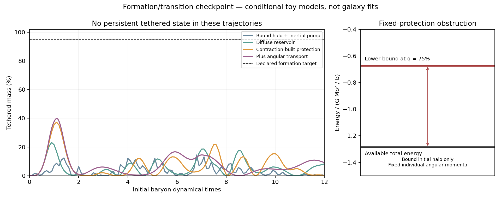

# Formation and transition: a new obstruction, no working mechanism yet

**The original goal remains open.** This investigation constructs a reversible
assembly interaction, tests four ways of forming the tethered state from
initially free material, and derives an energy obstruction that explains
why a large class of protected-state attempts cannot succeed. No real-galaxy
fit is claimed for these new models.

## Strongest result: protection can forbid formation

For the existing positive phase barrier, a spatially uniform conversion and
fixed individual baryon angular momenta, an analytic lower bound permits
arbitrary radial shell rearrangement but rules out crossing the barrier for
the tested bound initial halos. It is independent of the pump strength and
internal phase inertia.

At 12 baryon shells, initial total energy is approximately -1.28553 in units
G Mb²/b. Any configuration at the intermediate phase qT=75% must have energy
at least -0.67295. Positive dissipative heat cannot close that 0.61258 gap.
The same exclusion has a positive margin at 6 and 24 shells. These numbers
evaluate a conditional analytic theorem; they are not interval-certified
decimal bounds or observations.

This rules out pumping harder **within that family**, not arbitrary phase
transitions. Angular transport, local conversion, a changing barrier or an
external work source can change its hypotheses. [Proof and self-audit](BARRIER_BOUND.md).

## What was actually tried

All new runs start exactly free, with an ordinary truncated Plummer dark
profile rather than a profile built from the desired acceleration law.
The phase work has a reciprocal force; dissipated energy is recorded in a
receiver. The common mass/size inputs come from the existing two-state work.

| Route | Recorded outcome |
|---|---|
| Reversible inertial pump, bound initial halo | 72 completed trajectories; no persistent high-T state. The strongest high-coherence sampled peak is about 14.8%. |
| Same pump, initially diffuse reservoir | 12 completed trajectories; strongest sampled peak about 23.1%, followed by loss of T. The specific bound-halo energy obstruction no longer applies. |
| Protection grows during contraction | 16 completed trajectories with the extra gate force included; strongest high-coherence sampled peak about 37.3%, followed by loss of T. |
| Ordered angular momentum can move between baryonic shells | Four low-coherence explicit trajectories complete; four high-coherence explicit attempts hit their time caps. Two high-coherence cases subsequently complete with an implicit solver: peaks about 29.0% and 40.0%, without persistent formation. |

The declared illustrative target was qT>=95% throughout the final fifth of
the run, together with a settled acceleration relation and a retained free
population in the low-coherence control. No completed case meets the first
requirement. Transient percentages are diagnostics, not observed fractions.
Low-coherence cases also convert transiently; this is not a successful
observational population selector.

The cyclic-rotor interaction, phase inertia, damping, viscosity and virial
proxy remain effective assumptions. Their positive-energy construction does
not establish a microscopic interaction. [Equations and physical limits](DERIVATION.md).

## Checks and evidence

- Full-energy directional derivatives and independent radial finite
  differences check reciprocal force signs, including the changing barrier.
- Reversing ordered rotation reverses phase motion while leaving q unchanged.
  Zero coupling leaves the initial F state unchanged.
- The completed 100 non-transport pilot trajectories have relative energy
  drift below 3.2e-5. Viscous runs explicitly record energy and total-J error.
- The analytic barrier bound was checked on nonhomologous shell rearrangements
  and at three shell resolutions. Identical dimensionless results at four
  mass scales are a scaling property, not four empirical confirmations.
- A doubled-resolution transport continuation is resource-limited; accepted
  segments reproduce the first conversion pulse reasonably, but do not
  establish full-trajectory or continuum convergence. Exact completion times,
  solver status and comparison values are in [SUMMARY.json](SUMMARY.json).
- Every run folder has a v2 manifest with input/output hashes and its actual
  runner status. A completed runner can contain failed or inconclusive
  trajectories. Timeout records are retained, not counted as physical failures.

All review here is self-review. [Audit](AUDIT.md). No external source theorem,
fresh catalogue inference, cosmological growth or relativistic completion
is used to certify this mechanism. Kappa remains fitted.

## Where this leaves the missing piece

These tests isolate formation history as a real mathematical obligation:
protecting a pre-existing state does not explain how it was assembled.
The uniform-phase approximation also forces the entire reservoir to pay
the conversion cost together. A spatially local formation interaction could
evade that restriction, but it must pay the interface/stiffness energy and
derive the required density profile rather than insert it.

The next unresolved construction is inside-out conversion during baryonic
angular-momentum transport, with a diffuse outer reservoir and a physically
specified local interaction. The inherited 30-kpc phase stiffness could
block such a front; its cost should be checked before another evolution.
This is an open route, not a claimed solution. [Exact continuation handoff](HANDOFF.md).

## Reproduction

Use the exact argv and input list in each run's manifest. No package install
is required in the original environment (Python3.9.6, NumPy1.26.2,
SciPy1.11.4). The individual drivers accept --output and must write a new
path. The original contracts precede their respective experiments.
`summarize.py` regenerates SUMMARY.json from saved results and manifests;
`make_figure.py` regenerates checkpoint.png without rerunning dynamics.

All work is isolated in this new directory; original models, data, status
files and manuscripts were not edited. The repository was not committed.
