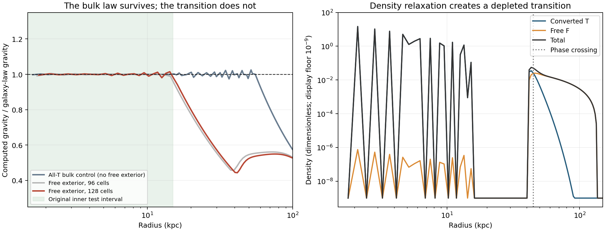

# Live density, boundary restoration and the galaxy law

**The full requested mechanism is not established.** Density and phase were
released together, with gravity and free-phase pressure differentiated from
the same energy. This produces a genuine bulk result and promising finite
cores, but the strongest charge-free candidate fails the broader galaxy law
and does not restore its boundary after an outward displacement.

## What is established within the tested model

In a pure cold converted region, material equilibrium gives

`g²/(a0+g) = g_b + g_F`.

Thus the original galaxy law emerges if the free component is excluded from
the interior. This is an Euler equation, not an inserted dark-density curve.
An independent all-T minimization from an unrelated Plummer density recovers
the law to .00537,.00106,.00141 dex at n64,128,256. That control deliberately
does not satisfy the free-exterior requirement.

The free phase was given an explicit positive polytropic pressure energy
`P_F=K rho_F^(5/3)`. Its conversion derivative is included. With no charge
and no added area tension, the all-F state has the exact seed instability
`delta E=-(pi²/4) integral rho h_F x² dV+O(x⁴)`. This supplies an energetic
route to conversion without preloading interface charge. It does not prove
the endpoint is a galaxy, or supply microscopic rates/heat transport.

## The decisive coupled test

Using original barrier beta20, ell30kpc, K3, k=tau=0, the front-start run
finds a cold core and substantial free exterior. At n128 the inner gravity
law on 1.5–15kpc agrees to .00849dex, with density and phase residuals about
1.3e-5. The n192 partial refinement improves that inner error to .000926dex,
but does not complete the whole scheduled experiment before its resource cap.

The material density develops a depleted transition region. Extending the
same gravity comparison to30kpc gives .23dex error; to50kpc it gives .35–.36dex.
The finite core is therefore not a galaxy-law solution across the transition.
The original outer-phase gate also worsens from3.4% T at n96 to6.8% at n128
and8.2% at n192; it must not be silently counted as a <=5% pass.

The n128 boundary, interpolated at q=.5, starts at **44.8595kpc**. After a
joint species-conserving displacement of matter and phase:

| Initial displacement | Relaxed boundary | Energy change |
|---|---:|---:|
| -1kpc | 44.8730kpc | -0.0001809 Eunit |
| +1kpc | 46.1224kpc | -0.0005439 Eunit |

The outward perturbation does not return. Both states lie in the same coarse
crossing cell, so reporting only a cell index would have hidden this failure.
The larger final material residuals and lower energies also preclude claiming
an exactly restored equilibrium. See `assessment.json` for interpolated values.

## Other routes, retained rather than repeated

Charged interfaces at lower tension can recover the inner law to .003dex,
but depend on the initial wall basin; another start remains near11kpc rather
than22kpc. Their remaining density residuals include tiny central cells, and
their extended gravity law has a wall-region error about.134dex. Their n256
joint recovery exceeded its240s cap before producing a result: this is
resource-inconclusive, not evidence of physical instability.

Increasing reservoir pressure reduces interior F contamination but puts gas
against the numerical box at K10/30. Such a confined state cannot stand in for
a free exterior. A larger-domain K10 charge-free test was scheduled but not
reached before the run cap; no conclusion about it is claimed.

The measured density-relaxed wall curvature includes the Schur correction
`H_xx - H_xm H_mm^-1 H_mx`, on the mass-conserving tangent space. In the n192
charged diagnostic, the translation curvature falls from38.15 to3.17 Eunit/kpc²
when material relaxation is included. Positive local curvature alone still
does not establish global radius selection or restoration.

## Scope and records

This is a controlled spherical large-disk model with prescribed baryons and
canonical a0. No new observational data were fitted. K is a stipulated fluid
closure; charge abundance is also stipulated in charged runs. Live baryon
response, a positive collisionless distribution function, physical time and
generic formation from diffuse matter remain unproved. Tiny-seed starts
reached different, fragmented states rather than the successful inner core.

`DERIVATION.md` gives the common energy, species forces, emergence identity,
seed instability and relaxed-density restoring-force formula. `AUDIT.md`
separates numerical failures, cap-active states and physical interpretations.
`HANDOFF.md` records exact continuations and exclusions. Per-run contracts
and manifests retain code, inputs, commands, statuses and hashes; failed and
timed-out runs are not erased or reported as physical counterexamples.
