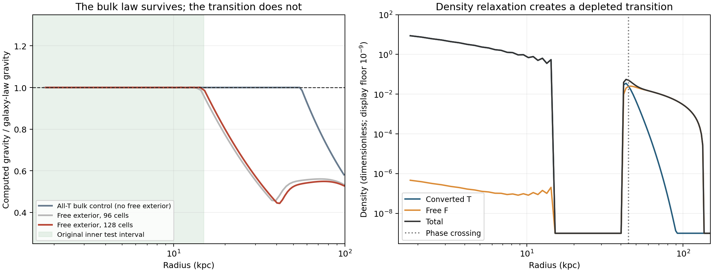

# Live density, material force balance and boundary restoration

**The full requested mechanism remains unestablished.** The galaxy law now
emerges from freely adjusting density in the cold interior. The finite core
still develops a depleted transition and fails outward boundary restoration.
These are the corrected LD-17/18 results; earlier numerical results are
preserved in `EARLY_REPORT.md` and their run directories.

## What was established within the model

One energy governs gravity, conversion, material transport, interface stiffness
and free-phase pressure. No target dark density or acceleration is imposed.
In a pure cold converted region, material equilibrium gives

`g²/(a0+g) = g_b + g_F`.

The original galaxy law therefore emerges when free matter is excluded from
the interior. An independent all-T control from an unrelated Plummer profile
recovers the inner law to1.8e-8 and1.1e-6 dex at n64 and128. This control
deliberately does not solve the free-exterior requirement.

The free phase has explicit positive pressure `P_F=K rho_F^(5/3)`, whose
conversion force is included. At zero charge, the all-F state has the exact
seed instability `delta E=-(pi²/4) integral rho h_F x² dV+O(x⁴)`.
This gives an energetic conversion route without preloaded charge, but
does not derive microscopic heat transport, rates or the final galaxy state.

## Current joint test

Spherical large-disk baryons; canonical a0; beta20, ell30kpc, independent
constant C=.95, K3; no charge or added area tension. Density and phase both
relax, and the exterior phase is never pinned.

| Maximum gravity-law error | n96 | n128 |
|---|---:|---:|
| 1.5–15kpc | .00559 dex | .000318 dex |
| 1.5–30kpc | .2385 dex | .2318 dex |
| 1.5–50kpc | .3409 dex | .3530 dex |

The n128 inner law agrees to about0.073%, while the depleted transition
changes the broader gravity curve by roughly a factor of two. Outer-region
mass is3.93Mb and6.78% is T: substantial free matter remains, but this exceeds
the original <=5% T gate. Do not round that into a pass.

The interpolated q=.5 radius is44.86755kpc. Displace matter and phase together,
conserve both species during remapping, then release transport and conversion:

| Imposed disturbance | Relaxed radius | Energy change |
|---|---:|---:|
| -1kpc | 44.86727kpc | +3.67e-8 Eunit |
| +1kpc | 46.12103kpc | -5.245e-4 Eunit |

The inward trial returns closely; the outward one does not. All three
crossings occupy the same grid cell, which would hide non-restoration if only
cell indices were compared. Density KKT residuals remain about.001–.009,
so these are not exact material-equilibrium certificates. Tiny-seed starts
also reach different, fragmented states rather than the good inner core.

## Audit and limits

The final plot exposed spurious alternating empty/full cells in the earlier
discretization. Current code uses the same enclosed-mass quadrature for W and
gravity, with exact gravitational exterior tails. Pure cold-T curvature is
positive because W''(u)-1>0. Restoring the parent's small-u W series also
removes tail cancellation; three directional-check steps agree to2–3.5e-9.
The bulk-control oscillation disappears. The finite-core transition deficit
persists. Earlier quadrature-dependent interpretations are superseded.

This is self-reviewed spherical model work, not a new observational fit.
K is a stipulated fluid closure. Live baryons, collisionless distribution
positivity, physical time and microscopic conversion remain unproved.
Two unfinished larger experiments remain resource-inconclusive, not excluded.

Current code: `stable_compatible.py`, `stable_recovery.py`.
Derivations: `DERIVATION.md`. Audit/continuation: `AUDIT.md`, `HANDOFF.md`,
`CURRENT.md`. Contracts/manifests retain commands, bounds, versions, hashes
and statuses. `validation.json` verifies provenance, not physical success.
