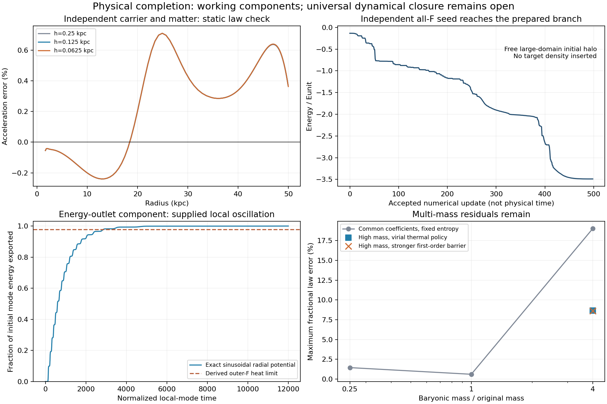

# A physical swing: independent vacuum carrier, matter state and radiative phase

**The original objective remains open.** This investigation produces a concrete
physical candidate for the missing carrier and energy outlet, and then finds
that the simple common-coefficient closure still fails across masses. It is
not a derivation of a universal galaxy theory.

The candidate is a **complex vacuum condensate** whose modulus controls local
conversion and interface pressure, while its massless angular mode transports
energy. Matter has its own internal state and a finite, number-conserving
alignment coupling to that modulus. The angular mode has no direct baryon or
particle-conversion coupling. This separates the degrees of freedom that the
old single-angle model identified by assumption.

The central result is more than a renamed force: the need for a separate
carrier follows from a vacuum-continuity obstruction; all independent static
forces have been solved; an independently seeded free halo reaches the old
branch; and a canonical field-energy transfer mechanism has been executed with
an energy ledger. These are separate tests, not one complete galaxy simulation.

## What is established

1. **A matter-only interpretation of the positive volume term fails.**
   `B rho_T/(rho_T+rho_F)` tends to0 along the F axis and B along the T axis as
   both densities vanish. For B>0 it cannot extend to a continuous matter-only
   Hamiltonian at vacuum. An independent carrier, or a different interaction,
   is required. This is a proved obstruction for the tested term.
2. **The finite-coupling static completion works in the one-galaxy benchmark.**
   Carrier x and material angle y are varied independently alongside density.
   J/epsilon=100 gives R=56.3436 kpc and a maximum0.70975% law discrepancy on
   1.5--50 kpc. The density is populated and monotone through the transition;
   the outer reservoir is mobile and essentially unconverted. Its active
   radial Hessian is positive; relaxed boundary stiffness is4.11305e-4
   Eunit/kpc^2; +/-1 kpc joint carrier/material perturbations return. J is an
   explicit additional physical coupling, not a fitted claim of microscopic
   derivation. Refinement is recorded in PC-24.
3. **The locked completion can be reached from an independent all-F seed.**
   The initial all-F material equilibrium is computed on a6.64 Mpc domain,
   with negligible edge population. It has a negative conversion mode. A
   small seed and joint relaxation reach the independently prepared branch
   within2.51e-7 kpc and4.93e-13 Eunit, with a0.6101% law discrepancy and total
   mass5.364 Mb conserved. No target density is inserted. This is numerical
   relaxation evidence, not a time evolution or a continuous-path proof.
4. **The released energy is quantitatively accounted for as a requirement.**
   It is1.09287e52 J. The outer F gravitational escape-energy upper bound is
   only0.0765287 Eunit, so at least97.7191% must escape if the remainder heats
   that reservoir. A massive carrier quantum is10622 times the inferred
   per-particle binding energy, ruling out the simplest single-particle
   emission interpretation. Collective processes remain possible.
5. **A massless angular outlet works as an explicit component mechanism.**
   A canonical radial/angular Hamiltonian transfers supplied radial oscillation
   energy into an angular mode, with a passive escape ledger. The exact
   sinusoidal carrier potential exports more than the required fraction in
   PC-22. Energy is conserved including the escaped component. Closed-system
   and off-resonance controls, a separate Floquet calculation and determinant
   invariant support the interpretation. Initial oscillation energy, seed and
   escape rate are supplied assumptions; production by galaxy collapse is
   not derived by this test.
6. **Outgoing phase radiation weakly drives conversion at leading order.**
   A plane massless wave has `(partial chi)^2=0`, so it does not source the
   modulus through the polar kinetic term. Spherical corrections start at
   1/r^3 while transported energy flux is1/r^2. A prescribed pulse on the
   actual outer-halo response coefficients gives a tiny linear carrier
   response; PC-18/23 track source work, absorption and carrier energy and
   report finite-resolution uncertainty. Matter is frozen during this fast
   component test. It does not establish full nonlinear halo transparency.

The complete equations and force transformations are in
[DERIVATION.md](DERIVATION.md). Exact extracted metrics and plots are in the
final report output listed below. **Every percentage above has its own model
and scope; they must not be combined into a claim of a completed formation run.**

## What failed when pushed beyond one galaxy

Common physical coefficients must be rescaled correctly when expressed in
galaxy units. In particular, canonical kappa scales as rM^-3, not as a fixed
physical material length. The physical particle-mass interpretation inferred
from the old stiffness would be4.6412e-23 eV/c^2, with a specific binding energy
8.19025e9 J/kg and phase-volume energy1.04467e-14 J/m^3. These are inferred
feasibility values, not observations or derived constants.

Under homologous baryon templates and the same constrained5.364 mass ratio:

| Test | Maximum fractional discrepancy bound | Material result |
|---|---:|---|
| Original physical coefficients, quarter baryonic mass |1.4734%|Monotone populated transition|
| Original coefficients, original mass |0.6103%|Monotone populated transition|
| Original coefficients, four times mass, fixed entropy |19.022%|Strongly depleted/rebounding transition|
| Same high mass, virial-scaled thermal state |8.6424%|Depletion remains|
| Alternative common B/8 and Q*8, quarter mass |6.7116%|Monotone but law no longer matched closely|
| Alternative common B/8 and Q*8, original mass |1.5117%|Density rebound factor10.39|
| Alternative common B/8 and Q*8, four times mass |0.9452%|Monotone populated transition|

These are failures of these coefficient/thermal-state choices, not a no-go
proof for every interaction. Virial-scaled K is a test policy, not a derived
temperature law. Blindly choosing a different K per galaxy would not close the
physical problem.

The repository's prior SPARC supply calculation already found28/175 shortages
for the5.364 no-loss budget under its specified spherical baryonic-mass proxy,
and no shortages for its baryon-retention census. That result is reused rather
than rerun. Simply giving this equilibrium model the corresponding53.643 Mb
supply does not repair it: the tested relaxation reaches a fragmented branch
with about55% law discrepancy. That separate experiment changes the available
mass; it is not claimed to satisfy the original5.364 benchmark.

The prior BK/DBI superfluid phonon and temperature-slaved two-fluid exclusions
are retained. The new angular mode is an energy outlet and does not replace the
already assumed constitutive galaxy-response force with a phonon force.

## The actual remaining obligation

One number- and energy-conserving dynamical closure must determine the F
kinetic/thermal distribution, conversion, and energy transfer into the angular
radiation channel using common physical couplings. It must reach a filled,
restoring boundary while reproducing the measured law over the appropriate
radial range across galaxies. The present W response, F pressure/entropy,
B, binding, wave stiffness and alignment parameters do not yet have that
common physical derivation. The static and radiation calculations establish
useful components, while their necessary joint implication is still missing.

No full nonspherical, observational-fit, cosmological or relativistic stability
claim is made. [SELF_REVIEW.md](SELF_REVIEW.md) separates proved deductions,
finite evidence and unchecked physical inputs. [HANDOFF.md](HANDOFF.md) records
what changed and the exact continuation conditions.

## Final numerical extraction

| Carrier/matter interface mesh | Boundary (kpc) | Actual maximum law error | Density rebound |
|---|---:|---:|---:|
| 0.25 kpc | 56.34360418 | 0.7097428% | 1.0 |
| 0.125 kpc | 56.35753691 | 0.7098114% | 1.0 |
| 0.0625 kpc | 56.36075819 | 0.7098285% | 1.0 |

The last radius shift is 0.00322 kpc. The finite-alignment refinement keeps
both matter and carrier variables free; this check does not inherit the
locked-model result by assumption.

The exact sinusoidal local-mode experiment exports **99.9563% of its supplied
initial oscillation energy**, versus the derived 97.7191% heating-limit
requirement. Its energy ledger error is 2.45e-9. This is a component test: it
has not been coupled to galaxy collapse. The three packet meshes give carrier
peaks 4.34e-6, 3.22e-6 and 3.00e-6; the last change is 6.8%, so no more precise
continuum peak is claimed. Material conversion is not evolved in that fast,
linear packet calculation.

The stronger first-order barrier does purify the inner phase, but the
force-converged high-mass case still has **8.6397%** transition error. This
isolates the material boundary layer rather than residual bulk F mixing in
that case. The other high-barrier cases remain near, but outside, their stated
phase-force tolerance and are not promoted as equilibria.

There is also an exact construction-specific obstruction: for the point-source
law density in a pure T core, canonical stiffness leaves

    mu_kappa' = -kappa(1+12r^2+192r^4)/(4r^3(1+4r^2)^3),

which is nonzero for every r>0 and kappa>0. A localized interface force cannot
cancel that varying interior residual. The formal deep-bulk fractional
correction is -3 kappa/(8r^3); it is not valid uniformly through the transition.
This explains why an exact law needs a physically derived bulk closure or
explicitly accepted corrections. It does not refute the observational law or
all possible stiffness mechanisms.



Canonical machine-readable extraction: [run_report/results.json](run_report/results.json).
Raw report fields sometimes give conservative multiplicative error bounds;
the extraction also computes actual fractional deviations. They are not the
same quantity for a negative residual.

## Reproducibility and route record

Each run has a bounded contract, immutable sources, stdout/stderr, result files
and a v2 manifest. `MANIFEST_AUDIT.json` checks all 29 records against current
hashes. A valid record can document a failed program or a physically unsuccessful
trial; it is not a theory certificate. No jobs remain running at this checkpoint.

The installed bounded runner records exact commands and software. For example,
from the repository root, with a fresh output directory:

```sh
python3 physical_completion_2026_10_25/launch.py physical_completion_2026_10_25/exact_goldstone_contract.json physical_completion_2026_10_25/reproduce_goldstone physical_completion_2026_10_25/exact_goldstone.py 180
```

`TARGET.md` is the immutable starting contract. `STATUS.md` is the single live
view for this phase. `HANDOFF.md` preserves open continuations; no universal
physical goal is marked complete. This investigation remains local and does
not change unrelated work.

| Claim | Run status | Exact interpretation |
|---|---|---|
| PC-1 | failed | Import-name collision before physics; retained. |
| PC-2 | completed | Required canonical kinetic companion works at base; common-mass screen partly nonconverged. |
| PC-3 | failed | Vacuum gradient retains base; old all-F box confined; small-nucleus report error stops formation. |
| PC-4 | completed | Corrected nucleus diagnostics; finite-box seed relaxes to base, not isolated formation proof. |
| PC-5 | completed | High-mass refined force balance fails close law/material criteria for both thermal policies. |
| PC-6 | completed | Physical unit transformations, inferred scales, kinetic identity and vacuum limits. |
| PC-7 | completed | Free all-F baseline and seed verified; Newton direction stalls before final formation equilibrium. |
| PC-8 | completed | Alternative common B/Q family; different masses trade core error and depletion. |
| PC-9 | completed | Bound-step projection changes globalization and advances free-halo relaxation. |
| PC-10 | completed | Three-field density/carrier/matter static solve at three finite alignment couplings. |
| PC-11 | completed | Cap-guarded global descent then Newton advances free halo near final branch. |
| PC-12 | completed | Force-finished free seed matches independently prepared branch. |
| PC-13 | completed | Canonical radial/angular exchange, passive escape, closed and off-resonance controls. |
| PC-14 | completed | Larger census supply conserved; initial continuation not force-converged. |
| PC-15 | completed | R50 constrained force verified; R40 has extra crossings and is not a valid path state. |
| PC-16 | completed | Independent-carrier radial Hessian, derivative/cap checks and +/-1kpc recovery. |
| PC-17 | completed | Massive emission threshold, Floquet determinant/growth, outgoing null-source identity. |
| PC-18 | completed | Two-grid linear angular-packet transport/response component and energy ledger. |
| PC-19 | completed | Force-converged census-supply branch is fragmented with large law error. |
| PC-20 | completed | Derived outer-F heating bound and longer harmonic polar-field export test. |
| PC-21 | completed | Alternative family middle case force-finished; material depletion remains. |
| PC-22 | completed | Exact sinusoidal carrier potential exports enough supplied oscillator energy. |
| PC-23 | completed | Third packet refinement; small response with explicitly retained peak uncertainty. |
| PC-24 | completed | Independent carrier/matter refinement twice preserves finite boundary and close law. |
| PC-25 | completed | Strong-barrier high-mass force-converged branch still has8.64% transition error. |
| PC-26 | completed | Strong-barrier base case near force convergence; not a promoted solution. |
| PC-27 | completed | Strong-barrier low-mass case near force convergence; not a promoted solution. |
| PC-28 | completed | Exact bulk obstruction and formal leading interior correction. |
| PC-29 | completed | Extraction and scientific figure; no additional physical simulation. |
