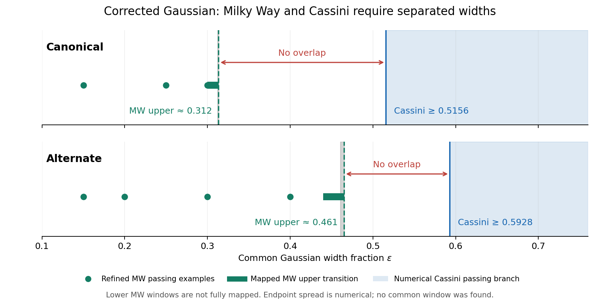

# KT34: scanning epsilon does not recover a joint window

**No common Milky Way–Cassini window survives for this corrected Gaussian
prescription and the original baryon family.** Smaller widths can fit the
Milky Way, but they fail Cassini. Widths large enough for the numerically
identified Cassini passing branch remove too much Milky Way radial support.
Changing epsilon alone does not repair the model.

Only epsilon was varied. The reciprocal operator, equal source/outer
Gaussians, simple nu, both acceleration footings, external field, all 1,375
allowed baryon configurations per footing, and every observational cut were
held fixed. The existing Milky Way width rounding was also retained.

| Footing | Approximate refined MW upper edge | Conservative production-grid MW upper edge | Cassini lower crossing | Joint window |
|---|---:|---:|---:|---|
| Canonical | 0.312 | 0.313549 | 0.515606 | none found |
| Alternate | 0.461 | 0.465284 | 0.592818 | none found |

The MW endpoints are numerical scales, not six-digit physical determinations.
Selected finer grids move their last passing bins; the larger production
edges are deliberately retained as conservative comparisons. Even those
edges leave epsilon gaps of **0.2021 canonical** and **0.1275 alternate**.
Complete lower MW pass intervals were not mapped: the task's decisive result
is the absence of overlap, not a claim that every smaller epsilon passes.

Dots are individually verified MW passing examples. Short green intervals
show the exhaustively mapped upper transition on the production grid, and
gray marks show its endpoint resolution spread. The blue region is the
numerically identified Cassini passing branch. This figure does not fill in
untested lower MW intervals.

## What makes this stronger than a sparse scan

The original rounding makes each cell's Gaussian width constant on known
epsilon intervals. We evaluated **every intersecting width state** in the
decisive bands rather than interpolate between sampled epsilon values.

| Coverage | Canonical states | Alternate states | Finding |
|---|---:|---:|---|
| Upper MW transition to Cassini onset | 150,398 | 83,407 | no higher passing island above the reported production edges |
| Cassini onset through epsilon 2.5 | 435,481 | 397,062 | zero states pass even the necessary local-speed cut |

That is **1,066,348 state evaluations across these bands**, with conservative
overlap at their shared boundaries. Independent code reconstructed the bin
counts and rechecked the recorded cut decisions. No monotonicity of Milky
Way force or chi-squared with epsilon was assumed.

A weighted-adjoint identity made the exhaustive test practical: one linear
solve per width computes a local-force functional shared by all baryon
models. It avoids a separate final Poisson solve for every cell while giving
the same local speed. Literal full solves agree within **5.4e-9 km/s**.
Every state surviving the necessary local-speed cut then receives all four
original observational tests.

In the Cassini-admissible bands through epsilon 2.5, the largest local
speeds are **216.989 km/s canonical** and **218.178 km/s alternate**, below
the required **219.9 km/s**. Tripling spatial resolution moves the worst
cases to **217.004** and **218.193 km/s**, still failing. Doubling the filter
radius from 300 to 600 kpc leaves the displayed values unchanged.

## The large-width escape is also excluded

The independent review derived a continuum bound for the actual corrected
operator, for any nonnegative finite-mass, inversion-symmetric source with
no external field and equal source/outer Gaussian widths:

    |g_ph,outer(x)| <= 2 sqrt(G M a0) |x| / sigma^2.

This does not assume spherical baryons or monotonic numerical scores. With
the fixed width rule and the worst rounding error, it bounds every original
Milky Way model below the required local speed for **all epsilon >= 2.5**.
Even adding 1 km/s to every stored Newtonian speed and 1% to the physical
source mass leaves the speed bounds at **214.604 km/s canonical** and
**218.871 km/s alternate**, both below 219.9.

The analytic force lemma was independently audited and the arithmetic was
independently replayed over every original cell. Its application remains
conditional on the Newtonian baseline and intended finite-mass source
normalization; those allowances are robustness checks, not certified error
bars. The proof uses the physical unclipped gas profile, not an overflow
guard extended literally to infinite height. A small solver/width unit
conversion mismatch found during review was corrected in the accepted v2
arithmetic. The earlier arithmetic remains saved as superseded.

See [REVIEW.md](REVIEW.md) for the derivation and
[cassini/MW_TAIL_AUDIT.md](cassini/MW_TAIL_AUDIT.md) for its separate audit.

## Cassini coverage and the remaining qualification

Cassini was scanned at 407 widths per footing, including zero, tiny widths,
a logarithmic sweep through 10, and controls at 100 and 1,000. All sampled
sign and ceiling crossings were searched. The only ceiling crossings found
were **0.5156064781** and **0.5928184097**. Independent density and flux
integrals, finer angular/radial quadrature, and expanded domains agree near
the roots. No lower-width cancellation island was found.

An analytic bound separately proves Cassini passes for every epsilon >= 4.
The Milky Way bound already excludes that entire tail. Below 4, Cassini's
branch structure is supported by dense numerical evidence, not an
interval-certified proof against an arbitrarily narrow unsampled island.
The epsilon-to-zero control approaches failing plain QUMOND. Finite spatial
accuracy in the Milky Way is also demonstrated by refinement rather than
rigorous continuum error bounds.

**Research decision:** stop treating epsilon tuning as a viable repair of
this equal-Gaussian, common-epsilon prescription under the fixed assumptions.
The exclusion margins are much larger than the observed numerical changes.
This does not prove that every Gaussian kernel construction, different
width law, baryon family, or nonlocal gravity theory is impossible. Such a
change would be a new model requiring its own action and tests.

## Artifacts and verification

- [mw/summary.json](mw/summary.json): compact endpoints, coverage and margins.
- [mw/README.md](mw/README.md): full parameter contract, dual method, cuts,
  endpoint refinement, numerical qualifications and reproduction commands.
- [mw/exact_run/results.json](mw/exact_run/results.json): complete necessary-cut
  enumeration from Cassini onset through epsilon 2.5.
- [mw/transition_run/results.json](mw/transition_run/results.json): every upper
  transition state and full scores for the necessary-cut survivors.
- [mw/checks_run/results.json](mw/checks_run/results.json): accepted numerical
  checks and literal-versus-dual comparisons.
- [cassini/README.md](cassini/README.md): signed quadrupoles, roots, asymptotic
  and uniform bounds, numerical accuracy and commands.
- [review/coverage_001/results.json](review/coverage_001/results.json): independent
  enumeration and decision audit.
- [review/tail_002/results.json](review/tail_002/results.json): accepted tail
  arithmetic in consistent physical units.
- [MANIFEST_VERIFICATION.json](MANIFEST_VERIFICATION.json): validation of all
  15 bounded-run evidence records against current inputs.

All 15 runs completed and their manifests validate; completion is not a
blanket scientific pass. In particular, the preliminary low-epsilon MW scan
contains unresolved narrow-kernel cases and remains diagnostic only. Its
passing witnesses were separately verified at higher resolution. The
production exclusion bands pass their numerical gates. All inputs from
KT33 and earlier lanes were used read-only. No physical parameters other
than epsilon were adjusted, and no original results, owner decisions,
seals, or retired sectors were changed.
