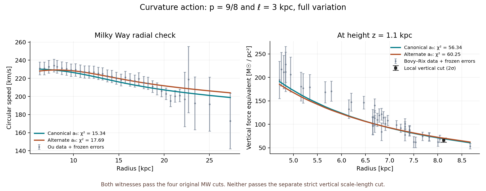

# KT39: a refined MW–Cassini survivor, with the dwarf problem still open

**The new full-action response at p=9/8 and ell=3 kpc passes the four primary
Milky Way cuts and Cassini on both original a0 footings.** Selected MW
witnesses survive refinements 2–5, halving the inner radius and doubling the
outer radius. Neither passes the separate strict vertical scale-length cut.
The same law retains only **12/24 canonical and 13/24 alternate isolated
dwarf passes**, versus 19/24 for plain QUMOND. This is a reproducible two-check
witness, not a broadly validated gravity theory.

The baryon family, data, a0 values and original observational cuts are fixed.
Both **p and ell are explicitly searched phenomenological parameters**; 9/8
describes the tested value, not a derived fundamental number. No Gaussian
convolution, source-dependent length or separate Solar response is used.

## Response and motivation

With the unfiltered Newtonian potential psi, define

    g = grad psi, H = Hess psi,
    x = |g|²/a0², s = ell² (H:H)/a0², z = x+s**p,
    P = x R(z), R(z) = Q(z)/z,
    Q(0) = 0, Q'(z) = nu_simple(sqrt(z)).

The complete anomalous response is

    A = [R-1+xR'] g,
    B = p ell² s**(p-1) x R' H,
    Delta Phi_ph = div A - partial_i partial_j B_ij.

The B term and full weighted discrete transpose are retained. This extends
the known generalized-QUMOND framework; these powers are our functional
choice, not a claim that Milgrom derived them. The p=1 endpoint is KT37;
p=2 is KT38. [Known framework](https://arxiv.org/html/2305.01589v2)

For p>1, simultaneous weak-amplitude scaling suppresses curvature relative
to x away from persistent zero-gradient saddles. Around a nonzero uniform
field with H=0, the extra linear high-wavenumber term found at p=1 vanishes.
This motivated intermediate powers after p=2 failed all ten sampled MW
lengths. It does not establish healthy dynamics.
[Derivation and regularity](analytic/DERIVATION.md)

## Accepted witness

All original 1,375 in-prior baryon cells per footing were tested. At p=9/8,
ell=3 kpc, **32 canonical and 20 alternate cells pass** the four primary cuts;
the strict-Lh intersection is zero. These are refinement-2 population counts,
not exhaustive fine-grid counts. Selected cells 1368 and 1287 at refinement 5:

| Observable | Canonical | Alternate | Original condition |
|---|---:|---:|---|
| Local speed (km/s) | 228.89907 | 229.26398 | Both original local-speed intervals |
| Local vertical force equivalent (Msun/pc²) | 69.11298 | 70.39439 | 62.0 to 70.8 |
| Vertical chi-squared, 43 points | 56.33985 | 60.25407 | At most 67.45935 |
| Rotation chi-squared, 37 points | 15.34480 | 17.69225 | At most 59.89250 |
| Vertical scale length (kpc) | 3.34721 | 3.52431 | Separate strict range: 2.42 to 3.02 |
| Cassini absolute Q2 / ceiling | 3.07767e-5 | 3.58139e-5 | At most 1 |
| Isolated dwarf dispersion passes | 12/24 | 13/24 | Same object-by-object 2-sigma screen |

Both selected cells pass all six numerical configurations. The alternate
local vertical force is nearer its upper cut, but the observed numerical
changes are much smaller than its remaining margin. This is selected
refinement evidence, not a continuum error certificate.

[Raw refinement](mw/refine_001/results.json) · [Independent MW audit](mw/REVIEW.md) ·
[Solar results](cassini/README.md) · [Dwarf results](dwarfs/README.md)

## Bounded search and its limits

The initial search tested p=1.25,1.5,1.75 at ell=1.5,2,2.5,3,3.5,4 kpc:
18 choices and 49,500 MW population evaluations. None passed the primary MW
conjunction on either footing. The two documented adaptive choices added
5,500 evaluations. The p=1.25,ell=2.75 midpoint also failed; p=1.125,ell=3
produced the witness. Ten selected rows received 60 literal-source and
refinement evaluations. All eight selected non-witness cases failed all six
configurations. This does not exclude untested powers, lengths or actions.

All 20 choices pass the fixed Cassini test on both footings. The only choice
retaining the auxiliary comparison of at least 17/24 isolated dwarf passes
on both footings, p=1.75 and ell=1.5, has zero MW passes. That comparison is
not a new original observational cut. The changes helping dwarfs do not
produce a joint improvement in this tested portfolio.

The dwarf calculation retains 24 Plummer sources and 41 Upsilon samples on
[1,3]. Pass sets agree across three grids; no sampled negative total radial
gradients or invalid variances occur in KT39. These are isolated virial
screens, not satellite external-field, distribution-function or equilibrium
tests. Continuous-Upsilon monotonicity is not assumed.

## Numerical and theoretical qualifications

Each tested power first passed energy-variation, reciprocity, Newtonian,
ell=0 and spherical-convergence controls. The compatible factored KT37 v3
Hessian is reused read-only. Its known first/last radial-row pointwise
limitations remain; moving both boundaries tests their observable impact.
The withdrawn KT37 angular operator is not used.

An independent audit regraded all 55,000 MW profiles and 60 refinement rows
without score or flag mismatches. It checked 192 tensor jets against an
independent analytic API and reproduced p=1 and p=2. Module POWER is fixed
per scan process or changed sequentially before each refinement record;
the low-level model is not a thread-safe mixed-power API.

Solar controls include both response terms, smooth-core contacts,
density/flux agreement, refinement and an independently reviewed Gaussian
shrink limit. This is the original fixed constant-external-field Cassini
diagnostic, not a solved Sun embedded in the new law's Galactic background.
[Independent Solar limit review](analytic/SOLAR_DERIVATION_REVIEW.md)

On nonzero indefinite tidal backgrounds, directions n with n.H.n=0 retain
the negative highest-order static coefficient p ell² s**(p-1) x R'. Removing
the uniform-field contribution therefore does not eliminate every tidal
small-scale response. This static result alone proves neither a ghost nor
a dynamical instability. For p<=1.5, including 9/8, B is generally C¹ but
not C² at H=0 with g nonzero; double divergence can require a weak
interpretation. Numerical convergence supplies no relativistic completion.

## Reproduction and consequence

From the repository root, run
`python3 rebuild_2026_10_22/KT39_power_curvature/verify_phase.py` to rebuild
RESULTS.json and validate all 16 manifests. They preserve exact commands,
input hashes, software and resource limits. `mw/verify_review.py` independently
regrades MW scores. VERIFICATION.json records coverage and reviewed artifacts.
Initial and adaptive choices remain separately identified.

This phase establishes a non-Gaussian MW–Cassini witness but does not repair
the dwarf deficit. The next useful discriminator is a complete external-field
and tidal calculation against the dwarf and strict vertical tests, while
retaining the MW fit. Static tidal response and fractional regularity need
assessment alongside that work; another unstructured parameter scan would
not resolve these issues.

Earlier evidence: [KT34](../KT34_reciprocal_epsilon_scan/README.md),
[KT36](../KT36_action_response_search/README.md),
[KT37](../KT37_generalized_action/README.md),
[KT38](../KT38_weak_field_curvature/README.md). Failed and withdrawn records
remain preserved and are not promoted to successful evidence.
