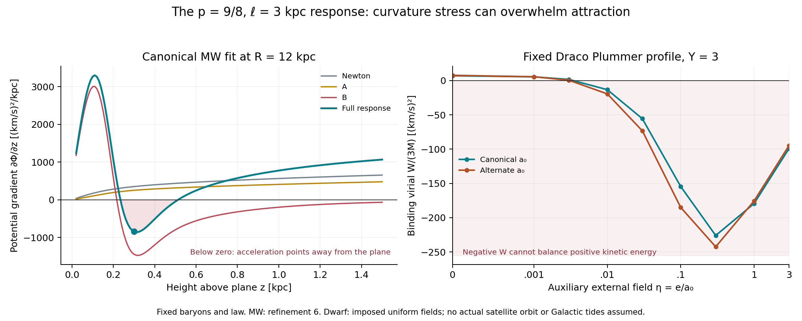

# KT40: the equations identify the mechanism—and expose its failure

The fixed p=9/8, ell=3 kpc response has a calculable mechanism: dependence
on the Newtonian tidal tensor suppresses the MOND response and adds a
derivative stress. This explains the accepted MW–Cassini numbers. New checks
show that the same stress produces **outward force in the fitted MW** and
**negative binding virials for specified dwarfs in external fields**.
The earlier four-cut/Cassini passes remain correct; they do not establish a
physically acceptable matter configuration. This phase derives the equations
and failure mechanism, not a replacement fundamental theory.

## 1. Complete equations

Let rho be baryonic density, psi the auxiliary Newtonian potential and Phi
the potential governing matter acceleration. With g=grad psi, H=Hess psi,

    x=|g|²/a0², s=ell²(H:H)/a0², z=x+s**p,
    E(g,H)=a0² P=|g|² R(z), R(z)=Q(z)/z,
    Q(0)=0, Q'(z)=1/2+sqrt(1/4+1/sqrt(z)).

The full action is

    S=integral dt d³r {
        rho[|v|²/2-Phi] - [2 grad Phi.grad psi-E(g,H)]/(8piG)
      }.

Its variations give

    Delta psi=4piG rho,
    Delta Phi=4piG rho+div A-partial_i partial_j B_ij,
    dv/dt=-grad Phi,
    A=[R-1+xR']g,
    B=p ell² s**(p-1) xR' H.

All terms are mandatory. A gradient has acceleration units; B has acceleration
times length units. The framework is known generalized QUMOND; this particular
P and its fitted p,ell are our tested functional choice, not a derivation from
microscopic physics. [Primary framework, Eqs.6–7](https://arxiv.org/html/2305.01589v2)

An exact primitive is given in [scaling/DERIVATION.md](scaling/DERIVATION.md).
The old baryons, a0 values and cuts were not altered.

## 2. What switches the response

Define the local field-variation length L=|g|/sqrt(H:H), where g and H are
nonzero. The dimensionless curvature discriminator is exactly

    chi=s**p/x=(ell/L)**(2p) (|g|/a0)**(2p-2).

At p=9/8, chi=1 occurs at

    Lcrit=ell (|g|/a0)**(1/9).

Thus the transition depends strongly on spatial size, while weakening the
acceleration changes it only slowly. Compact dwarfs remain affected despite
their low acceleration. For a Plummer sphere at r=a,

    L=2a/3,  chi(a) proportional to M**(1/4) a**(-11/4).

These relations explain the observed mass/size sensitivity; they are not
an object-dependent length prescription or a new fit.

For the fixed Solar external-field diagnostic, the curvature crossover is
about1.70 pc, compared with about0.0245 pc where the Solar and external
Newtonian accelerations are equal. A rescaling and dominated-convergence
calculation give the leading result

    Q2 approximately -0.15827317 a0/ell  (canonical external-field ratio),
    Q2 approximately -0.15240097 a0/ell  (alternate ratio).

The full Solar values agree within2.4e-8 relative with this leading expression
at the tested parameters. B supplies nearly all the quadrupole; its A/B
magnitude ratio is about1.8e-8. This is a fixed-positive-external-field,
large-ell/rM asymptotic, not a uniform mass-to-zero theorem or a solved Sun
embedded in the actual fitted Galaxy. [Derivation and limits](scaling/DERIVATION.md)

## 3. Why the MW fit passed, and the new force check it fails

At the Solar radius, the canonical refinement-5 witness decomposes as follows:

| Quantity | Newton | A contribution | B contribution | Total |
|---|---:|---:|---:|---:|
| Circular speed squared, (km/s)² | 39810.98 | 15594.05 | -3010.24 | 52394.79 |
| Vertical force at z=1.1 kpc, Msun/pc² | 63.18554 | 26.59593 | -20.66849 | 69.11298 |

B cancels about78% of the A vertical enhancement at that measured height.
The complete force therefore passes the original primary cuts. A and B
alone are diagnostic pieces of one action, not independently valid models.

At R=12 kpc,z=0.3 kpc, however, refinement 6 gives

| dPhi/dz, (km/s)²/kpc | Newton | A | B | Total |
|---|---:|---:|---:|---:|
| Canonical | 350.131 | 251.166 | -1445.067 | **-843.770** |
| Alternate | 347.380 | 293.184 | -1576.676 | **-936.111** |

Since acceleration is -grad Phi, these negative derivatives mean acceleration
**away from the plane** at positive z. The sign survives refinements3–6,
three direct potential-difference steps, and an independent review. The final
refinement changes its magnitude by less than0.4%. These are converged
numerical witnesses, not certified exact continuum error bounds.

For the unchanged decreasing gas profiles, vertical hydrostatic balance and
an isotropic barotropic pressure require

    dP_i/d rho_i = h_i (dPhi/dz)/tanh[z/(2h_i)],
    h_HI=.085 kpc, h_H2=.045 kpc.

The right side is negative at the outward-force point, so it cannot represent
a positive-compressibility barotropic gas there. Magnetic, anisotropic or
nonequilibrium support has not been supplied by this model. This is a failure
of that stated matter completion, not an exclusion of all imaginable matter
physics. [Independent force review](dynamics/MW_FORCE_REVIEW.md)

## 4. External fields reveal the dwarf mechanism directly

The full-action calculation used the same four selected original dwarf
profiles,41 Upsilon samples,both a0 values and auxiliary external gradients
eta=e/a0 in {0,.001,.003,.01,.03,.1,.3,1,3}. No field was fitted to an object.
The external fields are uniform diagnostics, not reconstructed satellite
orbits, Galactic tides, or line-of-sight dispersion models.

For every one of2,624 nonzero-field configurations, the scalar binding virial
is smaller than its isolated value. In1,805 configurations it is negative.
For canonical Draco,Upsilon2,eta=.01,

    W/(3M)=1.08196 +5.54923 -25.96949
          =-19.33829 (km/s)².

The three terms are Newton,A,B. Most of the deficit lies inside3 Plummer
radii. At eta=.01, all41 Draco masses have negative virial on both footings.
In the absence of external confinement, stationary scalar virial balance
requires2K=W with K>=0; W<0 therefore forbids a stationary equilibrium of
that prescribed centered profile, irrespective of velocity anisotropy.
This is stronger than a low predicted dispersion. [Full EFE results](efe/README.md)

There is also an analytic explanation. In the controlled external-dominated,
curvature-weak expansion, R'<0 produces a positive compression energy

    U_H=-[e² R'(eta²) ell**(2p)/(8piG a0**(2p))]
                         integral (H:H)**p d³r >0.

Fixed-mass compression rho_lambda=lambda³rho(lambda r) gives

    U_H(lambda)=lambda**(6p-3) U_H(1),
    W_H=-(6p-3) U_H = -(15/4) U_H <0  at p=9/8.

The extra curvature response acts as an outward stress. The quoted finite-field
results use the complete nonlinear action, not this asymptotic expansion
outside its validity range. Homology variation, a separate full-force monopole
integral,14 high-precision energy differences and three grids agree.
[Mechanism and expansion limits](efe/MECHANISM.md)

## 5. A restriction on any local curvature-only repair

Linearizing the full action at a smooth jet gives the frozen symbol

    delta Phi_hat=[K(n)+N(n) k²] delta psi_hat,
    K(n)=E_gg[n,n]/2, N(n)=E_HH[nn,nn]/2.

The mixed terms cancel. In the local comoving frame, ordinary
continuity/Euler matter with sound speed cs then has

    omega²=[cs²-4piG rho0 N(n)] k²-4piG rho0 K(n).

In a laboratory frame replace omega by omega-k.v0; uniform translation
changes the oscillation frequency but not the growth rate.

Negative N is a restoring contribution. Positive N causes short-wave growth
only when pressure is insufficient. In fact, the conditional two-gas-fluid
completion is stable at leading high k in every direction at all14 sampled
restoring-force points per footing; the remaining point fails equilibrium
through its outward force. We do not claim all MW points have a UV instability.

A general analytic obstruction nevertheless applies to the local cold-fluid
class: if f(h)=E(g0,h nn) tends to a finite high-curvature limit from above
somewhere, then f''>0 somewhere. That positive-density jet has N>0 and
unbounded frozen pressureless growth as k increases. Changing p alone cannot
remove this issue on every background while preserving those energy endpoint
properties. This is not a relativistic ghost or collisionless theorem.
[Exact theorem and proof](dynamics/GENERAL_OBSTRUCTION.md)

## Status and reproduction

The equations and tested screening mechanism are now explicit. They do not
provide a viable complete explanation with the fixed matter profiles: the
derivative stress responsible for the primary fit also produces the failures
above. A replacement must control external-field curvature stress and give a
consistent matter response, with an actual microscopic cutoff, nonlocal
response or additional dynamics if needed. None is derived by this phase.

The p,ell and a0 inputs remain phenomenological; this work does not derive
their values. Full Galactic embedding, actual satellite tides and a healthy
relativistic completion remain unresolved research obligations.

`verify_phase.py` validates all retained computation manifests and rebuilds
RESULTS.json. VERIFICATION.json separates completed execution, accepted
evidence and preserved failed or superseded records. The first Solar scaling
output had a dimensional conversion defect, later corrected and independently
matched to the original physical Q2. Several numerical-control failures and
the first assumed restoring-force assertion remain preserved. No KT39 source
or result was silently rewritten.
