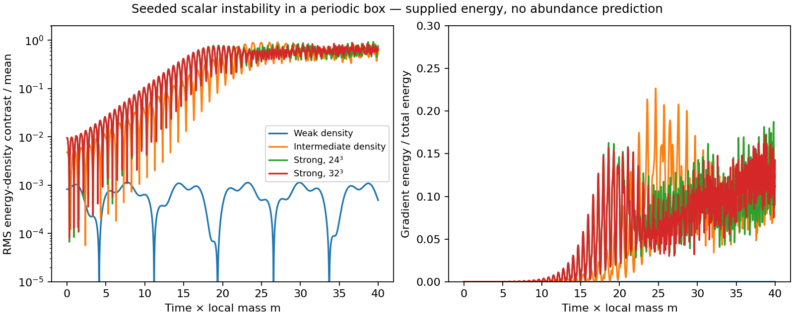

# Dense interacting scalar phase: self-resonance without a cold supply mechanism

2026-10-26. Continuation of the direct-field audit at 8544baff1f; execution
manifests record the actual repository revision at each run. Other work is
concurrent. This directory changes no action coefficients or upstream results.

## Result

A dense coherent real scalar is unstable to spatial perturbations in 295 of
303 sampled positive cluster benchmarks. Seeded three-dimensional evolution
confirms substantial spatial energy redistribution in two dense cases. Thus
“the restored potential is repulsive” is not enough to infer dynamical stability
of its oscillating condensate. The instability is self-resonance of an already
energized oscillation.

However, the nonlinear states tested here retain large positive effective
pressure: final-window P/E is .509 for the intermediate case and .639 for the
strong case. The latter changes by less than .03% across the tested time/space
refinements. Their detailed density patterns are not converged. No stable cold
clump population, cosmological abundance or cluster profile is obtained.

An exact field identity, independent of the fluid approximation, also excludes
an isolated stationary self-bound state of the fixed uniform restored scalar
in flat space under the decay and averaging hypotheses in PROOF.md. It does
not exclude gravitational binding or a different coupled matter/metric phase.

## Model, units and initial data

Use the inherited canonical potential, with external baryonic source d fixed:

    z=sec(q/2)-1,
    U_d=(d-8)z+36z²+40z³+10z⁴,
    q_tt = lap(q) - U_d'(q),  |q|<pi.

All cluster rows have d>8; no own scalar density is inserted into d. The scalar
energy is excitation energy relative to q=0 in this background. Source rest
energy and the constant vacuum term are not included in its box energy.
The calculation is classical and uses a flat metric and prescribed uniform
baryonic density. These are effective fixed-source stress diagnostics, not a
solution for the full physical matter-plus-gravity stress tensor.

For each of the 303 inherited positive shell requirements, supply a homogeneous
oscillation of energy E=rho_required/D. This deliberately tests capacity and
stability at the demanded density; it does NOT derive that energy or population.
The requirements come from `cold_local_production_2026_10_25/run/result.json`.
They retain the uncertainties and conditional source interpretation of the
previous audits; no new observational/covariance analysis is performed here.

Let m²=(d-8)/4, s=m t, y=m x. Floquet wave numbers are k/m, and lattice time
is s. Inherited units are .010962 pc and .0357534 yr. Nonlinear runs cover only
27–82 days, with box sides .000669–.0108 pc. They cannot test astronomical
survival. Excitation gravity scales kappa E L_dimensionless² are approximately
9e-24–6e-22; this is a local weak-gravity estimate, not metric evolution.

## Linear stability using the full potential

Integrate q(s) over its full period and simultaneously integrate two independent
solutions for each perturbation:

    delta_q_ss + [(k/m)² + U''(q(s))/m²] delta_q = 0.

The 2x2 monodromy matrix has unit determinant. With trace t, sampled growth is
mu/m=arcosh(|t|/2)/T_s when |t|>2, and zero otherwise. The neutral k=0 mode is
omitted from the growth maximum to avoid classifying its roundoff/Jordan-block
behavior as instability.

All 303 cases use k/m=0 plus 64 points between .025 and8. Four selected cases
(minimum, median and maximum E/d and the largest sampled growth) are recomputed
with 257 nonzero wave numbers and tighter tolerance. This is not a complete
stability chart: unsampled narrow bands and k/m>8 remain possible. The eight
cases without detected growth are not proved stable.

| Row | d | E/D units | Refined peak k/m | Refined mu/m |
|---|---:|---:|---:|---:|
| 173, least E/d | 170.635 | 1.03245 | none sampled | 0 |
| 207, median E/d | 817.549 | 3622.64 | 3.54521 | .254788 |
| 98, largest E/d | 1505.35 | 17469.04 | 5.32090 | .279708 |
| 214, largest initial sampled growth | 1713.17 | 12886.10 | 4.32402 | .288664 |

The count295 uses mu/m>1e-5. Maximum unit-determinant error is 5.23e-10,
background relative energy error9.62e-12, and return error4.39e-10. A separate
six-variable solver using a finite-difference potential Hessian reproduces the
four selected growth rates within1.66e-8 absolute. A constant-frequency analytic
monodromy agrees within4.30e-13; reversing the restoring sign fails that test.
These are numerical checks, not a proof that all resonance bands were found.

## Nonlinear three-dimensional test

Use a periodic cubic nearest-neighbor lattice with velocity Verlet. Initial
momentum is zero and

    q=A [1+(.001/3)(cos(k x)+cos(k y)+cos(k z))],

where U(A)=E and k is the refined unstable peak for the two dense rows. The
weak case uses k/m=1. The seed adds a small amount of energy, which is measured
and included in the ledger; it is not silently removed. No noise ensemble is
claimed. This deterministic seed preserves discrete symmetries and does not
sample all nonradial preparations. Box size is one seeded wavelength per side.
The lattice dispersion differs slightly from the continuum Floquet dispersion;
spatial refinement checks this and other grid effects together.

| Case | Grid, dt_s | Max energy drift | Max density contrast | Late P/E |
|---|---|---:|---:|---:|
| Weak row173 | 24³, .002 | 1.01e-6 | .00115 | .02171* |
| Intermediate row207 | 24³, .002 | 1.67e-4 | .916 | .50854 |
| Strong row98 | 24³, .002 | .001391 | .928 | .63883 |
| Strong row98 | 24³, .001 | .000226 | .928 | .63875 |
| Strong row98 | 32³, .001 | .000232 | .898 | .63869 |

Contrast is spatial RMS energy-density variation divided by the mean, not a
count of bound objects. Late averages cover s=30–40. *For the weak case, finite
window endpoint effects dominate the direct pressure: its virial-pressure
average is .002412 E and the endpoint term is .01930 E. It must not be read as
an equilibrated EOS. The corresponding terms are explicitly stored for all
runs. Maximum finite-time virial-identity residual is .001271 E, below the
implementation gate .01; it includes temporal sampling/quadrature error.

The high-density cases transfer up to about17–23% of their energy into gradients
and develop order-one contrasts. The strong-case mean pressure is robust over
these refinements, but final contrast changes from .762 to .626 between24³
and32³, and the maximum gradient fraction changes from .187 to .172. Therefore
we do not claim converged morphology, clump mass, stationary equilibrium or a
late-time turbulent spectrum. The intermediate and weak cases lack separate
resolution studies. No open-boundary release experiment was run.

The periodic box prevents net escape. Persistence in this box cannot establish
self-confinement. No damping, energy injection, artificial cooling or production
term was added to the nonlinear evolution.

## Constraint beyond the fluid approximation

For the full real field, averaging the equation multiplied by q gives

    <q_t²> = <|grad q|²+q U'>,
    
 = <|grad q|²>/3 + <q U'/2-U>.

For this restored potential and d>=8,

    q U'/2-U >= 36z²+80z³+30z⁴ >=0.

PROOF.md derives the inequality and states the temporal/boundary hypotheses.
Thus spatial interactions do not provide a negative-pressure term that could
balance an isolated, stationary fixed-source object. Combining this identity
with the isolated spatial stress virial condition excludes a nontrivial flat-
space stationary self-bound state under those hypotheses. This argument allows
inhomogeneous and incoherent fields; it does not assume a fluid or a single
oscillator. A finite-time configuration can evade stationarity through its
endpoint terms, and a gravitating or externally confined state is outside that
isolated-state conclusion.

For the two dense simulated states, P/E exceeds the inherited cluster v²/c²
proxy by roughly2.4e4 and5.0e4. This signals a large confinement mismatch in a
cold weak-gravity interpretation. It is not a precise Jeans/TOV solution or a
claim about all possible coupled states. The pressureless matter-source mapping
itself requires revisiting once relativistic effective pressure is present.

## Supply and galaxy condition

With constant d and periodic boundaries, total scalar excitation energy is
conserved. For prescribed time-dependent d,

    d/dt integral epsilon = integral (partial_t d) z

plus boundary energy flux. Self-resonance redistributes existing energy; it does
not fix total abundance. Starting exactly at q=q_t=0 on a restored background
leaves q=0 classically. A seed spectrum, past oscillation amplitude or a physical
energy-transfer history is still needed. Specifying one at the required cluster
energy would be an added initial-state assumption, not a first-principles result.
Quantum particle production is not covered by these classical equations.

Nothing in this test selects a cluster-only population or suppresses the same
excitation in galaxies. Under the inherited phenomenological spherical force
mapping the condition remains M_c(<r)<=delta L(r), with
L=(B+sqrt(B²+4AB))/2, B=M_b(<r), A=a0 r²/G. Delta must be measured, not fitted
here. There is no new derivation of the galaxy law, a0 or the vacuum/response
ratio. The experiment adds no fitted action parameter, but its amplitudes,
seed and box are explicitly chosen numerical initial/boundary data.

The remaining substantive route is a **coupled scalar–baryon–metric phase** that
derives energy transfer and confinement together. To evade this fixed-background
obstruction it must supply an identified stress/force contribution or violate
one of the stated hypotheses physically. Merely assigning a large occupation
number or renaming the fragmented state “cold” does neither.

## Context, reproducibility and status

Self-resonance and fragmentation need not yield stable cold relics; this general
distinction also appears in the primary study [Self-resonance after inflation:
oscillons, transients and radiation domination](https://arxiv.org/abs/1710.06851).
Its abstract was consulted2026-10-26 for context only. Its potentials and
cosmological conclusions are not imported into this framework.

Bounded manifests in floquet/, lattice/ and audit/ record completed runs;
mutation/ records the expected failed restoring-sign test. Execution commands,
input hashes and declared results are pinned. `raw_artifact_hashes.json` pins
additional raw time series and postprocessing dependencies. The scripts
physical_scales.py and plot.py regenerate the scale comparison and figure.
Host executables are ignored and compiled from source. Plot generation used a
temporary Matplotlib cache because the user cache was not writable; no numerical
run emitted warnings. Figure visually inspected. This is a same-author audit.

Outcome: **finite sampled instability and nonlinear redistribution verified;
parameter-free stable cold cluster phase not demonstrated.** The exact
fixed-background obstruction is separately conditional on PROOF.md hypotheses.
