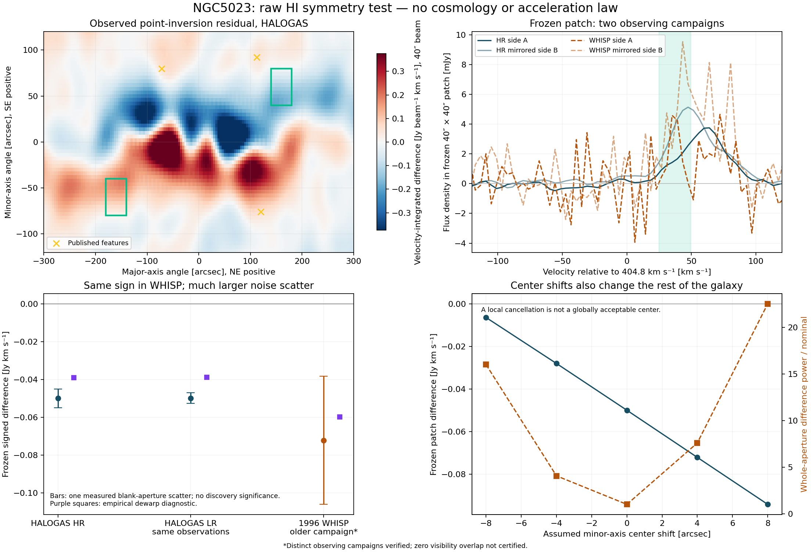

# NGC5023: actual-cube residual and separate-observation check

20 October 2026. Checkpoint `ngc5023-cube-2026-10-20`, base
`be8fc76cb0e207b88710f130abf2aa937f0895a5`.
[Target and non-claims](TARGET.md).

**The actual cubes were analyzed without LambdaCDM, an acceleration law,
distance or stellar M/L. A localized raw asymmetry is measured, but a new,
isolated unexplained signal is not established.** The selected feature is
stable against the restoring-beam, interpolation and spatial-baseline
checks. It is not isolated from already published HI structure under a
footprint-aware mask. A separate, much shallower 1996 WHISP observation
has the same signed difference, but does not establish the component that
remains after the stated geometry diagnostics.

## What was measured and held fixed

The observable is

`D(x,z,u) = I(x,z,u) - I(-x,-z,-u)`, with `u = v - 404.8 km/s`.

The null assumes a centrally symmetric emitter/velocity field and a
compatible observation operator. A symmetric rotation curve, symmetric
vertical lag and centrally symmetric warped rings lie inside this null;
it does not require a gravitational model. A symmetric extra-mass or
memory-bearing component also lies inside it. A nonzero result is HI
brightness/kinematic asymmetry, not automatically unusual gravity.

We used signed continuum-subtracted emission and 40-arcsec circular
restoring beams. Each comparison integrates a fixed 40-by-40-arcsec sky
box and 24.72-km/s velocity interval. Positive major offset is NE; positive
minor offset is SE. The source aperture is major offsets +/-300arcsec,
minor offsets +/-120arcsec and velocity offsets +/-123.6km/s. Half-plane
pairing omits the central 40-arcsec major-axis bin, including its non-self
pairs; reported paired flux is therefore aperture flux, not the galaxy's
complete integrated flux.

The exploratory candidate was the largest absolute contrast among 120
eligible HALOGAS-HR bins: positive major offset <=175arcsec, absolute
minor offset >=60arcsec, with the initial declared known-feature mask.
Its region and sign were written to [candidate.json](discovery_run001/candidate.json)
before any WHISP intensity analysis. The frozen center is
`(x,z,u) = (160arcsec,60arcsec,37.08km/s)`; its mirror uses all three
opposite signs. There was no reselection in WHISP.

| Cube, at 40arcsec beam | Frozen signed flux difference, Jy km/s | Measured blank-aperture scatter |
|---|---:|---:|
| HALOGAS HR | -0.0499723 | 0.0049124 |
| HALOGAS LR | -0.0498481 | 0.0028447 |
| WHISP, 1996 campaign | -0.0721641 | 0.0338457 |

HALOGAS HR/LR share observations and count only as a processing control.
The 1996 cube is a separate observing campaign from the 2010 HALOGAS
data; both use WSRT and share instrument-related uncertainties. See
[acquisition and conversions](independent/DATA_NOTE.md) and the separate
[independence check](independent/INDEPENDENCE_CHECK.md) for the exact
scope of the campaign/visibility-overlap evidence.
Complete visibility disjointness is unverified; no significance estimates
are multiplied as if full statistical independence had been certified.

The WHISP blank mean in this contrast is +0.0083961Jy km/s. Its observed
contrast is 2.38 empirical blank-scatter units below that mean; these are
**not Gaussian discovery sigmas**. At the measured HALOGAS amplitude,
the expected WHISP contrast is only about 1.48 blank-scatter units.
The old observation is therefore too shallow for a decisive single-patch
replication or rejection. Its same-sign amplitude is compatible with the
new observation, not a secure confirmation of a novel remainder.

## Centering, beam, mask and warp results

* **Centering:** the 75-case coarse grid varies major/minor center offsets
  over -8,-4,0,4,8arcsec and systemic velocity by -4,0,4km/s. The candidate
  can disappear or reverse somewhere in that broad envelope, but those
  changes can greatly increase the residual elsewhere in the galaxy.
  Nominal centering minimizes global difference power on the coarse grid.
  The best fine one-axis HR control is a -1arcsec minor-center shift:
  candidate -0.04446Jy km/s and global difference power 0.855 times
  nominal. Thus local cancellation is not evidence for an acceptable
  global center or proof that this is a centering artifact. Catalog optical
  positional precision is not a dynamical-center prior.
* **Published center ranges:** the original table literally gives RA
  +/-4.3seconds of time, or +/-46.37arcsec east/west, and Dec +/-6arcsec.
  The surprising literal RA range is retained as a separate stress
  test, not silently changed to 4.3arcsec. Published bounds are visual
  one-parameter deviations, not a joint Gaussian covariance.
* **Beam/interpolation/baseline:** HR native-beam contrast is -0.05111
  versus -0.04997Jy km/s at 40arcsec. Cubic interpolation gives -0.05034;
  omitting the spatial baseline subtraction gives -0.04994. The close
  HR/LR agreement survives the common beam. These controls address the
  restoring Gaussian and interpolation, not every dirty-beam/CLEAN error.
* **Masks:** the candidate survives the paired HALOGAS moment0 masks at
  2,3 and 5 blank-scatter thresholds. However, the initial mask tested
  bin centers only. Its footprint partly overlaps the declared box
  around published feature2: about 21% of its sky area intersects that
  conservative box, before beam wings. A footprint-aware 40arcsec
  exclusion removes the candidate, as do wider 60/80arcsec controls.
  The rectangles are conservative exclusion choices, not measured source
  boundaries; overlap does not prove the known feature causes the signed
  contrast. It means isolation and novelty have not been demonstrated.
* **Warp:** a data-derived projected centerline correction changes HR's
  contrast to -0.03897Jy km/s and WHISP's to -0.05985. Operator-matched
  blank scatters are 0.00483 and 0.03410 respectively. This correction
  absorbs some asymmetry but is an empirical sensitivity diagnostic.
  The published side-dependent PA/inclination warp and nonidentical
  spiral arms are not equivalent to changing one global PA or this
  centerline shift. Their full 20-ring model/cube was not recovered or
  reconstructed, so the residual has **not** cleared that ordinary
  explanation. A projected inner cut does not exclude outer gas along
  the line of sight.

The nominal all-aperture squared asymmetry, after real-blank power
subtraction, is 0.003315 HR and 0.003277 LR, whose square roots are about
0.058. This is an explicitly defined finite-aperture 3D statistic, not a
reproduction of a differently centered/masked published moment0 statistic.

## Does a more isolated pattern replicate?

After the first frozen-bin comparison, we made an **additional exploratory**
comparison using the fixed HALOGAS-HR residual as a template over all 120
search bins. Unit amplitude means the HR template itself. WHISP returns
1.331 with blank scatter 0.362. Removing the fixed HR templates for three
linear centering/velocity directions and one empirical warp-change shape
leaves WHISP amplitude 0.249 with blank scatter 0.502.

With the stricter footprint-aware known-feature mask, 112 pairs remain:
WHISP amplitude 1.177, scatter 0.353, changes to 0.372, scatter 0.674 after
the same kind of nuisance projection. These projections are sensitivity
tests: they can discard physical signal and do not represent the full
warp model. The remaining pattern is not independently established; its
absence is also not demonstrated. The HR residual norm falls by about
69% in squared power under the original projection, so much of the raw
pattern lies along these simple geometry-sensitive directions.
[Exact additional results](additional_run001/results.json).

## Noise and spectral limitations

Twenty translated, real blank-sky apertures are processed with the same
source sampling and bins. They preserve actual spatial/channel correlation
better than an independent-voxel approximation. They overlap each other,
so they are not twenty independent experiments or a calibrated tail
probability. The selected maximum, analysis choices and post-selection
extensions do not supply a global discovery significance.

Squared difference and sum powers have separate measured blank terms.
Negative corrected powers are retained; for example, the stricter WHISP
search regions do not show positive noise-corrected difference power.
The absolute-residual blank subtraction is retained only as a diagnostic,
since it can overcorrect low-SNR signals. Data-selected threshold masks
are diagnostics, not unbiased detection statistics. The additional
cubic/dewarp/baseline/spectral controls reprocess their blank apertures
through the same operator; the original broad center-grid scatter labels
reuse nominal blanks and only describe amplitude sensitivity.

Angular restoring beams are matched. Exact native spectral line-spread
functions are not. Additional 20/40km/s Gaussian smoothing keeps the
candidate sign in both campaigns but is not exact LSF deconvolution.
HALOGAS labels SPECSYS=BARYCENT with legacy VELO-HEL; WHISP uses optical
heliocentric coordinates. The small barycenter/heliocenter difference,
response mismatch, and shared WSRT calibration remain limitations.

## Source checks, novelty and audit

Both primary HALOGAS files match the release's advertised MD5 checksums.
The older NED-hosted WHISP cube has a verified gzip/source hash and native
16-bit scale/BLANK conversion. Its W.U. unit is 5mJy/beam. Its B1950/NCP
coordinates use the independently tabulated optical center in that frame;
its legacy FREQ-OHEL axis retains its secondary heliocentric reference.
A naive rest-frequency conversion would introduce a roughly17km/s false
offset. No inferred cosmological distance was used.

Global asymmetry is already published for this galaxy (Reynolds2020);
three extraplanar features and asymmetric warp/spiral structure are
published in Kamphuis2013. Full-cube point-inversion and squared-noise
statistics are explicitly developed in Deg2023. This is a fresh local
execution and separate-campaign check, **not a new method or a verified
previously unnoticed signal**. [Source/version details](warp/KNOWN_STRUCTURE.md).

An independent implementation reconstructs HR/LR/WHISP signed contrasts
from the actual FITS data without importing the production sampler;
maximum discrepancy is below 1.5e-8Jy km/s. Independent synthetic controls
test symmetry, mask leakage, interpolation and correlated noise. Audit
and runner records are in [the actual-data audit](audit/ACTUAL_REVIEW.md),
[method/synthetic audit](audit/METHOD.md),
[discovery](discovery_run001/manifest.json),
[replication](replication_run001/manifest.json) and
[additional controls](additional_run001/manifest.json).
Eight completed runner records, including rendering and independent checks,
pass current input/output validation. All 334 inventoried files from the seven
earlier packets are unchanged. [Verification](VERIFICATION.json).

The measured raw asymmetry is a valid observational lead. Distinguishing
an isolated novel component from known HI geometry, then confirming it
with sufficient independent sensitivity, remains open. No physical
memory state or new gravity has been identified. [Next obligations](NEXT.md).
