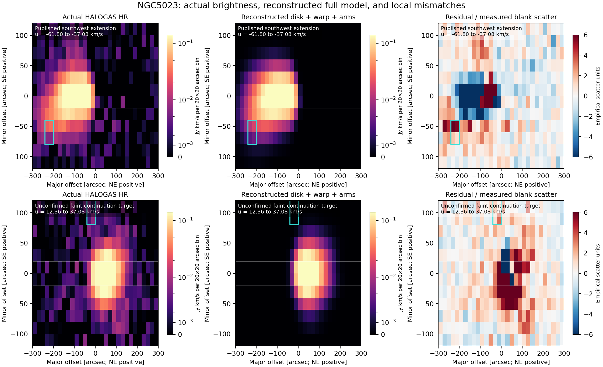

# NGC5023 asymmetric warp/spiral reconstruction and residual handoff

**A full three-dimensional reconstruction and finite uncertainty experiment
has now run on the actual HI cube. It leaves conditional model mismatches;
no independently established new signal or physical-memory closure follows.**
The strongest mismatch is in a previously published low-velocity extension.
A fainter unclassified patch remains a continuation target, with inadequate
older-data sensitivity and unresolved imaging systematics.

Checkpoint `ngc5023-full-warp-2026-10-20`, assessment base
`c821a8bccc8a20e107b4c6771d31e02d05aa8b10`.
Parent: [actual-cube phase](../ngc5023_cube_2026_10_20/README.md).
Start continuation at [CLAUDE_HANDOFF.md](CLAUDE_HANDOFF.md).

## What was reconstructed

An authentic public author baseline `.def` was recovered from pyHIARD
commit `9688d31c7ae0c857039d19b8f0a52f205c8b655c`. It is a two-half-disk
baseline, not the preferred spiral model. The exact preferred `.def`, model
cube and joint covariance were not recovered. Figures11/12 and Table4 of
[Kamphuis et al.2013](https://doi.org/10.1093/mnras/stt1153), retained at
[arXiv1306.5312v1](https://arxiv.org/abs/1306.5312v1), supply a qualified
reconstruction of the preferred20-ring disk and two spiral arms.

The optically thin model integrates face-on surface brightness over
`R dR dphi`, normalized exponential vertical profiles and a vertical rotation
lag. It retains side-dependent PA/inclination and the disk/arm geometry ties.
The arms use spatial widths in arcsec, hence angular width `width/R`, and
unwrapped phase interpolation with the documented approaching-major-axis
convention. Direct angular integration reproduces the quoted arm fluxes to
better than0.8% without source-readout renormalization. The model is projected
through actual NCP sky coordinates, native channel centers, restoring beam
and the unchanged native-to-analysis interpolation. Source effective
10km/s dispersion is applied once. Nearby distance6.6Mpc only translates
published lag/mass-flux units; no cosmology, halo, stellar M/L, or project
acceleration law enters the emission/kinematic calculation.

The implementation is independently checked, but it is not an exact
TiRiFiC reproduction. See [source recovery](recovery/RECOVERY.md),
[arm conventions](spiral/RULES.md), and
[corrected native-observation audit](audit/V2_NATIVE_REVIEW.md).

## What the uncertainty experiment establishes

118 labeled cases represent117 distinct parameter sets: the nominal case
also occurs at the Sobol center. The cases separately cover coherent
source-anchored ranges, smooth radial/counterwarp directions, graphical
readout perturbations, literal center stresses, interpolation/support/arm
extent and variance-matched vertical alternatives, plus32 deterministic
joint-box points. This is a finite sensitivity family, **not** the unknown
206-parameter posterior, a confidence set, or exhaustive graphical coverage.
The quoted source ranges are mainly one-at-a-time visual deviations; the
lag error comes from a different source fitting procedure.

Every case retains its peak-fixed source prediction and a separately labeled
three-amplitude calibration using central-bin footprints |z|≤20arcsec.
The conditional component-flux bounds come from the same cube, not external
independent priors. Some width/total-flux stress cases require very large
amplitude rescaling, up to14.36× for one arm; these are not within the
small graphical brightness readout error. All fits hit at least one bound;
72/118 hit both arm upper bounds. Three-column design conditioning does
not establish identification of the unrecovered full model.

Relative training-loss gates1.10/1.25/1.50 retain76/83/95 labels. They are
sensitivity strata, not acceptance probabilities or absolute adequacy.
All cases and bad training fits are preserved. Twenty real translated blank
apertures, including overlaps, propagate native correlations and the response
of the training-only amplitude calibration. Numerical cloud/native refinement
and CIC-response changes are carried as finite discrepancies, not rigorous
uniform integration bounds.

## Actual results

| Region | Nominal residual RMS / measured blank scatter |
|---|---:|
| Central training strip |8.195|
| Validation: bin centers abs(z)≥50arcsec |1.143|
| Guarded: bin centers abs(z)≥70arcsec |1.053|

The smallest full-family training RMS is still7.929. The minimum footprint
edges of the two outer cuts are40/60arcsec, before beam wings. The model
was originally fitted to this same cube, so these are protected from the
new amplitude calibration, not historically blind holdouts. In nominal
emission-bearing outer bins, RMS is2.224 scatter units (guarded1.539 in
only8 bins). Empty volume therefore cannot justify a blanket nondetection.

A40×40arcsec×24.72km/s box at(x,z,u)=(−220,−60,−49.44) retains a
6.50-scatter distance beyond the strict finite-family envelope plus tested
numerical discrepancies. It exceeds the20 empirical blank scan maxima
(2.56–3.68). **This is a model mismatch in known structure**: §3.4 and
Figure9 already show the southwest/NW-side low-velocity extension at this
position/velocity. Passing masks for the three Table2 features was not
passing a complete known-structure inventory. Its raw result and the
[subsequent source classification](recovery/KNOWN_EXTENSIONS.md) both remain.
A post-scan broad-extension exclusion leaves weaker peaks around3.65–4.04
scatter units; it is a diagnostic sensitivity, not a new blind test.

One retained unclassified target is(x,z,u)=(−20,+100,+24.72), corresponding
approximately to J2000 RA13h12m19.1s, Dec+44°01′12.7″ and V429.52km/s.
For the frozen40×40arcsec×24.72km/s aperture at a common40arcsec beam:

| Product | Flux minus measured blank mean [Jy km/s] | Empirical blank scatter |
|---|---:|---:|
| HALOGAS HR |0.01780|0.00339|
| HALOGAS LR |0.01139|0.00199|
| Older WHISP |0.01018|0.01694|

The strict conditional source-family maximum is about0.00090Jy km/s.
The broader37.08km/s aperture also has a positive HALOGAS mismatch.
HR/LR use the same observations; their recurrence is not independent
confirmation. A frozen negative control also recurs near−3.7 measured
scatter units in both products. The older cube would detect the HR/LR
candidate amplitude at only0.67–1.05 of its empirical scatter. It neither
confirms nor meaningfully rules it out. Its already inspected status,
same-instrument systematics, unverified complete visibility disjointness,
local tangent-frame approximation and effective spectral-response limits
remain explicit. No discovery significance is assigned.

A bounded later-catalog check found no matching separate cloud entry. The2022
HALOGAS catalog reports no NGC5023 cloud candidates, but merges disk-connected
gas and cannot resolve this patch’s identity; novelty remains unresolved. See
[the primary-source comparison](recovery/LATER_CLOUD_CHECK.md).

Gaussian restoring-beam checks do not recover residual dirty sidelobes or
UV calibration/deconvolution systematics. A fainter positive patch alongside
negative controls cannot establish a new gas object, unusual gravitational
force, or physical memory. There is also no proof that every weak signal is
absent. The viable continuation is to settle this tracer/imaging question
and ordinary-model adequacy before interpreting it physically.

[Common-beam follow-up figure](plot_run002/followup.png),
[exact numerical results](analysis_run002/results.json),
[frozen-box follow-up](followup_run001/results.json).

## Verification and reproducibility

[Independent model/family audit](audit/FAMILY_REVIEW.md),
[independent scan audit](audit/stats_RESULT.md),
[follow-up response audit](audit/followup_REVIEW.md),
[repairs and metadata qualifications](REPAIRS.md).
Completed records are distinguished from preserved failed setup/serialization
records. [VERIFICATION.json](VERIFICATION.json) checks current hashes and
451 prior inventoried files. Checkpoint and [NOVELTY_DELTA.md](NOVELTY_DELTA.md)
record claim boundaries. Source arrays, bounded commands, software versions
and execution manifests are retained. Large raw FITS files remain local;
the Git handoff lists their acquisition URLs/checksums and does not silently
replace them with different release products. No installations were made.
The user later authorized a scoped Git handoff; scientific work did not
modify prior packets, campaign files, publications or owner jobs.
