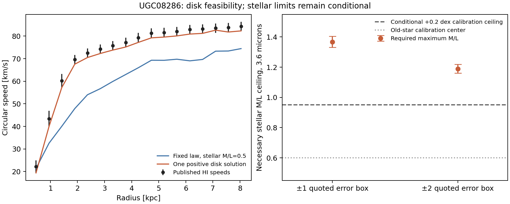

# UGC08286: positive extra mass is feasible; stellar-only closure is conditional

20 October 2026. Checkpoint `ugc08286-profile-2026-10-20`.
Assessment base `e8bb2ae70ad6b2c86790b9312861ac2269227f71`.
[Exact target and non-claims](TARGET.md).

**The requested disk inversion was run.** At the fixed canonical law,
distance and stellar baseline, a positive finite extra disk can reproduce
the adopted rotation curve. One equal-width annular solution contains
`1.8549e9 Msun` within a radial support of `8.07 kpc`, with every model speed
inside its quoted one-error interval. This is an allowed inverse solution,
not a unique density, a new force prediction or a detection of memory.

Allowing *any* nonnegative annular stellar M/L gradient in the two declared
photometric reconstructions, with no smoothing or chosen gradient shape,
requires the following maximum local M/L ceilings at the nominal distance:

| Fixed canonical law, all 17 points | Range of minimum feasible ceilings over six interpolation/resolution models |
|---|---:|
| Exact central velocity values | 2.81–4.38 |
| Each speed in its quoted ±1-error box | **1.331–1.405** |
| Each speed in its quoted ±2-error box | **1.160–1.218** |

Units are `Msun/Lsun` at 3.6 microns. The exact-central-value fits are
sensitive to small-scale shape and are not interpreted as physical stellar
profiles. The error boxes are feasibility regions, not joint confidence
levels: the original HI samples are correlated.

Independent old-star population work supports a dust-corrected Chabrier
calibration near `0.6`, with approximately `0.1 dex` accuracy. The declared
generous `+0.2 dex` sensitivity ceiling is `0.95094`. None of the six nominal
canonical stellar-only models fits inside that ceiling, even using the
two-error box. But this is a **conditional calibration comparison**: an
intrinsic radial M/L profile with usable uncertainties was not recovered.
Extinction, clean-versus-total light, projection and IMF correspondence
are not established merely by quoting the calibration. The observations
therefore do not unconditionally force an extra component.

## Actual geometry and data authentication

UGC08286 is NGC5023, nearly edge-on. All 17 SPARC rotation/model points
match the primary machine table; three local copies also match the remote
file byte for byte. Published inputs are `D=6.50+/-0.21 Mpc`, inclination
`90+/-3 degrees`, `Rdisk=1.05 kpc`, and no bulge. The published vertical
stellar model is exponential, with the inherited scale-height relation
giving `h=0.2021477434 kpc`. Gas forces retain their signs, including the
outward contribution of exterior gas at the inner three points, and the
published helium correction.

The forward kernel integrates **finite annuli with a prescribed vertical
profile**, using the elliptic Newtonian disk force. Exterior annuli can
pull outward; a spherical inverse is not substituted for the disk. Kernel
controls include direct ring-volume integration, thin-disk limits,
normalization, adaptive vertical integration, and the analytic continuous
exponential disk. [Geometry/source record](data/GEOMETRY.md),
[kernel derivation and tests](kernel/REPORT.json).

The complete 65-point SPARC light profiles were acquired, but are projected
and not inclination corrected. Their intrinsic deprojection algorithm was
not authenticated. No fitted correction/renormalization was imposed.
The gradient test instead uses the 17 published corrected light samples
with fixed linear/loglinear interpolation, explicit central/outer
extrapolation, and three numerical resolutions. Their total luminosities
are `1.0047` and `1.0141` times the quoted total. At the finest resolution
the recomputed unit-M/L stellar speeds differ from the published template
by RMS `0.49 km/s`, maximum `1.40 km/s`; this residual geometric/model
uncertainty is retained rather than called exact deprojection.

## What is and is not forced by positive mass

The fixed-baseline comparison is the record's class-A additive Newtonian
surplus: `Vobs^2 = Vlaw[baryons]^2 + Vextra^2`. It is not a self-consistent
solution of a coupled nonlinear polarization action. Each extra source
coefficient is a nonnegative inferred annular mass. No new fitted physical
coupling, halo law, regularization length or stellar-gradient parameter
was introduced.

The primary 18 equal-width annuli give a feasible total-mass interval of
`1.8549e9` to `2.6781e9 Msun` in the quoted one-error boxes, **within that
specific basis and support**. Refining to 35 cells gives a minimum
`1.7725e9 Msun`. Those are neither a universal mass interval nor a unique
reconstruction.

A deliberately unrestricted alternate grid with a narrow terminal cell
has a positive source direction that leaves all 17 sampled forces
unchanged. Its maximum mass is unbounded in the finite-node problem.
Independent checks show large forces between the sampled radii, so this
is not a physical continuum force-free halo. Equal-width controls remove
that particular null direction, but some coarse/extended bases are
ill-conditioned or require enormous cancelling source masses. Solver
status 4 is retained as indeterminate, never relabeled infeasible.
This is why a smooth-looking fitted density or a single minimum mass
cannot be promoted into a discovered physical profile.

The additional radial-support scan tests whether a compact central
component can work. Its raw results and exact finite-matrix negative
certificates are in [the extent run](extent_run/results.json) and its
[separate audit](audit/EXTENT_REVIEW.md). The first positive canonical
witnesses use radial cuts `5.67–6.15 kpc` in the one-error boxes and
`4.25 kpc` in the two-error boxes. These are discrete tested support cuts,
not continuous confidence bounds. The independent audit verifies all 190
feasible cases and exact rational negative certificates for all 218
excluded finite binary64 matrix cases, including separate certificates
for 20 raw status-4 cases (their original solver statuses are preserved).
Thus every smaller *tested* canonical support cut through `3.78 kpc`
fails even in the two-error boxes for these declared bases; a tiny central
relic does not reproduce the residual in this control. Continuous/off-grid
source classes are not certified by these finite matrices. The fixed `.5` stellar baseline, prescribed
extra-component heights and finite annular classes remain part of this
support comparison. No all-geometry compact-source theorem follows.

## The independent stellar evidence was checked

Retrieved sources include optical radial colors, HST age-selected spatial
profiles, S4G 3.6/4.5-micron profiles and ICA stellar images, and a 2026
resolved-population study. They establish that independent resolved
observations exist; this is not a claim of their absence. They do not
supply a retrieved intrinsic radial M/L/error envelope sufficient to make
this inversion unconditional.

S4G's ICA stellar color is fixed across corrected regions by that
decomposition, so it cannot be treated as a measured radial stellar color
gradient. Its integrated stellar fraction cannot be multiplied into every
annulus. The narrow old-star M/L accuracy applies to cleaned stellar light,
not automatically to all observed SPARC light in an edge-on system.
[Exact constraints and calibration sources](stellar/CONSTRAINTS.md).

An independent population estimate quotes `log10 Mstar=8.75` at `8.59 Mpc`.
Distance translation gives `3.22e8 Msun` at `6.50 Mpc`. In our declared
photometric/disk models, a stellar-only explanation on the canonical footing needs at least
`1.065–1.171e9 Msun` in the one-error boxes, even with no M/L ceiling.
However, the external estimate integrates a finite analysis footprint
defined using an optical surface-brightness boundary; complete total-mass
coverage and an object-specific global mass error were not recovered.
It is a nominal aperture comparison, **not** a hard whole-galaxy upper
bound or a formal statistical rejection. [Global-mass source check](stellar/GLOBAL_MASS_NOTE.md).

## Reproduction, validation and physical limit

The corrected baseline runner reproduces AG4h's `Delta chi2=15.8620044`,
coherent offset and prior-free constant M/L exactly. It does not claim a
separate re-fit of AG4g's reported `+3.70` prior pull. The first baseline
attempt failed on a result-key mismatch and invalid low-M/L trials;
its source and failed manifest are retained, and no physical result uses it.

Completed runner records:

* [Baseline](baseline_run02/manifest.json).
* [Disk and gradient inversion](inversion_run/manifest.json): 108 additive
  cases and 432 stellar cases.
* [Boundary and total-stellar-mass controls](sensitivity_run/manifest.json).
* [Radial-support test](extent_run/manifest.json): 408 cases.
* Kernel and independent-audit runs are linked in their own records.

The independent audit reconstructs all main saved LP constraints and
primal/dual witnesses, with adaptive integration and independent Newtonian
integrals. Adaptive quadrature changes the nominal M/L ceilings by less
than `5e-9`; the photometric/kinematic assumptions dominate that numerical
error. The main field named `quadrature_delta_v2_bound` records only a
96-versus-192-order discrepancy, **not** a rigorous integration bound.
[Full finite-range audit](audit/AUDIT.md).
All nine completed runner manifests pass current-input/output validation;
two historical failed attempts remain excluded. All 218 inventoried files
in the six earlier packets are unchanged. [Verification record](VERIFICATION.json).

The original HI study sampled at half the beam spacing and explicitly
warns that the points are not independent. Edge-on extraction and the
HI/Halpha turnover disagreement are additional observational caveats.
No observed covariance matrix was supplied. Odd/even subsamples and
distance controls were calculated, not silently folded into a claimed
significance. The alternative acceleration footing remains separate;
some widened/subsampled controls can approach or enter the generous
stellar calibration envelope.

Later detailed HI modeling already exists: Kamphuis et al. (2013) fits
a line-of-sight warp and spiral structure, with central inclination
`88.5+/-1.3 degrees`, HI scale height `0.29+/-0.10 kpc`, and a lag that
changes with the adopted nonaxisymmetric model. Public HALOGAS cubes are
available, but a machine-readable full fitted ring curve was not recovered
in this pass. That model/cube comparison was not executed here, so the
SPARC inversion is not promoted into a test of every existing kinematic
reconstruction. The later paper's quoted parameter bounds are visual,
one-parameter deviations rather than a joint Gaussian covariance.
[Exact later-HI source check](data/LATER_HI_NOTE.md).

**Outcome:** positive finite extra mass is allowed, and the fixed primary
setup puts substantial pressure on ordinary calibrated stellar gradients.
Neither a unique remnant nor a physical polarization/memory state is
forced. The missing discriminator is an authenticated intrinsic stellar
mass profile and a full edge-on kinematic/vertical-force comparison, not
another fitted acceleration scale. [Continuation and exact limits](NEXT.md).
