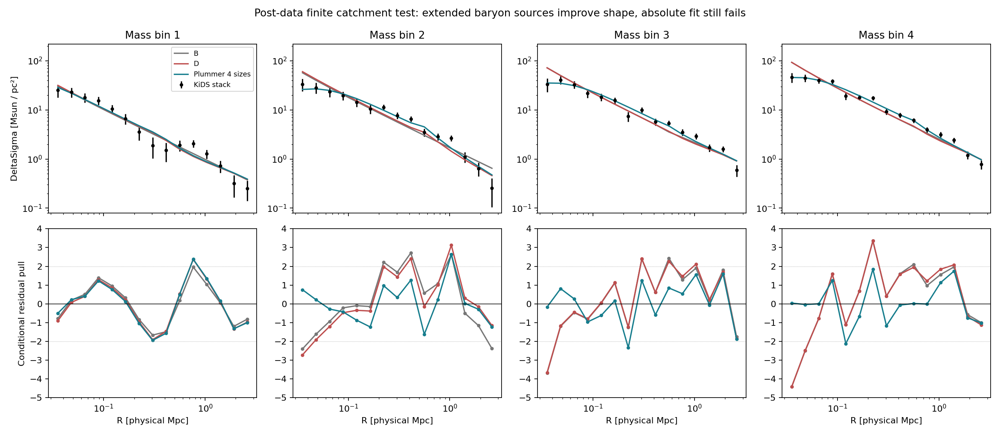

# Bounded round-four lensing execution

**The projection and continuous catchment comparison now have independent
numerical controls. The canonical source-unit finite catchment passes the
relative Δχ²≤4 rule but fails absolute fit quality decisively. A new,
self-consistent extended baryon source removes much of the mismatch, yet
all tested fixed/common/four-size versions still miss nominal p≥.01.**

This is an executed post-data successor, not a review or prospective test.
All additions are confined to this directory. Historical CFG804/805 code,
criteria, scores and failed sigma8 K2 remain unchanged. The old K2 is not
repaired by the new, separately defined projection control.

## Frozen conventions and actual computation

[POST_DATA_CRITERIA.md](POST_DATA_CRITERIA.md) was written before the first
new fit. [UNIT_DISPOSITION.md](UNIT_DISPOSITION.md) fixes the source-native
Msun/h retention convention as primary, using log10(h*Mta_phys/Msun),
h=.6736. Exact CFG416 criteria and code copies are under inputs. The old
physical-Msun argument is a fixed secondary sensitivity, never selected by fit.
This resolves the local source dictionary; it does not authenticate the
original observational census calibration or the central/all-baryon mapping.

Both point-source models profile four continuous galaxy masses and four
nonnegative environmental amplitudes using the supplied full covariance.
Masses lie in [9.5,12] log10 physical Msun. Four deterministic mass starts
use L-BFGS-B after exact whitened NNLS amplitude profiling; independent
least-squares checks the optimum. Tested starts agree within the declared
.05 χ² gate. This is tested convergence, not a proof of a global minimum.

The finite excess density is rho(s)=1/[2πs sqrt(1+4s²)], truncated at its
exact stock 5.364*N*Mb. No nearest-N profiles are used. Each trial mass
updates its represented edge and applies the same environmental exclusion
rule in both comparison families. The infinite B excess remains an
explicit nonfinite reference family. Its finite catchment exclusion rule
does not turn its own unbounded excess into an owned finite inventory.

The environmental template uses saved T1x P_grav at z=.2561784341,
piecewise-linear interpolation in native k, zero power outside the saved
band, and exp[-(.05k)²] smoothing. Physical data are evaluated at h70=1;
simulation h is separately .6736. No added low-k power, sigma8 rescaling
or new simulation was used. [DERIVATION.md](DERIVATION.md) records the
analytic point-source projection, finite-cylinder geometry, LOS kernel,
and the distributed-source mass derivative.

## Independent controls

| Control | Measured result | Gate |
|---|---:|---:|
| Zero-exclusion Hankel vs independent real-space xi/LOS | max relative 1.1725e-6 | ≤.01 |
| Refined Hankel vs refined real-space | 6.4563e-7 | ≤.01 |
| LOS refinement | 1.4856e-6 | ≤.01 |
| Finite exact-law one-halo vs direct density/cylinder quadrature | 1.6287e-13 | ≤.001 |
| Infinite one-halo vs independent quadrature | 2.3105e-9 | ≤.001 |
| Finite stock/edge identity | 2.2204e-16 | ≤1e-9 |
| Fitted exclusion-template refinement | 3.6303e-5 | <.01 |
| Max final χ² change on refinement | .0001834 | <.5 |
| Actual rho×2 mutation, both projection paths | exactly ×2 | >10% response |
| P-template×2 with NNLS amplitudes | biases exactly halved; χ² unchanged | invariance |

The initial controls_002 normalization entry was an algebraic value, not
an injected runtime mutation. That limitation is preserved and explicitly
disclosed in refinement_001, which executes the actual module-density
mutation through both numerical paths. The authoritative all-radius
[native_all_verified_001](native_all_verified_001/result.json) reruns the
complete fit after that supplementary control passed. The first launcher
attempt failed before computation due to an absolute output path; its
contract and [failure receipt](LAUNCH_FAILURE_001.md) are retained.

The no-exclusion mutation changes D's four fitted biases by
+1.19%, +29.45%, −6.77%, −6.10%. The predeclared any-bin >10% sensitivity
gate passes through bin 2; this is not an all-bin sensitivity claim.
No exclusion still has χ²_D=121.7890 and p=1.58e-7, and is an assumption
bracket rather than a finite-ownership rescue.

## Point-source comparison

| Convention / range | χ²_B | χ²_D | D−B | nominal p_D |
|---|---:|---:|---:|---:|
| Native Msun/h, all 60 points | 161.841092 | 165.358204 | +3.517112 | 9.7824e-14 |
| Native Msun/h, primary 32 points | 80.076100 | 79.042368 | −1.033732 | 8.6388e-8 |
| Legacy physical Msun, all | 159.462088 | 170.392998 | +10.930910 | 1.6501e-14 |
| Legacy physical Msun, primary | 80.076100 | 78.057035 | −2.019066 | 1.2372e-7 |

The nominal dof are 52 and 24, respectively. Nonnegative bias boundaries,
parameter profiling and post-data selection mean these are not calibrated
sampling p values. They are the frozen diagnostic convention, and the
large baseline discrepancy does not depend on a marginal threshold choice.
The relative native-unit gate passes while the absolute gate fails.

The verified native all-radius D fit is:

| Bin | log10 Mb/Msun | N | actual edge (physical Mpc) | fitted bias |
|---|---:|---:|---:|---:|
| 1 | 10.380297 | 10.0000 | .323673 | .195673 |
| 2 | 10.867868 | 10.0000 | .567404 | .182547 |
| 3 | 10.997395 | 8.26358 | .545327 | .470952 |
| 4 | 11.179003 | 6.46338 | .527331 | .480299 |

Bin 2 lies at the retention curve's declared piecewise transition, not a
nearest-N numerical grid. B masses are 10.358264/10.828764/11.000241/11.179225;
B biases are 0/0/.082457/0. With bias fixed to zero, native D−B=+101.7733;
the legacy continuous calculation gives +151.0390. The latter is a new
projection/representation result, not a reproduction or replacement of
the historical nearest-N +148.6910 score. The old K1 flag is not inherited.

## Actual full-covariance residuals

C is exactly symmetric and positive definite; min eigenvalue .0125919,
max 110.8265, condition number 8801.44, maximum cross-bin |correlation| .06020.
The exact signed additive bin partition for native D is
21.2510/38.6629/44.4060/61.0383, summing to 165.3582. Its nonadditive
conditional increments are 20.5338/37.2157/42.8232/59.4547. These are
different diagnostics; marginal block χ² values are not added as if independent.

The most extreme D conditional residual is −4.4162 in bin 4 at .03539 Mpc.
The inner R≤.12 Mpc signed contribution is 59.8710, intermediate
.12<R≤.76 contributes 54.2900, and outer R>.76 contributes 51.1972.
Thus the remaining mismatch spans the profile; a solely outer amplitude
explanation is insufficient. No morphology or gas identification follows.

[The machine-readable summary](summary_verified_001/result.json) saves
precision and whitened residuals for both comparison models and source
diagnostics. [The full prediction/residual table](summary_verified_001/predictions_residuals.csv)
contains all 60 radii per family; [the covariance](summary_verified_001/full_covariance.csv)
is retained. Each underlying comparison fit also contains its nuisance values, complete
predictions, one-halo and environmental templates, starts and convergence record.

## Executed physical profile falsifier

First, a diagnostic independent point/excess normalization at fixed fitted-D
shapes reduces χ² to 91.7013/48, nominal p=.0001486. The compact point
amplitude hits zero in bins 2–4, while excess amplitudes rise to
1.1655/1.2020/1.2527 times their baseline values. An independent point+1/R
shape still gives 121.1948/48, p=2.94e-8. These relaxations change physical
coupling and are shape probes only, not reciprocal new candidates.

Then [an additional post-data diagnostic](EXTENDED_PROFILE_DIAGNOSTIC.md)
was frozen before executing a **self-consistent distributed baryon source**.
For Plummer enclosed baryons b(y), the cold excess is recomputed as
[sqrt(b²+4b y²)−b]/2, differentiated to density, projected, and terminated
at exactly the same cold stock. The resulting actual edge is also used for
environmental exclusion. Both baryons and excess change reciprocally at
the level of the spherical acceleration algebra; the finite truncation and
template treatment remain conditional modeling assumptions.

| Source diagnostic | extra size freedom | χ² / nominal dof | nominal p |
|---|---|---:|---:|
| Point control | none | 165.3582 / 52 | 9.78e-14 |
| Fixed Plummer 5 kpc | none | 159.9262 / 52 | 6.51e-13 |
| Fixed Plummer 10 kpc | none | 145.6800 / 52 | 8.18e-11 |
| Fixed Plummer 20 kpc | none | 109.2949 / 52 | 5.89e-6 |
| One common fitted radius 35.33 kpc | one | 83.7763 / 51 | .002594 |
| Four fitted radii | four | 75.7342 / 48 | .006516 |

The fixed/common follow-up was separately declared before those fits in
[FIXED_SIZE_DIAGNOSTIC.md](FIXED_SIZE_DIAGNOSTIC.md). The four-size best fit
requires projected Plummer half-mass radii 12.19/42.29/37.89/37.80 kpc,
masses 10.410877/11.057031/11.178036/11.372269 log10 physical Msun, and
biases .197856/.166912/.444271/.432931. This points toward an extended
baryonic distribution as a specific profile-level ingredient. Actual
baryon/gas size and mass constraints have not been supplied or tested.

The source-family zero-size control matches the verified point result to
<3e-8 χ². Projection refinement is 3.96e-12 relative; cold boundary mass
residual <2.76e-14; tested density derivatives are positive. Direct fine
environmental evaluation at the optimum changes χ² by <3e-7. All four
starts and the independent optimizer agree. Remaining four-size signed
bin contributions are 21.0644/17.5552/19.4519/17.6627; the maximum
conditional pull is +2.6339 in bin 2 at 1.0365 Mpc.

Even this expanded family misses the fixed absolute gate. No extended-source
relative closure claim is made against the old point-source B family;
a matched reference would need the same source-size freedom. The outcome
is an ambitious executed profile falsifier and a constrained candidate
direction, not empirical rescue.

## Footing and reproducibility

T1x already has a numerical ownership assignment and per-host caps; its
criteria and source copies are pinned in source_footing. The missing
observational bridge is an ownership-consistent **isolation-selected
galaxy–matter cross-correlation**, not the absence of any partition algorithm.
Matter auto-power times fitted bias is not that measured cross-correlation.
The spectrum also retains inherited background/initial-condition footing.
This calculation supplies no microscopic production, finite energy/current
budget, formation timescale, common varied action or complete stability proof.

Every scientific command ran through the Mathbox bounded runner with fresh
output directories, 60-second wall cap, 55-second per-process CPU cap,
1-MiB log cap and conventional numerical-library thread variables set to 1.
No affinity or memory cap was requested; thread caps are cooperative and
the CPU limit is per process. No simulation steps were executed.
Each manifest stores exact argv, Git/dirty state, input hashes before and
after, result hashes, runtime and environment. All completed manifests are
validated with --root; inputs are copied from prior records rather than
depending on external data host paths. The final artifact summary is
summary_verified_001; summary_001 is a preserved earlier aggregate.

For replay, run run_bounded.py with a new --name and the corresponding
script/arguments from a saved contract; existing output names are refused.
All code, scientific inputs and convention files needed by those commands
are inside this directory. The recorded computation uses Python 3.9.6,
NumPy 1.26.2, SciPy 1.11.4 and Matplotlib 3.9.4; the provenance runner uses
Python 3.12.11. Numerical conclusions remain conditional on these tested
finite arrays, bounds, interpolation and library implementations.

Final self-review covered the new projection derivation, criteria and report:
one routine prose clarification; no mathematical-token changes. No unresolved
local notation or arithmetic typo was identified. This is a proofreading
check, not an additional proof audit. [FINAL_VALIDATION.json](FINAL_VALIDATION.json)
records the final manifest/hash checks.
