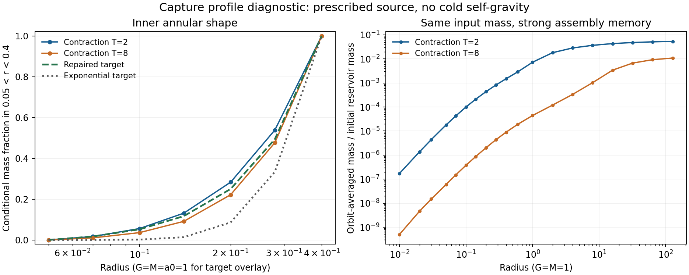

# Captured profiles: a limited shape match, strong memory, and a core constraint

2026-10-11. Base checkpoint: `a5e6e3696c2fe80dfcd1932c633f371f4b08d3c1`.
The previous goal turn was progress: it executed assembly capture and matched
the physical isolated/tidal inflow. This turn computes a predicted radial
profile and derives a separate continuum constraint. The full theory is OPEN.

**Results:** the captured population's conditional inner mass shape is closer
to the repaired kernel than to the raw exponential kernel in the specified
test. It does not select the required normalization: changing the contraction
duration changes inner retained mass by about a factor of 167. Separately,
a bounded collisionless DF with finite escape depth cannot reproduce the
law's exact central cusp around smooth cored baryons.

## A bounded three-dimensional incoming population

The previous finite planar orbit atoms did not define a bounded 3D phase-space
population. Here use constant `f=f_0` on the finite region

\[
 1.5\le r\le2.5,\quad .02\le E\le.8,\quad -1\le\mu\le0,
 \qquad \mu=v_r/v,
\]

and zero elsewhere. All spatial orientations and velocity azimuths are
included. Initial energy uses the Plummer source `G=M=1, b_i=.5`. Every
input trajectory is initially isolated-unbound and inward moving. The
reservoir mass is `.001`; an independent one-dimensional integral fixes
`f_0=3.016629088e-6`. This is a declared diagnostic input, not a measured
cosmic abundance or a physically inferred incident distribution.

The exact spherical phase-volume element is

\[
 d^3x\,d^3v=8\pi^2r^2v\,dr\,dE\,d\mu.
\]

Gaussian quadrature samples `(r,E,s)`, with `mu=s^2-1`, so the weight contains
`2s`. Spherical orientation averaging is exact for this DF and source.
Quadrature uses `n_r=n_E=n`, `n_s=4n`, at `n=4,6,8,10`, or
256, 864, 2048 and 4000 representative trajectories. The continuous input
DF and its normalization are the same on every grid.

The source contracts by the preceding cubic prescription to `b_f=.05` in
`T=2` or `T=8`. Tracers have no self-gravity; the source work is prescribed
and tracked. No desired halo profile enters the evolution or orbit weights.

## Predicted orbit-averaged mass

For each final negative-energy trajectory, conserve its actual final E and
angular momentum j. In the final spherical potential,

\[
 v_r^2=2[E-\Phi(r)]-j^2/r^2,\qquad
 P_i(<R)=\frac{\int_{r_p}^{\min(R,r_a)}dr/v_r}
 {\int_{r_p}^{r_a}dr/v_r}.
\]

The numerator is zero below pericentre and equals the denominator above
apocentre. Weight these CDFs by the incoming phase-volume masses. A sine
substitution removes the integrable endpoint singularities. This is a
phase-averaged profile, not evidence that actual finite-time mixing has
occurred. No particle weights are reassigned to fit a target.

Selected results:

| Quadrature n | T | Captured reservoir fraction | Annular CDF difference: exponential | Annular CDF difference: repaired |
|---:|---:|---:|---:|---:|
| 4 | 2 | .052123 | .20143 | .04117 |
| 6 | 2 | .055274 | .20573 | .04548 |
| 8 | 2 | .056984 | .20548 | .04523 |
| 10 | 2 | .055814 | .20516 | .04491 |
| 4 | 8 | .012777 | .22330 | .06304 |
| 6 | 8 | .012570 | .14157 | .02860 |
| 8 | 8 | .012694 | .13435 | .03275 |
| 10 | 8 | .012801 | .14301 | .02822 |

**Exact meaning of the shape statistic:** on the seven stored radii in
`.05 <= r <= .4`, compare
`[M(r)-M(.05)]/[M(.4)-M(.05)]` with the same expression for the target.
The statistic is the maximum absolute difference at those radii. It discards
mass inside `.05` and normalizes the remaining annular mass. It is not a
relative density error, a force error, a full cumulative-profile agreement,
or a statistical goodness-of-fit. There is no fitted a0: `a0=1` is a declared
overlay and was not generated by the dynamics. The two kernels follow the
definitions in the prior [kernel audit](../orbit_selection_2026_10_11/SOURCES_AND_KERNEL.md).

The finer grids support the direction of the comparison but do not certify
continuum convergence, especially across the capture boundary. At n=10,
`M(<.4)=1.49929e-6` for T=2 and `8.99229e-9` for T=8: a ratio about 167.
Total retained mass changes by a much smaller factor, about 4.36. Thus even
similar conditional inner shapes conceal strong assembly memory. Both use
the same initial population, initial/final baryons and source mass.

Absolute target amplitudes have not been achieved. For example the repaired
target with the diagnostic a0 has `M_c(<.4)=.10648`. Increasing the tracer
weights to force that amplitude would require re-evolving their gravity;
it is not a valid shortcut to a self-consistent galaxy. The repaired target
at that radius carries roughly 11% of enclosed baryonic mass, whereas this
experiment deliberately remains in a low-mass tracer regime.

The raw exponential target also decreases on part of the inner full grid:
`M_c(.01)=1.27575e-6`, `M_c(.02)=6.23383e-7`. That demands negative effective
cold density somewhere between them for this extended Plummer source.
A positive cold DF cannot realize that entire raw target. The comparison
annulus `.05--.4` is monotone; the repaired target avoids this particular
negative-density problem. Do not transfer a point-source hollow calculation
through extended baryons without this check.

## An exact constraint beyond the finite experiment

The [core derivation](CORE_CONSTRAINT.md) establishes a distinct local result.
For smooth baryons `g_N~Ar`, both kernels give

\[
 M_c(<r)\sim\frac{\sqrt{a_0A}}G r^{5/2}.
\]

A bounded fine-grained mass DF plus finite escape speed instead implies a
finite central density and `M_c(<r)=O(r^3)`, even with anisotropy, retention
selection and normalized time averaging. Exact-to-origin equality is
therefore impossible in that class. This is not an observational exclusion
on any finite annulus without a physical phase-space ceiling.

A positive local isotropic construction for the target in its **full
self-consistent potential** has
`f(epsilon) ~ const (Psi_0-epsilon)^(-11/6)`. Its phase-space peak diverges
but its mass remains finite. In the baryon-only harmonic tracer potential,
the corresponding exponent would be `7/4`; using that value for the full
cusp would be incorrect. The coefficients and hypotheses are in the linked
derivation. These are inverse requirements of the supplied law, not a
derivation of its form or identification of a particle/field.

## Evidence, limits and next decision

[run](run/manifest.json) passes 37/37 checks and
[refinement_run](refinement_run/manifest.json) passes 24/24. Checks cover
source-work and angular-momentum conservation, independent initial mass
normalization, radial quadrature, a known Kepler CDF and period, rejection
of uniform-anomaly weighting, tighter integration and positive Abel endpoint
normalizations. Maximum source-work residual is `1.34e-8`; the smallest
absolute final sampled energy is `1.59e-5`, above the `1e-7` classification
margin. Both manifests validate against their current input/output hashes.

Independent review checked the 3D measure, turning-point brackets, dwell-time
weighting, exact central obstruction and Abel coefficients. The remaining
numerical risks include narrow unresolved capture regions, finite quadrature
and loss of precision for nearly degenerate turning points; 96/192-node
agreement is evidence for these samples, not a rigorous interval enclosure.
The plot is generated from saved results by [plot.py](plot.py), without a new
evolution or fit.

**Decision:** keep capture as an executed mechanism, but do not identify it
with universal settling. The next substantive route is whether self-gravity
and a finite baryonic assembly reservoir erase the observed history dependence
without imposing the desired density. The exact-core branch additionally
requires either a singular cold initial state/other dynamics or a physical
regularization of the law. Those are distinct hypotheses to test, not
interchangeable names for a solved carrier.

The cold abundance, vacuum coupling, kappa=1/2, global action, physical
stellar population and observational closure remain unresolved. No frozen
criterion or other research lane was changed.
