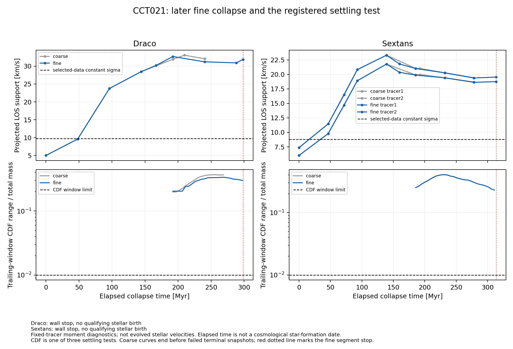

# CCT021 — later fine collapse

Start with [RESULTS.md](RESULTS.md), [NEXT.md](NEXT.md), [CONTROL_BRIDGE.md](CONTROL_BRIDGE.md), and [STAR_FORMATION_CONTEXT.md](STAR_FORMATION_CONTEXT.md). The registered physical and birth criteria remain unchanged; only this foreground segment's computational cap increased.

Canonical evidence: `Draco_fine_late`, `Sextans_fine_late`, `analysis_001`, `controls_002`, `figure_001`, `audit_001`. `VALIDATION.json` records all seven manifest checks, including the retained failed alias execution `controls_001`. Preflights are setup only.

Neither fine run settled or inserted stars by 298.57 / 313.66 Myr. Both ended at the declared wall budget with invariants intact. Later convergence, actual star-formation chronology, stellar safety, spin/energy escape, reciprocal coupling and four-dwarf closure remain unresolved.

