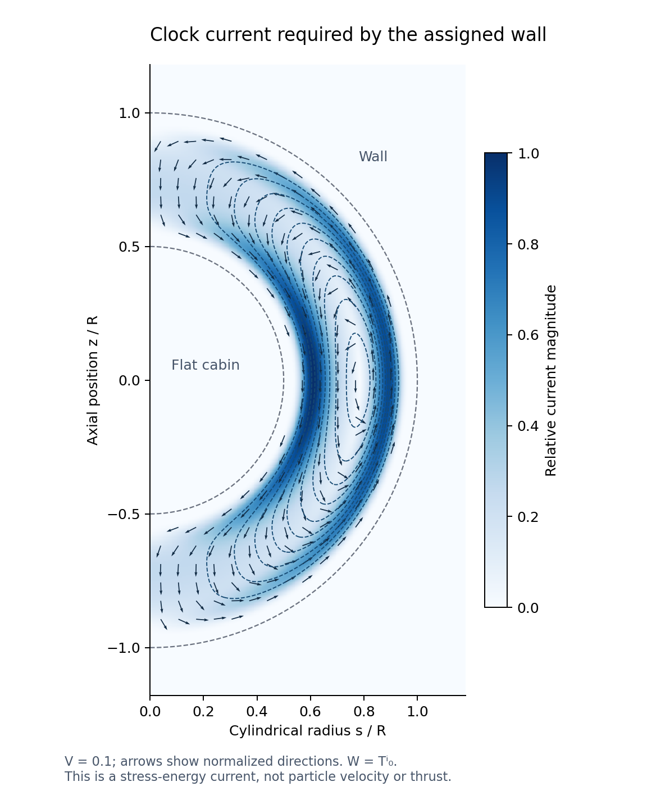

# Nonlinear clock consistency and the wall's geometric current

2026-10-15. Continues [CHB](../cold_harmonic_boundary_2026_10_15/REPORT.md), commit 8b5201869904120885d5b5eb502b693f5e93ce5a. The first run observed shared HEAD 283acbcffe1c6c4a5e8f9860f66e43c4e3808ab3. The original physical propulsion goal remains open.

## What the nonlinear calculation establishes

The proper-source replacement's lapse factorization is valid, but the resulting Hamiltonian constraint is **not first class modulo itself**. An exact diagonal planar calculation, with metric variations taken before any flat substitution, gives on a constraint-compatible family

\[
\{\mathcal C[n],\mathcal C[m]\}\approx\int(nm'-mn')P_z\,dz.
\]

P_z is not an independent constraint in the material interior; the shift equation had solved it algebraically. Preservation therefore requires a lapse consistency condition, rather than allowing the inference that lapse linearity has already removed the unwanted mode. This is not an automatic ghost result. A full Dirac algorithm may impose further restrictions and must classify the resulting constraints and kernels.

The calculation has also been extended to arbitrary positive diagonal spatial metrics, not just γ=I. Its exact coefficient is −Wz+s^z C, where s=β/N. On the constraint surface this agrees with a separately derived all-three-dimensional clock equation.

## A precise geometric connection

For the pure core action F(ΦI,B,C), direct variation of the normalized clock yields

\[
\partial_i(N^2W^i)=0,\quad
W^i=\sqrt\gamma\,\gamma^{ij}(F_{B^j}+2F_{C^{jI}}B^I).
\]

This is a condition that any admissible core evolution must satisfy. It is not a new propulsion force law. A point where W vanishes must also have div W=0 to admit a positive regular lapse. An explicit smooth momentum family satisfies the bare Hamiltonian constraint but fails this condition, demonstrating why admissible data require more than C=0.

On the assigned stationary wall, N=1 and W^i=T^i{}_0. The conventional Killing-energy current associated with the chosen time generator is −Tμ{}_0; this sign and frame convention matter. Writing Ψ=b+b³/3 for the target shift profile gives the exact expression

\[
\boxed{\mathbf W={M^2\over2}(\Psi_{xz},\Psi_{yz},-\Psi_{xx}-\Psi_{yy}).}
\]

It is identically divergence-free, and its derivatives are confined to the wall. For a radial profile its meridional streamfunction is χ=−M²s Ψs/2. Regular nonzero contours form closed current orbits within the transition.

The image uses one smooth radial profile, V=0.1 and arbitrary normalized units. Arrows are normalized current directions. This is not a particle trajectory, a prediction of material flow speed, a stability test or a thrust plot. The chosen profile has gtt<0 everywhere; obtaining this current requires no Killing-horizon crossing or intrinsic sphere-curvature activation threshold. The relation is a consequence of the prescribed metric and its required Einstein stress, rather than a demonstrated way to produce that stress from cold energy.

## Why the closed loops matter dynamically

Linearizing the pure-core clock equation about the stationary target gives

\[
2\mathbf W_*\cdot\nabla\delta N+\nabla\cdot\delta\mathbf W=0.
\]

Around each regular closed current orbit, the integrated divergence forcing must vanish for δN to be single-valued. There is also a homogeneous kernel: any axisymmetric δN=F(χ) is constant along current lines. Such functions can vanish outside the wall, so an asymptotic clock condition alone does not remove this kernel from the clock equation.

The rest of the constraint algorithm must determine whether these functions are fixed, constrained or gauge, and which perturbations obey the compatibility condition. No healthy degree-of-freedom count, nonlinear evolution theorem or curved spectral stability follows yet. An operating controller adds extra clock-variation terms; the pure-core equation cannot be applied unchanged to a powered launch.

## Evidence and status

[PROOF.md](PROOF.md) gives the complete local algebra, clock variation, geometric current and closed-orbit implications. [REVIEW.md](REVIEW.md) is an adversarial self-review; no independent reviewer or novelty search is claimed.

- [Algebra v1](run_v1/calculation/results.json): 14 exact checks, including all six Euler functional derivatives and the Poisson bracket modulo a total divergence.
- [General bracket v1](general_run_v1/calculation/results.json): two exact identities for arbitrary positive diagonal metric functions and momenta in the stated planar sector.
- [Clock v3](clock_run_v3/calculation/results.json): 18 exact checks, including source/current conversion, divergence, streamfunction, lapse obstruction and linearized kernel.
- [Plot run](plot_run_v1/calculation/results.json): a reproducible illustration using analytic radial derivatives; visually inspected.

Clock v1 executed its assertions but omitted their counter increments, so its stored check count is zero and is not used as the final count. Clock v2 failed after a reused coordinate symbol mixed the axisymmetric and momentum-bump variables. V3 fixes that implementation issue and records all 18 checks. Both prior runs and raw failure remain frozen.

The old finite clock-mass construction remains refuted as before. The proper-source replacement now has a derived nonlinear consistency condition and an explicit geometric current. Its complete constraint classification, curved stability, physical negative-stress source, and powered payload evolution remain unresolved. No cold-energy fuel or working drive has been established.
