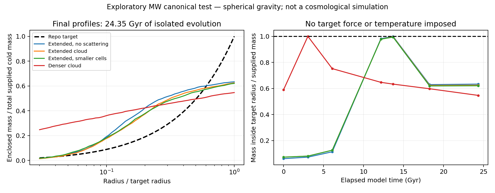

# Unforced halo formation: first finite test

12 October 2026

The tested carrier dynamics do not reproduce the frozen CFG626 Milky Way canonical target. This is a negative result for these initial conditions and numerical approximations, not a proof that every realization of the carrier theory fails.

## Model and comparison

The calculation evolves full three-dimensional particle positions and velocities with spherical monopole self-gravity, a fixed softened baryonic potential, and optional isotropic elastic scattering. The low-speed cross section is 4 cm²/g, with the alpha=2 candidate's below-resonance energy dependence. Neither the target density nor a target temperature enters the evolution. The target is used only for scoring.

The target radius is 514.318 kpc, velocity unit 165.240 km/s, and time unit 3.04345 Gyr. Initial particles occupy a uniform sphere of radius either 2.43039 or 1.2 target radii, with isotropic one-dimensional velocity dispersion 0.05 velocity units. All particles remain in the calculation; crossing the target radius does not delete them. Both starts have the same supplied mass but different energies.

The final time is 8 model units, or 24.35 Gyr of isolated evolution. This is an exploratory integration duration, not an assertion about the age of an observed galaxy. At 4.5 units (13.70 Gyr), the extended refined cases contain about 99.4–99.7% of the supplied mass inside the target radius, but already have maximum enclosed-mass errors of 30.3–31.1% of supplied mass.

## Final results

Mass errors compare cumulative profiles over 0.03–1 target radii (about 15.4–514 kpc). They do not test the inner rotation-curve region. Acceleration errors are RMS differences in log10 total acceleration over the sampled radii.

| Case | Particles | Mass inside target radius | Maximum mass error / supplied mass | RMS log10 acceleration error | Maximum sampled relative energy drift |
|---|---:|---:|---:|---:|---:|
| Extended, base | 2048 | 62.793% | 37.207% | 0.2333 | 0.0800% |
| Extended, collisionless | 2048 | 63.330% | 36.670% | 0.2117 | 0.1179% |
| Extended, refined | 4096 | 62.476% | 37.524% | 0.1857 | 0.00836% |
| Extended, smaller collision cells | 4096 | 62.061% | 37.939% | 0.1940 | 0.02696% |
| Compact, base | 2048 | 52.148% | 47.852% | 0.4963 | 1.169% |
| Compact, refined | 4096 | 54.663% | 45.337% | 0.4933 | 0.1738% |

The extended runs put about 38% of supplied mass outside the target radius by the final time. This is not necessarily unbound mass. Their collisionless control behaves similarly. The compact runs produce a different profile and a larger discrepancy. There is no demonstrated common target attractor here.

## Numerical scope and provenance

The base timestep is 0.001 model units; refined runs use 0.0005. Collision-cell widths are 0.05 or 0.025 target radii. Gravity softening is 0.01 target radii. The stochastic collision estimator uses randomly shifted cells, disjoint random pairings, and pair-count corrections. Individual collisions conserve pair momentum and kinetic energy.

The first script, `halo_formation_probe.py`, completed four cases, then stopped when the compact initial condition exceeded its collision-probability limit. Its incomplete run is preserved in `halo_formation_probe_run/`. The revised `halo_formation_probe_v2.py` uses adaptive collision-only substeps, retaining the four completed cases and calculating the two compact cases. Its run in `halo_formation_probe_v2_run/` completed all 13 numerical checks, and its manifest validated. These checks concern implementation and finite numerical behavior, not successful target formation.

Important limits:

- Spherical gravity suppresses nonspherical instabilities. Baryons are fixed, with no response.
- The calculation has no cosmological expansion, accretion, or cosmological initial perturbations. The dilute production calculation does not derive these halo initial conditions.
- Only one random seed was tested. Timestep, particle count, and collision-cell variations give limited resolution evidence, not full convergence.
- Collisions between separated particles inside a cell need not conserve global angular momentum exactly. Smaller cells probe this approximation only partially.
- Compact mean collision counts change from about 50 to 89 per particle under refinement; the detailed collision history is not converged.
- The stored field named `virial_2K_over_absW` is an energy ratio, not the correct external-potential virial diagnostic. It must not be cited as evidence of virial equilibrium.

## Consequence for the formulas

The action, near-threshold production, charge conservation, and scattering formulas remain a candidate description of a prepared cold carrier. This test supplies no derivation of the repository's halo law or its acceleration scale. The missing result is a physical mechanism that selects the target across systems and initial conditions. Inserting the target into a relaxation term would not establish that result.

The consolidated equation source is `COLD_ENERGY_EQUATIONS.tex`. The plot is reproducible with `plot_halo_formation.py` from the saved v2 results.
