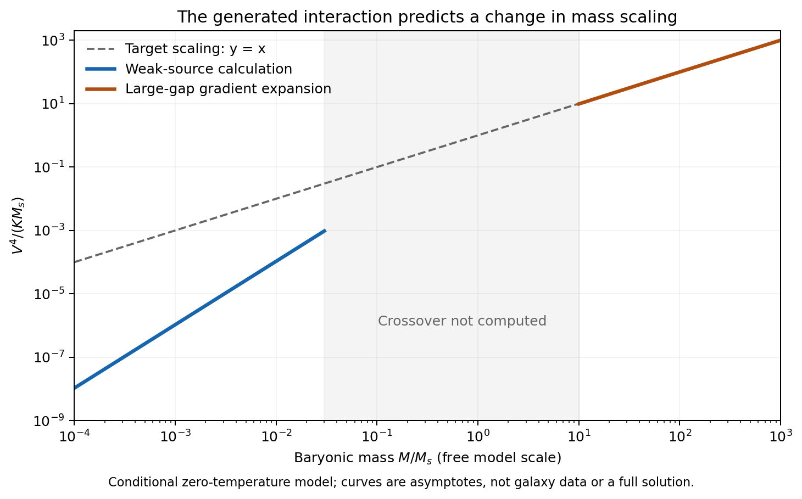

# Cold energy: consolidated equations, evidence and open closure

12 October 2026. Publication checkpoint for the owner's requested one-document consolidation. **This is the consolidated equation inventory of the candidate and follow-ups developed in this lane, not a claim that a complete physical theory has been solved.** Historical scripts and alternative models remain linked rather than silently combined.

Status key: **MODEL** = specified action, state or closure; **DERIVED** = consequence under explicit assumptions; **TARGET** = empirical/fitted relation to be explained; **OPEN** = no completed derivation. Lean checks implications, not physical existence or observational truth.

- Carrier action, production and bounds: MODEL → conditional DERIVED results.
- Fermion–polarization sector: a separate MODEL with conditional DERIVED response; its connection to the carrier is OPEN.
- Galaxy law and vacuum normalization: TARGET; the microscopic selector and kappa are OPEN.
- Edge transport: conditional MODEL; the drift audit below prevents mistaking a selected coefficient for a prediction.
- Formal record: **36 Lean theorems** across the architecture (18), transport (13), and drift audit (5), with **nine rejected damaged-proof controls**. Their exact scope is listed below. The carrier quantum inequalities and full stochastic calculus are not among these Lean certificates.

The main synthesis below retains its original formulas and scientific qualifications. The final sections add the missing explicit transport, gravity, source-production and audit equations in consistent local notation.

Research synthesis dated 12 October 2026. This account combines the carrier, production, force-generation and dynamical calculations in this research lane. It is a candidate framework with explicit missing connections, not a completed unified theory or an experimental discovery.

The strongest result is a division of the problem into two calculable mechanisms. A charge-conserving scalar interaction can convert prepared sources into massive, low-pressure excitations without violating energy conservation. Separately, a proposed fermion medium generates a positive cubic polarization energy and a passive dynamical response. That response can produce an additional inverse-radius force, but its mass dependence changes between controlled regimes. The framework does not yet derive the existence of the medium, connect it to the scalar carrier, or fix the vacuum-linked acceleration scale.

## Physical meaning and target

“Cold energy” here means energy carried predominantly as rest mass, with small material pressure relative to energy density. It does not mean negative temperature, negative energy, or a source of energy without an input. Low pressure at production also does not establish cosmological cold dark matter: free streaming, abundance and structure formation must be calculated.

The galactic target is

$$
g_b(r)=\frac{G_NM_b(<r)}{r^2},\qquad
g_{\rm target}=\nu(g_b/a_0)g_b,
$$

with the deep-acceleration behavior

$$
g_{\rm target}\simeq\sqrt{a_0g_b},\qquad
V_f^4=G_NM_ba_0.
$$

The repository proposes

$$
a_0=\kappa c\sqrt{G_N\rho_{\rm DE}},\qquad \kappa=\tfrac12,
$$

where rho_DE is mass-equivalent vacuum density. In this research lane that normalization is a target input, not a derived result. The full repaired interpolation kernel is recorded in [the earlier carrier equation document](COLD_ENERGY_EQUATIONS.tex); the new force calculations do not derive that kernel.

## Components and notation

Natural units hbar=c=k_B=1 apply to microscopic equations unless SI units are stated. In the nonrelativistic medium, v is a band velocity and need not equal the speed of light.

| Symbol | Meaning |
|---|---|
| Phi, X | Complex daughter and source carrier fields, charges one and two |
| m, M, g_c | Daughter mass, source mass and source-conversion coupling |
| u_*, Delta_c | Daughter momentum divided by m, and M^2-4m^2 |
| psi, b | Nonrelativistic daughter and source annihilation fields |
| varphi, P | Additional scalar force potential and vector polarization |
| C, q_b | Positive force-sector stiffness and baryonic scalar coupling |
| Psi, m_*, k_0, v, h | Fermion field and parameters of its nodal-ring Hamiltonian |
| beta_3 | Coefficient of the generated cubic polarization potential |
| Z_varphi, I_P | Positive bare time-kinetic coefficients of the force fields |
| Phi_N | Ordinary Newtonian gravitational potential |

The notation avoids collisions in the earlier notes: their carrier phi becomes Phi, their force phi becomes varphi, their force stiffness a becomes C, their baryonic coupling alpha becomes q_b, and their cubic beta becomes beta_3. The carrier coupling ratio is called r_lambda below. No parameters from the two sectors are identified by these renamings.

## Charge protected scalar carrier

Choose positive m, Delta_c and lambda_rep, with

$$
M=2m\sqrt{1+u_*^2},\quad
\Delta_c=M^2-4m^2=4m^2u_*^2,\quad
\lambda_{\min}=g_c^2/\Delta_c,\quad
\lambda_{\rm tot}=\lambda_{\min}+\lambda_{\rm rep}.
$$

The proposed relativistic carrier Lagrangian is

$$
\mathcal L_c=\partial_\mu\Phi^*\partial^\mu\Phi+
\partial_\mu X^*\partial^\mu X-V_c,
$$

$$
V_c=m^2|\Phi|^2+4m^2|X|^2+
\left|\sqrt{\Delta_c}X+\frac{g_c}{\sqrt{\Delta_c}}\Phi^2\right|^2
+\lambda_{\rm rep}|\Phi|^4.
$$

With metric signature (+---), its field equations are

$$
(\Box+m^2)\Phi+2g_cX\Phi^*+2\lambda_{\rm tot}|\Phi|^2\Phi=0,
\qquad (\Box+M^2)X+g_c\Phi^2=0.
$$

The transformation (Phi,X) to (exp(i theta)Phi,exp(2i theta)X) preserves the action. The conserved charge and positive-square potential give E greater than or equal to m|Q| in the stated isolated, nongravitating classical theory. They do not permit extracting unlimited kinetic energy by repeated source conversion.

At a fixed finite regulator the leading nonrelativistic Hamiltonian has a stronger operator statement. Define

$$
\delta=M-2m,\quad c_3=\frac{g_c}{2m\sqrt{2M}},\quad
k_c=\frac{\lambda_{\rm tot}}{4m^2},\quad
Q=\int(\psi^\dagger\psi+2b^\dagger b)\,d^3x.
$$

Then H=mQ+D_c, with

$$
D_c=T+\int\delta\left(b+\frac{c_3}{\delta}\psi^2\right)^\dagger
\left(b+\frac{c_3}{\delta}\psi^2\right)d^3x
+\left(k_c-\frac{c_3^2}{\delta}\right)\int\psi^{\dagger2}\psi^2d^3x,
$$

$$
k_c-\frac{c_3^2}{\delta}
=\frac{\lambda_{\rm rep}}{4m^2}
+\frac{g_c^2}{8m^2M(M+2m)}>0.
$$

Consequently 0 <= <T> <= <D_c>. For N initially resting sources, Q=2N and D_c=delta N, so the initial excess-energy fraction is delta/(2m), approximately u_*^2/2. This regulated result is not a continuum quantum-field-theory proof. Adding gravity or another interacting sector requires accounting for its energy; the carrier-only bound cannot automatically be transferred to the combined system.

Here the nonnegative kinetic operator is

$$
T=\int\left[\frac{|\nabla\psi|^2}{2m}+\frac{|\nabla b|^2}{2M}\right]d^3x.
$$

The interaction-inclusive volume-averaged pressure bound is also available. Put r_c^2=c_3^2/(delta k_c)<1 and

$$
b_\pm=\frac12\left(1\pm\frac1{\sqrt{1-r_c^2}}\right),\qquad
d=\frac{\langle D_c\rangle}{m\langle Q\rangle}.
$$

Under the fixed-regulator homogeneous-expansion assumptions,

$$
b_-D_c\le PV\le b_+D_c,\qquad
\frac{|P|}{\rho_E}\le\frac{b_+d}{1+d}.
$$

Here P is scalar material pressure, distinct from the bold polarization vector. This is not a sound-speed or perturbation-transfer-function bound. Derivations and assumptions: [quantum energy](NR_QUANTUM_BOUND.md) and [quantum pressure](NR_QUANTUM_PRESSURE.md).

## Production and scattering

A resting source can decay into two daughters with

$$
p_*=m u_*,\quad
v_*=\frac{u_*}{\sqrt{1+u_*^2}},\quad
\frac{P_{\rm free}}{\rho_E}=\frac{u_*^2}{3(1+u_*^2)},
$$

$$
\Gamma_c=\frac{g_c^2}{8\pi M}\sqrt{1-\frac{4m^2}{M^2}},
\qquad \tau_c=\hbar/\Gamma_c.
$$

The decay transfers energy already stored in the source. Preparing the source and its charge is an unresolved physical input. A finite Hermitian source–pair model gives daughter-pair probability 0.9999549 after ten nominal lifetimes at its finest tested grid, while conserving total probability and Hamiltonian energy. This is a one-source resonant-band calculation, not a cosmological yield or many-source field solution. See [unitary production](DILUTE_UNITARY_DECAY.md).

Away from the source pole, the tree-level scattering screen uses

$$
x=\frac{s-4m^2}{\Delta_c},\quad
\lambda_{\rm eff}=\lambda_{\min}\left(r_\lambda-\frac{x}{1-x}\right),\quad
r_\lambda=\lambda_{\rm rep}/\lambda_{\min},
$$

$$
\sigma_0=\frac{\lambda_{\rm rep}^2}{8\pi m^2},\qquad
\frac{\sigma(s)}{\sigma_0}
=\left(\frac{\lambda_{\rm eff}}{\lambda_{\rm rep}}\right)^2\frac{4m^2}{s}.
$$

A bare pole cannot be integrated as a physical collision rate. The resonance requires finite-width treatment, and real-source conversion must not be counted a second time as a separate process in the same inclusive rate.

The revised screening benchmark is m=1 MeV, u_*=0.02, r_lambda=2 and sigma_0/m=0.3 cm^2/g. It gives g_c about 2168 eV, lambda_tot about 0.00881292, lifetime about 3.52096e-13 seconds, and free pressure/energy about 1.33280e-4. Its daughters initially move at about 0.02c. A specified running-width and Maxwell-distribution calculation gives effective cluster scattering about 0.28761 cm^2/g at mean relative speed 1900 km/s.

This branch was chosen after the larger cross section encountered a cluster constraint. It is not an independent prediction or a globally allowed dark-matter model. The earlier 4 cm^2/g halo simulations and the older unitary-production benchmark must not be relabeled as calculations of the revised branch. Source epoch, abundance and free streaming are still missing. See [the resonance audit](empirical_2026_10_12/RESONANCE_FOLLOWUP.md).

## Why ordinary carrier evolution did not finish the mechanism

The dilute carrier's Newtonian starting equations are a kinetic equation and Poisson equation,

$$
\partial_t f+\mathbf v\cdot\nabla_x f-
\nabla\Phi_N\cdot\nabla_v f=C_{22}[f],\qquad
\rho_c=m\int f\,d^3v,
$$

$$
\nabla^2\Phi_N=4\pi G_{\rm grav}(\rho_b+\rho_c)
$$

for the original carrier-only Newtonian model. Elastic collisions conserve local mass, momentum and kinetic energy. Their redistribution of energy does not select a universal halo normalization by itself.

The performed isolated formation, gas-cycle and rotating-source tests did not select the target profile. Some configurations gained energy; others cooled because the source history and orbital phases mattered. Distinct initially settled halos retained substantial profile differences. A fixed rotating driver could demand more angular momentum than its nominal reservoir. These are failures of the tested finite setups, not a proof that cosmological assembly cannot work. Evidence: [formation](HALO_FORMATION.md), [settled halos](mechanism_2026_10_12/SETTLED_HALO_RESULT.md), and [torque](mechanism_2026_10_12/TORQUE_RESULT.md).

This motivates investigating an additional response field. It does not justify inserting the target halo density into the kinetic equation and calling it a prediction.

## Additional force sector and its microscopic candidate

A phenomenological force sector uses

$$
\mathcal L_{\varphi P}=
\frac{Z_\varphi}{2}\dot\varphi^2+\frac{I_P}{2}|\dot{\mathbf P}|^2
-\frac C2\left|\nabla\varphi-\frac{\mathbf P}{C}\right|^2
-q_b\rho_b\varphi,
$$

with C,Z_varphi,I_P positive. Extra counterterms and the fermion determinant complete this candidate effective action. The square makes a particular critical relation between quadratic coefficients explicit; no symmetry has yet been shown to protect it.

The new fermion Hamiltonian is

$$
H_F=\frac{k_x^2+k_y^2-k_0^2}{2m_*}\Gamma_1
+vk_z\Gamma_2+h\sum_{j=1}^3P_j\Gamma_{j+2},
\qquad \{\Gamma_i,\Gamma_j\}=2\delta_{ij}.
$$

An explicit four-component representation is Gamma_1=sigma_x tensor 1, Gamma_2=sigma_z tensor 1, and Gamma_3,4,5=sigma_y tensor (sigma_x,sigma_y,sigma_z). The eigenvalues are

$$
E_\pm=\pm\sqrt{q_1^2+q_2^2+\Delta_f^2},\quad
q_1=\frac{k_x^2+k_y^2-k_0^2}{2m_*},\quad
q_2=vk_z,\quad \Delta_f=h|\mathbf P|.
$$

At P=0 the bands touch on a momentum-space ring. Assume N=2 filled negative-energy bands, zero temperature and chemical potential at that touching energy. For an energy tube Lambda below k_0^2/(2m_*), define A=N m_*/(2 pi v). Integrating the occupied bands gives

$$
V_F(\Delta_f)-V_F(0)=
-\frac A3\left[(\Lambda^2+\Delta_f^2)^{3/2}-\Lambda^3-|\Delta_f|^3\right].
$$

After subtracting the analytic quadratic term, the leading nonanalytic term is

$$
V_{F,\rm ren}=\frac{\beta_3}{3}|\mathbf P|^3+\cdots,
\qquad \beta_3=Ah^3=\frac{Nm_*h^3}{2\pi v}>0.
$$

The cubic sign and coefficient are calculated consequences of this band model. The quadratic counterterm, existence of the medium, occupation state, and symmetry protection of the ring are separate assumptions. The cubic term is not also added as an independent bare interaction when retaining the same fermions; that would double-count its contribution.

Before eliminating the fermions, the force-sector equations can be written as

$$
i\partial_t\Psi=H_F(-i\nabla,\mathbf P)\Psi,\qquad
Z_\varphi\ddot\varphi-\nabla\cdot(C\nabla\varphi-\mathbf P)=-q_b\rho_b,
$$

$$
I_P\ddot P_j+P_j/C-\partial_j\varphi
+h\langle\Psi^\dagger\Gamma_{j+2}\Psi\rangle
+\frac{\delta E_{\rm counterterms}}{\delta P_j}=0.
$$

The expectation value requires the specified fermion state and regulator. Replacing it by a local cubic derivative or a retarded linear kernel is an approximation to these equations, not an additional independent force. Live baryons would require their own coupled equations; the fixed-source calculations prescribe rho_b.

The Hamiltonian is local as a nonrelativistic differential operator. Its regulated band interpretation is not a relativistic ultraviolet completion. Nodal rings observed in ordinary solids provide an analogy, not evidence for a cosmic dark medium. Derivation, matrix representation and thermal tests: [fermion origin](mechanism_2026_10_12/NODAL_RING_ORIGIN.md).

## Static force and mass dependence

Define

$$
\mathbf D=C\nabla\varphi-\mathbf P,\quad
\nabla\cdot\mathbf D=q_b\rho_b,\quad
\mathbf g_s=-q_b\nabla\varphi,\quad
\mathbf D/C=\delta F_F/\delta\mathbf P.
$$

In the local cubic approximation, D/C=beta_3 |P|P. Outside a spherical baryonic source,

$$
\mathbf P=\frac B r\hat{\mathbf r},\quad
B=\sqrt{\frac{q_bM_b}{4\pi C\beta_3}},
$$

$$
g_s=\frac{q_b^2M_b}{4\pi C r^2}+\frac{q_bB}{Cr},\qquad
V_\infty^4=\mathcal K M_b,\quad
\mathcal K=\frac{q_b^3}{4\pi C^3\beta_3}
=\frac{q_b^3v}{2Nm_*C^3h^3}.
$$

This reproduces the desired mass exponent only in its specified approximation. It does not fix the coefficient. The inverse-square scalar term must also be included when calibrating the measured Newtonian constant; G_grav cannot simply be identified with measured G_N without that accounting.

A single ring has anisotropic spatial response. For a uniformly oriented ensemble with equal radial and axial band speeds, the generated weak-field spatial energy has Hessian eta |k|, with

$$
\eta=\frac{Ah^2\pi^2v}{16}=\frac{Nm_*h^2\pi}{32}.
$$

The weak-source limit instead obeys

$$
\mathbf D/C=\eta|\nabla|\mathbf P,\qquad
V_\infty^2=\frac{q_b^2M_b}{2\pi^2C^2\eta},\qquad
V_\infty^4\propto M_b^2.
$$

Here |grad| has Fourier multiplier |k|. A finite Gaussian source confirms that the change in exponent is not a point-source singularity. In the opposite large-gap, slowly varying regime the leading generated gradient correction gives

$$
V_\infty^4\simeq\mathcal K(M_b-M_{\rm off}),\qquad
M_{\rm off}=\frac{8\pi C A h v^2}{9q_b}.
$$

This expression cannot be extrapolated to M_b=M_off as a minimum-mass theorem. With the still-free scale M_s=4 pi C beta_3 v^2/(q_b h^2), the two dimensionless asymptotes are

$$
x=M_b/M_s,\quad y=V_\infty^4/(\mathcal K M_s),\qquad
y_{\rm weak}\simeq(32/\pi^3)^2x^2,\quad
y_{\rm gapped}\simeq x-2/9.
$$

The transition has not been solved. An interpolation formed by simply adding the gapless kernel to the cubic potential is not an established nonlinear fermion effective action. See [the force calculation](mechanism_2026_10_12/NODAL_FORCE_LIMITS.md).

## Temperature and occupancy are physical constraints

At zero chemical potential and finite T, the same homogeneous determinant gives

$$
\frac{dV_F}{d\Delta_f}
=2AT\Delta_f\ln\!\left[2\cosh\left(\frac{\Delta_f}{2T}\right)\right].
$$

For Delta_f much less than T, the leading potential is A T ln(2) Delta_f^2, not a cubic. At T=0 and finite chemical potential,

$$
\frac{dV_F}{d\Delta_f}=A\Delta_f\max(\Delta_f,|\mu|).
$$

Thus either finite temperature or shifted occupancy changes the sufficiently weak local response back to a linear constitutive law. In that local approximation the far force returns to inverse-square behavior. Spatial nonlocality must also be included before predicting an actual crossover profile. Neither “cold” nor a small mean pressure guarantees that the required fermion state persists.

## Time dependent response and energy conservation

For a homogeneous gap Delta_f and axial energy momentum q, use exp(-i omega t), z=omega+i0 and s=sqrt(q^2-z^2). The retarded polarization Hessians are

$$
\frac{\Pi_\parallel}{Ah^2}=\Delta_f+
\frac{s^2+4\Delta_f^2}{2s}\arctan\frac{s}{2\Delta_f},\qquad
\frac{\Pi_\perp}{Ah^2}=\Delta_f+\frac s2\arctan\frac{s}{2\Delta_f}.
$$

At small frequency and zero momentum their induced inertias are Ah^2/(6 Delta_f) and Ah^2/(4 Delta_f), both positive. Their absorption is nonnegative above the pair threshold sqrt(q^2+4 Delta_f^2). A positive oscillator-bath representation verifies the retained homogeneous linear stability when the static field Hessian and bare kinetic terms are positive.

For the assumed isotropic ensemble at zero gap,

$$
\Pi_R(\omega,k)=\frac{Ah^2\pi vk}{4}F(\omega/(vk)),
$$

$$
F(x)=\frac\pi4(1-x^2)
-\frac i2[x-(1-x^2)\operatorname{atanh}x],\qquad 0<x<1.
$$

The coupled mode equation is

$$
(Ck^2-Z_\varphi\omega^2)
[C^{-1}+\Pi_R(\omega,k)-I_P\omega^2]-k^2=0.
$$

Its small-k resonance has

$$
\omega=\omega_0-i\Gamma_d,\quad
\omega_0^2\simeq\frac{C^2\eta}{Z_\varphi}k^3,\quad
\Gamma_d\simeq\frac{C^2}{2Z_\varphi}
\frac{Ah^2\pi}{12v^2}\omega_0^2.
$$

The computed complex poles decay in the tested homogeneous setting. Fermion absorption moves energy into excitations; it does not erase energy. The damping time grows as k^-3 at long wavelength, so stability does not establish settling within a galaxy's lifetime. Physical times cannot be assigned without the unfixed coefficients. These results are detailed in [the dynamics audit](mechanism_2026_10_12/NODAL_DYNAMICS.md).

## The missing connection between the two mechanisms

A proposed full framework would need, schematically,

$$
S_{\rm total}=S_{\rm gravity}+S_{\rm baryons}+S_c+
S_{\varphi P}+S_F+S_{\rm bridge}+S_{\rm counterterms}.
$$

This is an inventory of required sectors, not a completed action: S_bridge has not been specified or derived, and the relativistic carrier and preferred-frame band medium have not been embedded in a common covariant theory. Setting S_bridge=0 leaves two independent mechanisms. A nonzero bridge can change the carrier energy bound, fermion temperature and chemical potential, and must be recalculated rather than assumed harmless.

The observed baryonic force would include ordinary gravity and the new scalar force. If the carrier also supplies a real halo, its gravitational field must be included once. The effective density inferred from the scalar force is not automatically the mass density of the carrier. Adding a target dark halo and the scalar force without a joint calculation risks counting the same inferred discrepancy twice.

Rotation curves and lensing are also distinct obligations. A force on baryons does not specify how photons propagate. The proposed nonrelativistic scalar coupling does not yet predict the lensing metric, gravitational waves or relativistic cosmological perturbations.

Finally, no calculation links the independent vacuum energy to the force coefficients. Adding a constant vacuum offset leaves the nongravitating constitutive equations unchanged. The desired identities remain

$$
\mathcal K\stackrel{?}{=}G_Na_0,\qquad
a_0\stackrel{?}{=}\frac c2\sqrt{G_N\rho_{\rm DE}}.
$$

An explanation of these relations must supply an interaction, symmetry or cosmological boundary condition that actually connects the quantities. Choosing their values to satisfy the equalities is calibration, not derivation.

## Observations and their assumptions

The released SPARC table contains 2693 acceleration pairs. The existing descriptive calculation gives RMS log-acceleration residual 0.13712 dex for the frozen repaired target at the canonical scale, versus 0.51398 dex for the baryons-only Newtonian comparison. These are results for the target relation, not predictions from the new fermion model. The relation's historical use of SPARC, correlated radial points and absent full covariance prevent interpreting this as independent microscopic validation or a model-selection significance. See [the empirical audit](empirical_2026_10_12/EVIDENCE.md) and the [released table](https://astroweb.case.edu/SPARC/RAR.mrt).

The same audit records weak-lensing support for an extended acceleration relation under isolation, mass-estimation and deprojection assumptions; a cluster self-scattering constraint under halo-model assumptions; and low-mass dwarf departures from unrestricted universality. None directly detects Phi, X, Psi or P. The revised carrier benchmark's cluster comparison depends on its resonance prescription and velocity distribution.

Respecting the observations means retaining those uncertainties, including inconvenient regimes, and comparing predictions to observables before adjusting parameters. No data set is presumed assumption-free. For this candidate the most useful distinct predictions are a low-mass change in the mass–velocity relation, finite-temperature or occupancy transitions, and the response times implied by its medium. Their physical scales must be fixed independently before a meaningful test.

## Claim status and evidence map

| Claim | What is established here | What remains necessary |
|---|---|---|
| Protected cold carrier | Classical energy structure and regulated quantum inequalities | Continuum completion and survival with added interactions |
| Near-threshold production | Kinematics, rate estimates and finite unitary transfer | Physical source preparation, abundance and production epoch |
| Carrier halo formation | Explicit finite evolution tests | A mechanism that selects the target rather than initial-condition memory |
| Cubic force interaction | Positive contribution from a specified fermion band Hamiltonian | Existence of that medium and critical quadratic matching |
| Spatial force | Controlled weak and gapped limits with different mass scaling | Nonlinear crossover, anisotropy and inhomogeneous source solution |
| Dynamics | Passive homogeneous response and decaying resonances | Live matter, halo stability and physical settling time |
| Vacuum acceleration | A target numerical relationship | A derivation linking vacuum density to interaction coefficients |
| Empirical identification | Phenomenological comparisons with stated assumptions | Independent tests of the microscopic candidate and lensing completion |

Each linked research note contains its computational contract and run directory. [The concise equation index](mechanism_2026_10_12/EQUATIONS.md) provides a shorter entry point. Numerical checks verify specific implementations and finite assertions; their count is not independent empirical support. Failed numerical attempts and rejected mechanisms remain in the archive rather than being rewritten as successes.

The framework is therefore ready to be inspected as an explicit candidate with equations and failure conditions. It is not ready to be presented as a demonstrated source of usable energy, a unified dark sector, or a derivation of the repository's complete acceleration law.

## Supplement A — Explicit carrier, kinetic and production equations

These complete the compact carrier inventory above; assumptions and earlier benchmark distinctions remain in force. In the (+---) carrier convention, with the charge orientation used in the carrier notes,

$$
j^\mu=i(\Phi^*\partial^\mu\Phi-\Phi\partial^\mu\Phi^*)
+2i(X^*\partial^\mu X-X\partial^\mu X^*),\qquad
\partial_\mu j^\mu=0,\qquad Q=\int j^0d^3x.
$$

The leading nonrelativistic mean-field equations are

$$
i\dot\psi=-\frac{\nabla^2\psi}{2m}+2c_3b\psi^*+2k_c|\psi|^2\psi,
\qquad
i\dot b=-\frac{\nabla^2b}{2M}+\delta b+c_3\psi^2.
$$

An exactly zero classical daughter amplitude is invariant under these mean-field equations. Quantum production or a specified seed cannot be replaced by an unstated classical perturbation.

For a prescribed coherent source of energy density rho_s define the source amplitude A_s, pump rate Omega_s and detuning omega_det by

$$
A_s=\frac{\sqrt{\rho_s}}{\sqrt2 M},\qquad
\Omega_s=\frac{2g_cA_s}{M},\qquad \omega_{\rm det}=2E-M.
$$

The weak-pump, prescribed exponentially depleted source gives

$$
\beta_{\omega_{\rm det}}(t)=i\Omega_s
\frac{1-e^{-(\Gamma_c/2+i\omega_{\rm det})t}}
{\Gamma_c/2+i\omega_{\rm det}},
\qquad
f_{\omega_{\rm det}}(t)\le
\sinh^2\left[\frac{2\Omega_s}{\Gamma_c}(1-e^{-\Gamma_ct/2})\right].
$$

The narrow-line number estimate is

$$
n_\Phi(t)=\frac{2\rho_s}{M}(1-e^{-\Gamma_ct}).
$$

These microscopic time formulas use natural units. A dilute homogeneous expanding estimate, neglecting inverse reactions and using gamma_c=Gamma_c/hbar as an inverse-second rest-frame decay rate, would instead obey

$$
\dot n_X+3Hn_X=-\gamma_c n_X,\qquad
\dot n_\Phi+3Hn_\Phi=2\gamma_c n_X.
$$

This last pair is a conditional bookkeeping approximation, not a computed relic abundance: H(t), initial source density, source velocities, inverse reactions and the production epoch must be specified independently.

For a dilute gas with number phase-space density F, the elastic operator is

$$
C_{22}[F](\mathbf v_1)=\int d^3v_2d\Omega\,
|\mathbf v_1-\mathbf v_2|\frac{d\sigma}{d\Omega}
(F'_1F'_2-F_1F_2).
$$

Its moments give

$$
\partial_t\rho_c+\nabla\cdot(\rho_c\mathbf u)=0,
\qquad
\rho_c(\partial_t+\mathbf u\cdot\nabla)u_i
=-\partial_j\Pi_{ij}-\rho_c\partial_i\Phi_N,
$$

$$
\Pi_{ij}=\rho_c\langle(v_i-u_i)(v_j-u_j)\rangle.
$$

For stationary spherical non-streaming moments,

$$
\frac{d(\rho_c\sigma_r^2)}{dr}
+\frac{2\beta_{\rm ani}\rho_c\sigma_r^2}{r}=-\rho_cg,
\qquad
\beta_{\rm ani}=1-\frac{\sigma_\theta^2+\sigma_\phi^2}{2\sigma_r^2}.
$$

The stress closure and distribution must be calculated; satisfying Jeans balance alone does not select or prove the existence of a halo distribution.

## Supplement B — Full target kernel and finite mass budget

The retained comparison kernel is defined by

$$
h_R(y)=\frac{y}{e^{\sqrt y}-1},\quad
h_R'(y_P)=0,\quad h_P=h_R(y_P),\quad y_{\min}=10^{-12},
$$

$$
h_{\rm mono}(y)=h_R(y_{\min})+
\int_{y_{\min}}^y\max\left[h_R'(z),\frac{0.05h_P}{z+y_P}\right]dz,
\qquad
\nu_{\rm mono}(y)=1+\frac{h_{\rm mono}(y)}{y}.
$$

This is a specified, numerically tabulated target, not a consequence of the carrier or fermion action. Its continuation outside the tabulated domain and its applicability to each source population must be stated in any new calculation.

In the spherical real-mass realization,

$$
M_{c,\rm target}(r)=[\nu(g_b/a_0)-1]M_b(r),\qquad
\rho_{c,\rm target}=\frac1{4\pi r^2}\frac{dM_{c,\rm target}}{dr}.
$$

For compact baryons in the ideal deep regime, write

$$
A_M=\sqrt{M_ba_0/G_N},\quad
M_{\rm total}=A_Mr,\quad M_c=A_Mr-M_b,\quad
\rho_c=\frac{A_M}{4\pi r^2}.
$$

A finite available cold mass S_c then requires

$$
\boxed{r\le\frac{S_c+M_b}{A_M}}.
$$

The deep expression is not valid arbitrarily far inward. It cannot extend to infinite radius under a finite supply either. Density positivity is an additional requirement beyond positivity of enclosed mass.

A condensed-baryon-only selector is a distinct candidate: replace the source of the *target* by stars plus cold gas while retaining all gravitating mass in the actual force equation. This is not derived here, and it must not be substituted into a frozen all-baryon comparison after seeing the result.

## Supplement C — Gravity, lensing and total-energy accounting

Retaining a metric-gravity realization, its required field equation is schematically

$$
G_{\mu\nu}=\frac{8\pi G_N}{c^4}
(T^b_{\mu\nu}+T^r_{\mu\nu}+T^c_{\mu\nu}
+T^{\rm DE}_{\mu\nu}+T^{\rm int}_{\mu\nu}).
$$

This is a framework choice and bookkeeping requirement, not a derivation of the interaction stress from an existing complete action. G_N must be calibrated after any additional force is included. Dark energy written on the right is not also added as the same Lambda term on the left.

For the usual weak-field (-+++) metric convention,

$$
ds^2=-(1+2\Phi_g/c^2)c^2dt^2
+a^2(t)(1-2\Psi_g/c^2)d\mathbf x^2.
$$

Nonrelativistic motion probes Phi_g; lensing probes Phi_g+Psi_g. A scalar force on baryons alone does not determine either metric potential. The microscopic carrier's (+---) notation above must be translated consistently before any single covariant action is claimed.

A real cold halo and a modified metric response are different realizations; the independent scalar force construction is not already either one's complete relativistic theory. Counting the same inferred discrepancy once as mass and again as a force is not allowed. In the tested additive non-lensing prescription,

$$
g_{\rm dyn}=g_b+g_c+g_s,\qquad g_{\rm lens}=g_b+g_c,
\qquad g_{\rm dyn}-g_{\rm lens}=g_s.
$$

This identity is certified; an observational exclusion requires the actual population, covariance and mass-calibration analysis.

In c=1 units a physical exchange requires

$$
\nabla_\mu T_c^{\mu\nu}=Q^\nu,\qquad
\nabla_\mu T_{\rm receiver}^{\mu\nu}=-Q^\nu,
\qquad \nabla_\mu T_{\rm total}^{\mu\nu}=0.
$$

A strictly constant vacuum has zero covariant divergence and cannot accept nonzero Q while remaining that same constant vacuum. A dynamical receiver is needed if the mechanism transfers energy to it. Probability conservation of a transport equation is not a substitute for this energy–momentum accounting.

The vacuum target is explicitly

$$
\rho_{\rm DE}=\frac{\Lambda c^2}{8\pi G_N},\qquad
a_0^2=\frac{\kappa^2\Lambda c^4}{8\pi},\qquad
\left.\frac{\Lambda c^4}{a_0^2}\right|_{\kappa=1/2}=32\pi.
$$

The last equality follows from choosing kappa=1/2; it does not select that value. No cosmologically inferred cold/baryon ratio is imposed in these transport proofs, and the repository's value 5.364 must not be called assumption-free data.

## Supplement D — Edge transport and the general-drift correction

This section uses distinct notation: q_E is the binding-energy gap; d_tr is a transport rate coefficient; alpha_tr is a free drift coefficient; C_E is a density amplitude. They are unrelated to the force stiffness C, baryonic coupling q_b, carrier energy fraction d, or cosmological kappa.

At fixed angular momentum L and constant radial period T_r,

$$
q_E=E_R(L)-E,\qquad
n(q_E,L)=8\pi^2 L T_r f(E_R-q_E,L),
$$

$$
\partial_tn=-\partial_{q_E}J,\qquad
J=A_{\rm tr}n-\partial_{q_E}(Dn),\qquad
A_{\rm tr}=\alpha_{\rm tr}d_{\rm tr},\quad
D=d_{\rm tr}(q_E+q_0),\quad q_0=D_0/d_{\rm tr}.
$$

For positive density and zero current,

$$
\boxed{n=C_E(q_E+q_0)^{\alpha_{\rm tr}-1}}.
$$

Thus the previously used inverse-square-root distribution is conditional on alpha_tr=1/2. Conservation of probability does not fix this coefficient. With x=sqrt(q_E+q0), the corresponding Ito transformation is

$$
\boxed{dx=\frac{d_{\rm tr}(2\alpha_{\rm tr}-1)}{4x}dt
+\sqrt{d_{\rm tr}/2}\,dW_t.}
$$

Only alpha_tr=1/2 gives drift-free Brownian motion. The following closed forms retain that restriction.

For the reflecting/no-flux benchmark and local spatial energy gap delta_E,

$$
\frac{\rho_{L,\rm refl}}{\rho_{L,\rm sharp}}
=\frac2\pi\arctan\sqrt{\delta_E/q_0},
\qquad \rho_{L,\rm refl}\propto\delta_E^{1/2}\quad(\delta_E\to0).
$$

For an absorbing boundary n(0)=0 with q0>0,

$$
n_{\rm abs}=C_E\left(1-\sqrt{\frac{q_0}{q_E+q_0}}\right),
\qquad J=-d_{\rm tr}C_E/2,
$$

$$
I_{\rm abs}(\delta_E)=2C_E\left[\sqrt{\delta_E}
-\sqrt{q_0}\arctan\sqrt{\delta_E/q_0}\right]
\sim\frac{2C_E}{3q_0}\delta_E^{3/2}.
$$

A nonzero stationary population in this open model needs replenishment. For the ideal killed half-line extension only,

$$
P(\tau>t\mid q_i)=\operatorname{erf}\left[
\frac{\sqrt{q_i+q_0}-\sqrt{q_0}}{\sqrt{d_{\rm tr}t}}\right].
$$

This is not a halo lifetime prediction: the drift choice, diffusion amplitude, physical boundary and recapture remain undetermined. A fluctuating scalar escape level at a fixed geometric boundary does not remove nonzero orbital harmonics in the tested weak stationary-noise model:

$$
D_E=\frac12\sum_{n\ne0}(n\Omega_r)^2|h_n|^2S(n\Omega_r).
$$

A genuinely evolving catchment, collective correlations and non-Markov dynamics remain outside that calculation. Details: [edge calculation](../edge_transport_2026_10_12/REPORT.md) and [assumption audit](../edge_transport_2026_10_12/INDEPENDENCE_AUDIT.md).

## Supplement E — Certification, reproducibility and the exact unsolved equation

| Record | Verified scope | Result |
|---|---|---|
| [Architecture Lean](../gravity_architecture_lean_2026_10_12/README.md) | Conditional real algebra, derivative, supply, lensing and exchange deductions | 18 theorems; 3 damaged proofs rejected |
| [Transport Lean](../edge_transport_2026_10_12/lean_run/results.json) | Finite spectral sums, current and coordinate-transformation algebra | 13 theorems; 3 damaged proofs rejected |
| [Drift audit Lean](../edge_transport_2026_10_12/drift_run/results.json) | General drift, alternative density and cancellation condition | 5 theorems; 3 damaged proofs rejected |
| [Transport numerical run](../edge_transport_2026_10_12/run_v2/results.json) | Specified finite quadratures, currents and heat-kernel checks | 93/93, including 3 numerical mutation checks |

No successful proof uses an admitted proof or a project-specific axiom. The standard logical dependencies are propext, Classical.choice and Quot.sound. Failed control files are deliberately retained and are not successful certificates. The Lean results do not include a formal proof of GR, the carrier's continuum quantum theory, stochastic calculus, all microscopic response integrals, empirical likelihoods or the full architecture. All audits here are self-review, not external independent replication.

The unresolved dynamical object remains

$$
\boxed{\partial_tf_c+\mathbf v\cdot\nabla_xf_c
-\nabla\Phi_g\cdot\nabla_vf_c
=\mathcal C_{\rm sel}[f_c,\rho_b,\chi].}
$$

A complete result must derive this selector (or demonstrate the target from a specified collisionless history), its reciprocal energy–momentum exchange, its source/phase dependence and metric coupling. It must then predict the galaxy law, lensing, finite mass budget and cosmological evolution with one set of independently fixed parameters. Neither selecting a target density nor fitting kappa supplies that derivation.

This consolidated record provides the equations actually obtained, the tested consequences, the counterexamples and the remaining unknowns. It does not claim a solved source of usable energy or a proven replacement for existing cosmology.
