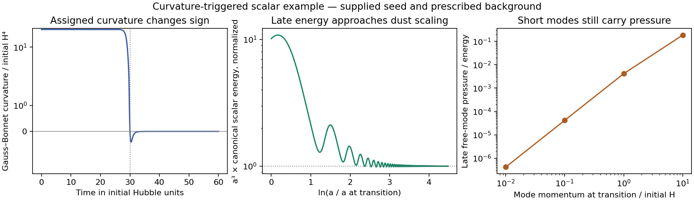

# Curvature activation and a cold scalar remnant

Curvature can amplify a supplied scalar seed and leave a component with nearly
pressureless oscillations in the explicitly tested background. This supplies a
conditional production route for a cold scalar field. It does not identify that
field with the project's tether carrier. The same minimal action fails a
separate test as a stable, constant dark-energy endpoint.

Checkpoint CCC-001, 14 October 2026. Base revision
`d8972731d0977652bb93d49ca3ee71baff54bcb8`. All new work is confined to this
directory; previous source histories, observational seals, and other chats'
working files are unchanged. The mathematical goal remains open.

## The candidate action and its known foundations

With signature −+++ and c = ℏ = 1, use

\[
S=\int\sqrt{-g}\,d^4x\left[
\frac{M_P^2R}{2}-\frac12(\nabla\phi)^2-U(\phi)+F(\phi)\mathcal G\right],
\quad U=\frac{m^2\phi^2}{2}+\frac{\lambda\phi^4}{4},
\quad F=\frac{\eta\phi^2}{2}.
\]

Here η > 0, λ > 0, and m² ≥ 0. The curvature coupling changes the linear
effective mass to m² − η𝒢. This is a quadratic coupling, distinct from the
previous investigation's linear αφ𝒢 portal. Exactly zero classical initial
field and velocity remain zero. A quantum fluctuation spectrum or another
physical seed must be supplied before claiming actual production.

This mechanism and action class are known. [Silva et al., 1711.02080v3](https://arxiv.org/html/1711.02080v3)
establish the scalarization foundation. [Macedo et al., 1903.06784v1](https://arxiv.org/html/1903.06784v1)
study mass and quartic self-interaction and exhibit radially stable scalarized
black holes in portions of their parameter space. Those results do not certify
our assigned cosmology or every parameter choice. In their Eq. 2 conventions,
φ_here = φ_paper/√2, m_here = μ_paper, λ_here = 4λ_paper, and
η_here = 1/ℳ_paper². No novelty is claimed.

## Black hole activation and saturation

Let x = r/r_h, μ = mr_h, ζ = η/r_h², and f = 1 − 1/x. The monopole radial
operator has dimensionless potential

\[
V=f\left(\frac1{x^3}+\mu^2-\frac{12\zeta}{x^6}\right).
\]

Activation requires a global unstable mode. Checking m² − η𝒢 < 0 at a point
does not establish one. The static onset problem is

\[
-[x(x-1)\phi']'+\mu^2x^2\phi
=12\zeta x^{-4}\phi.
\]

Four nested finite-element meshes, up to 3840 elements, give:

| μ | Approximate lowest ζ threshold |
|---|---:|
| 0 | 0.1814034 |
| 0.1 | 0.196140 |
| 1 | 0.444905 |
| 3 | 1.51311 |
| 10 | 10.5221 |
| 30 | 81.2721 |

These are numerical thresholds with finite outer boundaries, not certified
intervals. The last mesh step is below 10⁻⁴ relative in every case. A separate
massless shooting calculation gives 0.1814032123, agreeing with the finest
mesh within 1.8×10⁻⁷. The original paper's rounded massless threshold translates
to about 0.1814–0.1815 in these conventions. The known sufficient massless
bound ζ > 5/24 is consistent with this result.

At μ = 1 and ζ = 0.6, a positive nonlinear static solution with quartic
potential exists numerically. Its horizon field, normalized as
√λ r_h φ, is 1.47863003. Its scalar energy functional divided by 4π, in
units with r_h = λ = 1, is −0.09302549. This includes the negative curvature
interaction; it is not a black hole mass change or an available positive
exported-energy budget. Changing the outer boundary from 25 to 35 and tightening
the BVP tolerance from 10⁻⁷ to 2×10⁻⁸ changes the horizon amplitude by
about 1.1×10⁻¹¹. The horizon boundary is imposed at x = 1 + 10⁻⁶.

For an exact positive stationary solution y, define p = x(x−1) and
q = μ²x² − 12ζ/x⁴. The scalar-only Hessian satisfies

\[
\int[p(\delta')^2+(q+3x^2y^2)\delta^2]dx
=\int\left[py^2\left((\delta/y)'\right)^2+2x^2y^2\delta^2\right]dx
+\left[p y'\delta^2/y\right]_{\partial}.
\]

For compactly supported perturbations, the boundary term vanishes and the
quadratic form is positive. This conditional factorization concerns the scalar
on a frozen metric. It supplies no full metric stability or escape certificate.

## An explicit cosmological activation and release calculation

A flat FRW geometry has

\[
\mathcal G=24H^4(1-\epsilon_H),\qquad
\epsilon_H=-\dot H/H^2.
\]

Its sign changes at the end of acceleration. Positive η can therefore activate
the scalar during an accelerated phase and remove the tachyonic contribution
during radiation domination. This sign distinction is already discussed in
[Anson et al., 1903.02399v3](https://arxiv.org/html/1903.02399v3).
Their inflationary-instability warning is relevant: amplification can spoil a
background rather than supply an acceptable relic. Our added positive
self-interaction and assigned test background are not a solution of their
observational viability problem.

The executable example prescribes a dominant background, in H_initial = 1
units, through

\[
\epsilon_H(t)=1+\tanh(t-30),\quad
H(t)=\{1+t+\log\cosh(t-30)-\log\cosh(30)\}^{-1}.
\]

This H obeys its defining differential equation and changes smoothly from
inflation to radiation. Integrate

\[
\ddot\phi+3H\dot\phi+(m^2-\eta\mathcal G)\phi+\lambda\phi^3=0
\]

with m = 0.1, η = 0.1, λ = 1, φ(0) = 10⁻⁶, and φ̇(0) = 0, until t = 5000.
The field reaches about 1.56 before dilution and oscillation. Over the final
ten complete cycles:

- The ratio of integrated canonical pressure to integrated canonical energy
  density is 0.000202055.
- Canonical energy times a³ varies by 4.09×10⁻⁵ relative, or 0.00409 percent,
  between the aligned cycle crossings.
- H/m at the final time is 0.001006; the final instantaneous quartic-to-quadratic
  potential-energy ratio is about 1.25×10⁻⁵.

This is a cold, coherent scalar comparison. It does not measure a temperature
or count particles. Tightening the ODE tolerances changes the final energy by
3.43×10⁻⁸ relative. The η = 0 control, with the same supplied seed, ends with
about 1.76×10¹¹ times less scalar energy. The zero-seed control remains zero.
Neither comparison predicts a cosmological abundance.

The signed bookkeeping identity is

\[
E_{\rm eff}=\tfrac12\dot\phi^2+U-F\mathcal G,\qquad
\dot E_{\rm eff}=-3H\dot\phi^2-F\dot{\mathcal G}.
\]

The refined integration closes this ledger to about 10⁻¹² absolute in the
assigned units. E_eff is a useful explicitly time-dependent scalar functional,
not the full covariant gravitational energy density. Curvature is prescribed
by an external dominant background here. A full energy budget must vary the
metric and the dominant source and retain the Gauss–Bonnet stress. This example
does not create energy without a source or demonstrate negligible backreaction
for an observed parameter set.

## Spatial modes and black hole escape

Five post-transition wavenumbers, k_physical(t = 30) = 0, 0.01, 0.1, 1, 10,
were propagated with two supplied classical initial bases. An independent
friction-removing variable a^(3/2)δφ agrees with direct propagation; the
Wronskian follows a⁻³. No sampled mode becomes nonlinear for those initial
amplitudes. This does not bound all wavelengths or supply a primordial spectrum.

The final free massive-mode isotropic pressure estimate is
k_physical²/[3(m² + k_physical²)]. It is 4.21×10⁻⁷ for the k = 0.01 example,
but 0.186 for k = 10. A cold homogeneous background does not establish an
entirely cold distribution. The high-wavenumber occupation and its subsequent
redshift remain essential inputs.

For massive particles after nonminimal forces are negligible, radial
Schwarzschild geodesics give

\[
v_{\rm local}^2=\frac{r_h}{r}
+\left(1-\frac{r_h}{r}\right)v_\infty^2
\]

in c = 1 units. Locally cold particles with v ≤ 10⁻³ need r ≥ 10⁶r_h to
escape ballistically. However, a fast launch arbitrarily close to the escape
speed can yield a cold arrival at infinity. Thus the bound does not exclude
cold export. Likewise, a free massive wave is cold at infinity only if its
frequency lies close to its mass: v∞ = 10⁻³ gives ω/m − 1 ≈ 5×10⁻⁷. The
emitted spectrum must be computed; static hair does not supply it. A dynamical
merger can exchange energy and is outside this stationary geodesic comparison.

## The same minimal action fails as a stable constant dark energy endpoint

An exact homogeneous calculation includes metric response. It assumes no
independent cosmological constant or other nonvanishing asymptotic source.
Take U = m²φ²/2 + λφ⁴/4 with m² ≥ 0 and λ ≥ 0, not both zero. Every expanding
flat de Sitter solution with a constant nonzero scalar has a growing
homogeneous scalar–metric mode.

For clarity, the lapse-dependent homogeneous Lagrangian after integration by
parts is

\[
L=-\frac{3M_P^2a\dot a^2}{N}
+\frac{a^3\dot\phi^2}{2N}-Na^3U
-\frac{8F'\dot\phi\dot a^3}{N^3}.
\]

It follows from Na³𝒢 = 8 d[(ȧ/N)³]/dt and yields

\[
3M_P^2H^2=\tfrac12\dot\phi^2+U-24H^3F'\dot\phi,
\quad
\ddot\phi+3H\dot\phi+U'-24F'H^2(H^2+\dot H)=0.
\]

At a constant-field de Sitter point,
3M_P²H² = U and m² + λφ² = 24ηH⁴. The linearized constraint gives

\[
\delta H=\frac{4F'H^3}{M_P^2}\delta\phi
-\frac{4F'H^2}{M_P^2}\delta\dot\phi.
\]

Substitution in the scalar equation yields

\[
Z\delta\ddot\phi+3HZ\delta\dot\phi+C\delta\phi=0,
\qquad Z=1+\frac{96\eta^2\phi^2H^4}{M_P^2}>0,
\]

\[
C=-\frac{8m^4+12m^2\lambda\phi^2+6\lambda^2\phi^4}
{2m^2+\lambda\phi^2}<0.
\]

There is therefore a positive growth exponent
γ/H = [−3 + √(9 − 4C/(ZH²))]/2. The symbolic check derives the original
equations from the lapse action and independently linearizes the uneliminated
equations. The zero scalar, for m² > 0, has U = 0 and provides no positive
vacuum energy. A constant scalar minimum on a *fixed* de Sitter background
would miss the destabilizing metric response.

This is a scoped obstruction to a stable constant endpoint of this action.
It does not exclude other potentials, extra vacuum terms, other couplings, or
time-dependent acceleration. It does not establish novelty. The derivation
and its physical scope have undergone self-review, not independent peer review.

## Evidence and remaining work

The three bounded runs contain 212 passing checks: activation and cold remnant
84, finite release modes 23, homogeneous de Sitter audit 105. Their manifests
pin scripts and declared outputs. Check counts are not confirmations of the
full theory. Commands and environments are stored in each manifest; temporary
exploratory probes are not used as canonical evidence.

The production route survives as a conditional cold scalar mechanism. The
constant dark-energy route is obstructed for the stated action. A finite black
hole export calculation remains open. The next physical dependencies are a
justified initial spectrum and scale, full background and perturbation
backreaction, a relic-abundance comparison, and an actual reciprocal baryon
tether vertex. Altering the potential or adding a dark-energy sector would
define a new route requiring a new contract. No exclusive baryon anchor,
cosmological κ, or dark-energy conversion law has been derived here.
