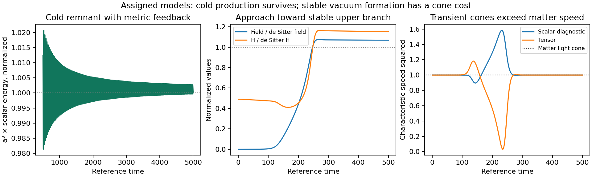

# Curvature production with gravitational feedback

The cold scalar remnant survives full **homogeneous** gravitational feedback in
the tested examples. A saturating coupling can also support a stable constant
dark-energy branch, and a slower-source example reaches that branch without
the tensor-gradient failure seen in faster trials. However, the recorded
propagation cones extend outside the minimally coupled matter cone. An exact
tensor inequality explains why activation from rest encounters this problem.
No complete causal theory of the original cold tether has been established.

Checkpoint CFB-001, 14 October 2026; base
`f8e581283bed676b1b62bce73774b9e6876d2fd9`. This continues CCC-001 without
altering its scripts, results, or conclusions for its original action. Different
coupling functions below define different actions; their successes are not
combined into a certificate for one theory.

## What replaced the prescribed expansion

The homogeneous model contains a canonical scalar φ with potential U, an
inflaton χ with quadratic potential, a radiation fluid, and the interaction
+F(φ)𝒢. Instead of prescribing H(t), it solves the scalar and metric equations
together. Reheating transfers energy from the inflaton to radiation at an
assigned rate Γχ. The separate damping comparison also transfers Γφ φ̇² from
the scalar to radiation. These rates conserve total background energy, but
their microscopic interactions and perturbation actions have not been derived.

The constraint and scalar equation are

\[
3M_P^2H^2=\tfrac12\dot\phi^2+U+\rho_\chi+\rho_r-24H^3F'\dot\phi,
\]

\[
\ddot\phi+(3H+\Gamma_\phi)\dot\phi+U'
-24F'H^2(H^2+\dot H)=0.
\]

The source obeys χ̈ + (3H + Γχ)χ̇ + mχ²χ = 0 and
ρ̇r = −4Hρr + Γχχ̇² + Γφφ̇². Differentiating the constraint and using the
scalar equation gives a two-by-two system for φ̈ and Ḣ. `check_feedback.py`
verifies the exact signed exchanges and this reduction; the numerical
Friedmann residual independently checks their implementation.

Fields are measured in M_P units and time in an assigned reference Hubble unit
H_ref⁻¹. Thus m_hat = m/H_ref, η_hat = ηH_ref², and
λ_hat = λM_P²/H_ref². Numerical M_P = H_ref = 1 is a nondimensionalization,
not a measurement of Planck-scale inflation. A physical parameter set still
requires H_ref/M_P. χ starts at 15M_P, at rest; Γχ = 0.05mχ. No inflationary
power spectrum or CMB fit is claimed.

## The cold remnant survives this feedback test

First retain F = ηφ²/2, with η_hat = 0.1, m_hat = 0.1,
U_hat = 0.005φ_hat² + λ_hat φ_hat⁴/4, and a supplied φ_hat seed of 10⁻⁶ at
rest. Set mχ_hat = √6/15 and integrate to reference time 5000.

For λ_hat = 1, the refined calculation gives:

| Quantity | Result |
|---|---:|
| Late integrated canonical pressure divided by integrated energy | 3.92×10⁻⁶ |
| Relative a³ρ variation at aligned complete cycles | 5.60×10⁻⁷ |
| Scalar canonical energy fraction at the assigned endpoint | 0.0156573 |
| Gauss–Bonnet energy fraction at that endpoint | −3.16×10⁻¹³ |
| Maximum relative Friedmann residual | 8.90×10⁻⁸ |
| Minimum tensor kinetic coefficient in M_P² units | about 0.9918 |
| Minimum tensor gradient coefficient in M_P² units | about 0.9868 |

The cycle interval is t = 4367.33–4995.65. The tiny late Gauss–Bonnet contribution
makes the canonical dust comparison appropriate there. The endpoint is not
today and the quoted fraction is not a relic-abundance prediction. λ_hat = 100
and 10000 also leave cold remnants in the tested range. The η = 0 comparison
has much less scalar energy; an exactly zero classical seed remains zero.

The λ_hat = 0.01 example reaches the explicit |φ_hat| = 100 guard before the
end time. That guard marks an uncompleted strong-field comparison, not a
theorem that this action is impossible. An earlier uncapped exploratory probe
was terminated after exceeding its intended runtime; no scientific conclusion
is assigned to that probe.

## A different coupling supplies a stable dark energy branch

The previous quadratic-coupling action has an unstable nonzero constant-field
de Sitter point for its positive quadratic/quartic potential. Now change the
action to

\[
F=\frac{\eta v^2}{2}(1-e^{-\phi^2/v^2}),\qquad
U=\frac{m^2\phi^2}{2},\qquad m^2>0.
\]

No independent cosmological constant is added. For a constant nonzero field,
3M_P²H² = U and U′ = 24F′H⁴. Define y = φ²/v². The fixed-point relation is

\[
\frac{\eta m^2v^4}{M_P^4}=\frac{3e^y}{2y^2}.
\]

The two branches merge at y = 2; above the minimum coupling 3e²/8, one branch
has y < 2 and the other y > 2. The homogeneous scalar–metric perturbation is
Z δφ̈ + 3HZ δφ̇ + Cδφ = 0, with

\[
Z=1+\frac{6M_P^2}{v^2y}>0,\qquad C=2m^2(y-2).
\]

The upper branch is homogeneously stable. At the exact endpoint Ḟ = F̈ = 0,
so tensor kinetic and gradient coefficients both equal M_P². Stability of
constant points through the effective-potential method is known; see
[Pozdeeva et al., 1905.05085v2](https://arxiv.org/html/1905.05085v2), with
their curvature coefficient U_paper = M_P²/2, potential V_paper = U_here, and
F_paper = −F_here. The independent local calculation reproduces its criterion;
no novelty is claimed.

For m_hat = 0.1, v_hat = 1, choose y = 4, giving η_hat = 511.8576566,
φ_hat = 2, and H_hat = 0.08164966. Initial fields 1.98 and 2.02 at rest return
to this point with positive tensor coefficients in both numerical examples.
The same action has a low-field cold basin: a scalar starting at 0.02 evolves
as an oscillating field rather than automatically climbing to the de Sitter
branch. A start at 0.2 fails the initial tensor-gradient screen. A stable
endpoint alone therefore does not establish a viable formation history.

The mass gap about the upper branch obeys

\[
\frac{M_{\rm eff}^2}{H^2}
=\frac{12(y-2)}{(v/M_P)^2y+6}<2(y-2).
\]

An order-one y does not produce a large separation between the oscillation and
Hubble scales. A cold homogeneous basin and a stable vacuum branch do not yet
supply a galaxy-scale cold distribution or its transition to dark energy.

## Formation failures and a slower-source continuation

With the same supplied seed and initial H near one, five saturating-coupling
examples v_hat = 0.5, 1, 2, 3, 5 reach a tensor-gradient boundary. η is scaled
as v⁻⁴ to retain the target y = 4. The v_hat = 10 example stays in a low-field
regime and misses the upper branch during the tested interval. Four assigned
reciprocal damping rates, Γφ_hat = 0.1, 1, 10, 100, fail to remove the first
boundary in the v_hat = 1 case. These finite comparisons are not a universal
formation exclusion.

The continuation changes the initial source curvature: choose
mχ_hat = H_initial_hat√6/15 while retaining χ_initial_hat = 15, m_hat = 0.1,
v_hat = 1 and the same η_hat. In the tested scan, H_initial_hat = 0.032 gives
little surviving field, whereas 0.06, 0.08, 0.1, 0.2 and 0.5 hit a tensor
gradient boundary. At **0.04**, the trajectory reaches the upper branch without
that boundary. At t = 30000:

- φ_hat = 2.00000768 and H_hat = 0.08165029;
- the continuously located minimum tensor gradient coefficient is 0.0546590;
- the maximum relative Friedmann residual is about 1.30×10⁻¹⁰.

The source and resulting scales are assigned. This is a finite formation
counterexample to an overly broad claim that the upper branch is always
unreachable. It does not reproduce the observed thermal history, dark-energy
epoch, or a preceding long cold-matter era.

## The propagation cone cost

Tensor coefficients are Q_T = M_P² + 8HḞ and 𝓕_T = M_P² + 8F̈. Their
ratio is the tensor characteristic speed squared relative to minimally coupled
matter. These expressions follow directly from
[Kobayashi et al., 1105.5723v3, Appendix A Eq. 92](https://arxiv.org/html/1105.5723v3).

The scalar diagnostic uses the standard Horndeski quadratic coefficients, with
the extra matter enthalpy term of
[De Felice and Tsujikawa, 1110.3878v1, Eqs. 23–28](https://arxiv.org/html/1110.3878v1).
In M_P = 1 units, writing D = Q_T + 96F′²H⁴ gives the reduced expression

\[
c_S^2=1+\frac{128F'^2H^2[Q_T\dot H-2H^2(\ddot F-H\dot F)]}{Q_TD}.
\]

The normalized scalar kinetic coefficient is positive in the sampled examples.
For the slower-source trajectory the recorded scalar speed squared ranges
approximately from 0.896 to 1.584; the recorded tensor maximum is about 1.182.
Positive speeds avoid that particular gradient sign failure, but do not put
the cones inside the matter cone. These extrema are sampled diagnostics unless
explicitly located as continuous extrema.

The source-free scalar relation is exact. Its extension to the inflaton plus
radiation with phenomenological reheating is a **conditional principal-sector
diagnostic**: the cited perfect-fluid derivation does not itself supply the
full covariant reheating perturbation action. It is not a complete coupled
principal-symbol certificate. At isolated scalar-clock turning points, the
implemented expressions use their analytic continuation, rather than treating
zero unitary-gauge kinetic normalization as a physical ghost.

Using Raychaudhury, the source-free result, and the healthy minimally coupled
perfect-fluid extension with enthalpy S ≥ 0, can be written

\[
c_S^2-1=\frac{32F'^2H^2[6Q_T\dot H+\dot\phi^2+S]}{Q_TD}.
\]

Thus Ḣ > 0 and F′ ≠ 0 imply a scalar cone outside the matter cone under those
hypotheses. The slow formation example increases H from 0.04 toward 0.08165;
its cone cost is consistent with this structural relation.

There is an even simpler result requiring no scalar-fluid perturbation
extension. If Q_T > 0 and c_T² ≤ 1, then

\[
\frac{d}{dt}(\dot F/a)\le0.
\]

A coupling that starts with Ḟ = 0 cannot subsequently increase while obeying
that strict upper-cone condition. Both activation couplings used here increase
as |φ| grows from rest. The complete proof and its exact limits are in
[TENSOR_CONE_LEMMA.md](TENSOR_CONE_LEMMA.md). It is a formal corollary of the
known tensor action, not a novelty claim or a universal ban on gravitational
production. Superluminal EFT characteristics do not alone prove closed
timelike curves or settle ultraviolet front velocities.

## Evidence and remaining physical dependencies

Canonical evidence is `feedback_run_v1`, `saturation_run_v1`, and
`scale_cone_run_v2`: 43 + 73 + 41 = **157 passing checks**. They test different
parts of the analysis and do not count as confirmations of one complete
physical theory. The failed first cone run, original code, and correction are
preserved. Its final comparison used different sampled time grids for a sharp
minimum. Version 2 locates that minimum on each continuous solution and retains
the same refinement tolerance and positive-gradient requirement.

The next physical dependency is a justified interaction that retains finite
cold production while meeting the desired propagation-cone condition. Additional
derivative operators change the tensor lemma's hypothesis and require a new
action and principal analysis; changing only the scalar potential or adding
ordinary damping does not change the tensor coefficients. A quantum seed and
spectrum, physical scales and abundance, observational comparison, and an
actual reciprocal baryon tether vertex remain open. No κ, exclusive baryon
anchor, black-hole export spectrum, or dark-energy conversion law is derived.
