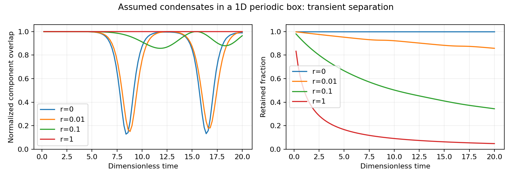

# Nonlinear separation reduces loss modestly, then remixes in the tested box

2026-10-13. The preceding calculation found a linear charge-demixing instability. This package evolves the two condensates in space with local annihilation. In the tested one-dimensional periodic model, separation occurs but does not persist: the components largely remix. The low-loss run gains about 2.46 percentage points in retained population by the end of the run. This supports a transient overlap reduction, not a stable storage state.

## Specified equation and initial state

Let eta=g_cross/g_self and r=a/g_self, with the threshold couplings and cold annihilation coefficient derived in the preceding packages. Use time tau=g_self n0 t/hbar, coordinate X=x sqrt(m g_self n0)/(hbar c), and dimensionless densities normalized to the initial per-sign mean n0. The evolution is

\[
i\partial_\tau\psi_\pm=-\tfrac12\partial_X^2\psi_\pm
+(|\psi_\pm|^2+\eta|\psi_\mp|^2)\psi_\pm
-\tfrac{i r}{2}|\psi_\mp|^2\psi_\pm.
\]

There is no production during this storage test. The local loss law is d n_±/d tau=-r n_+n_-. The initial densities are

\[
n_\pm(X,0)=1\pm0.001[\cos(4qX)+0.05\cos(qX)],\quad
q=2\pi/L,\quad L=8\pi/\sqrt2.
\]

Initial phases are zero. This is an imposed classical perturbation of already existing coherent condensates, not a calculation of quantum nucleation or photon production. The box is periodic, with no physical wall, external cooling, thermal cloud or photon return. Eta=2.0002 approximates the previous carrier benchmark. Eta=0.5 provides a stable-mixture control; zero seed provides an exactly homogeneous control.

## Integration and checks

A Fourier split-step method uses half a kinetic step, an exact local nonlinear-and-loss step, then half a kinetic step. For the local step, d=n_high-n_low is constant. With step h and d>0,

\[
n_{\rm low}'=\frac{n_{\rm low}e^{-rdh}}
{1+(n_{\rm low}/d)(1-e^{-rdh})},\qquad n_{\rm high}'=n_{\rm low}'+d.
\]

The continuous d=0 limit is n'=n/(1+rnh). Integrated densities give the local nonlinear phases exactly. The code uses expm1/log1p for small arguments. Splitting error remains and is checked by step refinement.

Each run tracks charge difference, high-frequency spectral content and the independent trapezoidal loss balance

\[
\langle n_+(T)\rangle-1+r\int_0^T\langle n_+n_-\rangle\,d\tau=0.
\]

The lossless control also checks Hamiltonian conservation. The uniform control reproduces n=1/(1+r tau). Spatial grids of 256 and 512 points and time steps 0.002 and 0.001 test both r=0.1 and r=0.01. These checks support the tested interval only; they do not prove a continuum theorem or long-time behavior.

## Results to tau=20

The overlap diagnostic is O=<n_+ n_->/(<n_+><n_->). A uniform mixture has O=1. The following are the original 256-point, step-0.002 runs; the refined cases agree within the tolerances recorded in the script.

| Loss ratio r | Minimum O | Final O | Retained fraction | Uniform reference |
|---:|---:|---:|---:|---:|
| 0 | 0.12250 | 0.98931 | 1.00000 | 1.00000 |
| 0.01 | 0.14833 | 0.99855 | 0.85796 | 0.83333 |
| 0.1 | 0.85781 | 0.96501 | 0.34388 | 0.33333 |
| 1 | 0.99995 | 0.99995 | 0.04762 | 0.04762 |

At r=0.01 the survival improvement is 0.02463 of the initial inventory (about 2.96% relative to the uniform survivor count). Strong initial separation does not translate into persistent isolation in this run. At r=0.1, the stable-mixture control retains 0.33333346, essentially the homogeneous reference; the demixing case retains about 0.3438773. Fast annihilation at r=1 prevents appreciable separation from this seed before most of the inventory is lost.

The low-loss recurrence is consistent with conservative motion and the restricted periodic geometry; it is not evidence that all 3D geometries must remix. Conversely, a deep minimum in overlap at one time cannot be used as a storage lifetime claim. Larger-scale domain growth, random fluctuation spectra, different box shapes and genuine dissipative cooling could change the evolution and need their own tests.

## Physical scope

The previous benchmark g_self n0 approximately 5e-7 eV makes one dimensionless time about 1.32 ns, so tau=20 corresponds to roughly 26 ns. The periodic length is about 5 micrometers. This is a microscopic transient test, not a macroscopic storage demonstration. The loss ratios are explicit parameter sweeps; they are not experimentally measured photon couplings. Other channels and non-mean-field correlations are omitted.

This narrows the mechanism search: repulsion alone can lower overlap, but this tested implementation does not keep the components apart. A physical trap plus a cooling or relaxation process that settles the separated domains would need to be derived and checked. Photon manufacture and capture still remain unresolved. There is no new gravity or propulsion result here.

All 40 declared checks passed.

Canonical evidence is `run_v2/`, which adds time and grid refinement for the strongest-separation lossy case. The original `run/` is retained with its exact script saved as `check_initial.py`; its original input path now points to the later script, so use the canonical manifest for current-path validation. No new Lean proof is claimed for the numerical PDE trajectory; the prior algebraic instability proofs do not certify it.
