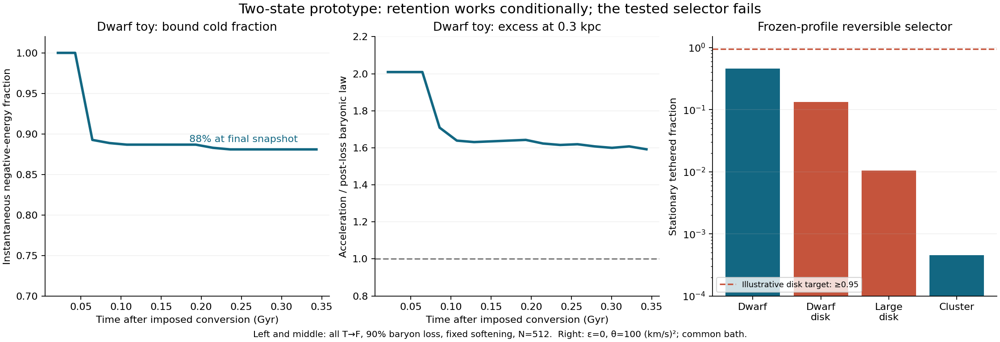

# Two-state mechanism: built and tested, joint explanation remains open

**A positive-mass free remnant can survive an imposed loss of the tether.
The simplest common-gap/common-bath transition rule fails to preserve disks
while making the toy dwarf mostly free.** We therefore have a useful bounded
prototype, not an explanation of observed dwarf and cluster excesses.



## What was built

- A spherical two-state energy with T and F of equal positive rest mass.
  Both gravitate; only T contributes to the tether field. Conversion energy
  is explicitly assigned to a receiver rather than silently discarded.
- Exact static coexistence equations and allowed free-mass budgets.
- A reversible, mass-conserving kinetic closure and its stationary fractions
  on fixed total profiles. Its bath, gap and rate normalization are assumptions.
- Live, softened radial-shell collapse after imposed T->F conversion and
  90% baryon loss, with energy and numerical-resolution checks.

All models are isolated, spherical, Newtonian and unscreened. No real galaxy
catalogue was fitted. No new mechanism is claimed to have been established
microscopically, and no existing observational pass transfers to this model.

## Results that matter

| Test | Result | Interpretation |
|---|---|---|
| T present at cold equilibrium | g=law(g_b+g_F), not law(g_b) | Free mass changes the disk relation; a population selector is essential |
| Illustrative 0.05 dex acceleration tolerance | M_F(<r)/M_b(<r) <=0.236 for dwarf disk, <=0.158 for large disk | These are conditional local budgets, not confidence limits or total dark fractions |
| Refined dwarf conversion experiment | 88.09% snapshot-bound at 0.344 Gyr; late acceleration 1.592–1.643 times the post-loss baryonic law at 0.3 kpc | Conditional retention and an excess are possible after conversion is supplied by hand |
| Dwarf numerical follow-up | Timestep fraction change 0.00391; N=256->512 change 0.01367; finest maximum energy error 7.07e-5 | Passes the stated finite-run tolerances; no zero-softening or asymptotic stability claim |
| Cluster impulse experiment | At t=2.5 code units (5.54 Gyr), N=256 snapshot-bound fraction 98.05%, acceleration ratio 5.55 at 500 kpc | A large excess can be produced, but this extreme 90%-loss scenario is not a fitted cluster mechanism |
| Common-gap reversible selector | No epsilon interval for any common theta>=0 giving q_dwarf<=0.1 and both q_disks>=0.95 on the frozen profiles | This specific selector fails; arbitrary two-state theories are not ruled out |

The dwarf starts with 3e5 Msun of baryons and ends with 3e4 Msun. The cluster
starts with 1e14 and ends with 1e13 Msun. These are toy impulses, not inferred
histories. The quoted force excesses are not stellar-dispersion fits or lensing
predictions. The full cluster run extends to 17.72 Gyr; its final snapshot is
not used as an age-matched astronomical prediction. Earlier samples are stored.

The first dwarf profile resolution comparison failed (0.7969 versus 0.8711
bound); its failure remains recorded. The targeted follow-up separated the
timestep and particle-count effects and passed at N=256/512. The finest
reported result is still conditional on fixed softening of 4.74 pc, cold
radial initial velocities, an imposed cutoff and missing stiffness/tides.

## Why the selector fails

Conversion releases tether field energy. Protecting disks therefore needs
an internal binding energy or a kinetic barrier. For the tested fixed profiles,
the common-gap/common-bath stationary relation is

    epsilon = mean_mu(q) + theta log[q/(1-q)].

The disk target requires epsilon >=49656.10+2.94444 theta, while the dwarf
target requires epsilon <=3.84294-2.19722 theta, in (km/s)^2. These intervals
do not intersect for theta>=0. This is a restricted selector obstruction,
not a proof against history-dependent or spatially varying interactions.

At epsilon=0 and theta=100 (km/s)^2, the computed T fractions are 45.6% for
the dwarf, 13.3% for the dwarf disk, 1.05% for the large disk, and 0.0454% for
the cluster. That leaves too much F in disks. Setting their conversion off
by name would evade the problem rather than explain it.

## Evidence and limitations

- [Design and pre-run criteria](DESIGN.md).
- [Energy, forces, conversion and restricted selector derivation](DERIVATION.md).
- [Self-audit and exact missing implications](AUDIT.md).
- [Corrections and failed first runs](AMENDMENTS.md).
- [Profile diagnostic contract](PROFILE_CONTRACT.md) and [refinement contract](REFINEMENT_CONTRACT.md).
- [Static results](run_static_v1/results.json), [generic retention](run_dynamics_v1/results.json),
  [profile experiments](run_profiles/results.json), [dwarf refinement](run_refinement/results.json).
- Current provenance: each of those four folders has a validated v2
  `manifest.json` with status `completed`, input/output hashes, versions,
  execution command, runtime and resource limits. Completion of execution is
  distinct from a successful scientific test: the profile resolution test
  records its initial failure and the selector records its obstruction.

The earlier `run_static/` has a rejected factor-1000 unit-conversion error;
`model_v0_unit_error.py` preserves the original source. `run_dynamics/` is
the first coarse run, with one energy-tolerance failure. Neither supersedes
the corrected evidence. No external source theorem or observation is assumed
to validate the new calculations. Review was self-review, not independent.

## Reproduce

Python 3.9.6, NumPy 1.26.2, SciPy 1.11.4; plotting used Matplotlib 3.9.4.
From repository root, direct diagnostic reruns (new outputs, leaving records intact):

```bash
python3 two_state_mechanism_2026_10_24/model.py --mode static --output /tmp/two_state_static.json
python3 two_state_mechanism_2026_10_24/model.py --mode dynamics --output /tmp/two_state_dynamics.json
python3 two_state_mechanism_2026_10_24/profile_experiment.py /tmp/two_state_profiles.json
python3 two_state_mechanism_2026_10_24/refine_retention.py /tmp/two_state_refinement.json
```

These commands do not create fresh manifests; the exact bounded-run commands
are recorded in the existing manifests. `refine_retention.py` compares against
the saved `run_profiles/results.json`, which is explicitly hashed as an input.

## Next physical obligation

The next construction needs an actual interaction or metastable barrier that
protects disks and leaves a durable free population elsewhere. Under a simple
irreversible-rate comparison with equal elapsed times, the illustrative
targets already demand a dwarf-to-disk conversion-rate contrast of about 45.
That contrast must arise from physics, with the receiver and energy budget
included. Coupled live T/F evolution and age-matched data tests follow only
after that missing selector is specified. [Continuation handoff](HANDOFF.md).
