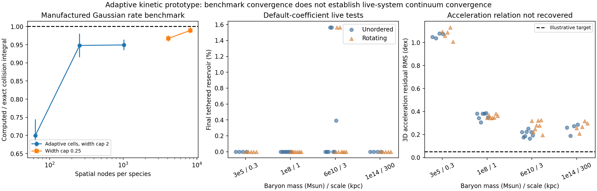

# Adaptive kinetic capture with the conservative 3D field

**Built and tested an adaptive-cell kinetic solver. It removes the requirement
that two simulation centers occupy the tiny physical encounter volume. The
collision integral converges on known benchmarks, but the live tests still do
not produce tethered disks or recover the galaxy acceleration relation.**

All **48 default-coefficient formation runs** and two seeded-field controls
completed. Tests cover spatial carriers, velocity samples, cell width, time
step, seed and initial shape. Rotation is only an initial velocity condition;
there are no galaxy-type switches. The finite initial-value tests last two
initial dynamical times.

## What changed

`octree.py` builds adaptive occupied cells with an explicit maximum width and
additional refinement in crowded regions. `kinetic.py` evaluates a local
phase-space collision integral from cell volume, particle weights and incoming
normal flux. It keeps separate B/F/T trajectories and the prior full 3D
longitudinal field. Every state change pays its complete finite field-energy
cost through a central impulse and an explicit radiation-energy receiver.
There is no energy rescaling or prescribed T population.

Several sampled velocities can start at each spatial node, with divided masses,
and then transport independently. Increasing those samples leaves the initial
spatial mass distribution fixed. A constant softened gravitational self term
makes uncharged velocity replication energy-invariant; its force is zero.
Adaptive collision cells do not remap the gravitational/field density, so
regridding does not inject energy.

The cell-based framework is motivated by standard kinetic particle methods;
[SPARTA documents cell-local collision organization](https://sparta.github.io/doc/collide.html)
and separate [time-step](https://sparta.github.io/doc/compute_dt_grid.html) and
[cell/mean-free-path diagnostics](https://sparta.github.io/doc/compute_lambda_grid.html).
Our T/F conversion and central normal-flux closure are custom effective
assumptions, not a microscopic interaction derived or validated by those sources.

**Numerical cell size is not physical interaction range.** The solver uses the
local Boltzmann limit of the prior normalized 0.1kpc kernel, assuming physical
distributions vary slowly on that range. A pair of macro centers in a cell
represents locally co-located kinetic distributions; their actual separation
need not be below0.1kpc. Coarse-cell and sampling errors must still converge.
This is not merely an expanded search radius labeled “local.”

## Collision-integral accuracy

For two normalized unit Gaussian spatial distributions and independent unit
Gaussian velocities, the exact mass-weighted normal-flux integral is known:

    I_exact = 1/(8 pi²).

The density-overlap integral and velocity integral were checked separately.
The following numbers are means across independent sampling seeds:

| Spatial nodes per species | Initial velocities per node | Width cap | Computed / exact rate |
|---:|---:|---:|---:|
| 64 | 2 | 2 | 0.700 ± 0.044 |
| 256 | 2 | 2 | 0.948 ± 0.033 |
| 1,024 | 2 | 2 | 0.949 ± 0.014 |
| 4,096 | 2 | 0.25 | 0.967 ± 0.008 |
| 8,192 | 2 | 0.25 | **0.9895 ± 0.0078** |

Uncertainties are standard errors of the mean, not universal error bounds.
There are16 seeds in the first three rows and8 in the last two. Refining only
particle count at a fixed coarse width stalls; refining spatial cells as well
improves the integral. The final mean is about1.05% below the known answer.
Uniform-density tests and separate velocity-sampling controls are also saved.

Cold-flow controls pass for uniform coflow and rigid rotation. They also expose
an error worth retaining: a smooth monokinetic compression has zero collision
rate in the exact point-local limit, but finite cells produce artificial
collisions. The measured integral falls from0.08230 to0.04097 to0.02052 as cell
width falls from1 to0.5 to0.25. That is convergence of a numerical error, not
physical dissipation to interpret as assembly.

## Live-gravity results

| Quantity | Default-coefficient results |
|---|---:|
| Completed formation trajectories | **48** |
| Largest final tethered fraction | **1.5625%** |
| Instantaneously bound free reservoir | **98.4375–100%** |
| Total attempted conversions / captures / releases | 10 / 7 / 0 |
| Maximum normalized energy drift, including seeded-field controls | **1.034e-5** |
| Maximum normalized collision energy mismatch | **3.03e-18** |
| Best final 3D acceleration residual RMS | **0.1646 dex** |
| Best final maximum absolute acceleration residual | **0.3541 dex** |

The energy norm is max(abs(initial potential energy), abs(initial mechanical
energy)). Radiation receiver Q is included. Continuous transport has finite
mesh symmetry errors: maximum normalized momentum and angular-momentum drifts
are9.68e-6 and1.27e-6. Pair collision conservation is algebraic; floating-point
integration is not exactly energy conserving.

The inherited illustrative RAR target is0.05dex; it is not an observational
likelihood. The initially supplied reservoir is5.364 times baryonic mass.
Retaining it is not evidence that observed dwarf/cluster mass or lensing has
been explained.

All final nonzero T populations occur in the6e10Msun/3kpc family. They are sparse
and do not establish rotation selection:

- With64 spatial nodes and2 velocities per node, the rotating case ends with
  2/128 T samples and the unordered case with none.
- In the higher-resolution pair—256 spatial nodes,2 velocities each, narrower
  cells—the unordered case ends with2/512 T (**0.390625%**), and the rotating
  case with none.
- Cell and interval controls sometimes produce one T sample out of64. These
  are stochastic small-number changes, not a converged population contrast.
- The higher-resolution dwarf- and cluster-scale rotating controls end with
  no T and essentially all the assumed reservoir instantaneously bound as F.

The recorded proposal exposure per medium sample is at most0.017 in default
runs, and considerably smaller in most cases. This is a pre-impulse integrated
hazard diagnostic, not a rigorous bound over every possible history. It shows
that the tested interaction is weak over this assembly interval; removing the
physical-neighbor sampling bottleneck does not itself make conversion rapid.

The highest reference opacity proxy C*rho_B*cell_width at saved snapshots is
0.294. The maximum actual individual hazard-step product is0.00972. Neither
number alone proves full spatial/velocity convergence. The finest live run has
512 samples per species, far fewer than the finest manufactured benchmark.
Field source smoothing remains sigma=b, inherited from the previous prototype.



The live panels show all default-coefficient controls; points are finite
experiments, not independent observational galaxies or confidence intervals.

## Strong-rate diagnostic excluded

An optional common100x-rate experiment was interrupted after entering a
spatially unresolved collisional regime. It is **excluded from formation
results**. Its partial files are preserved under `run_stress`; interruption
bypassed the runner's final manifest writer, so that folder must not be described
as a validated completed run.

An independent, completed `run_stress_screen` check finds initial opacity proxies
of3.26 and0.544 for the large-galaxy and cluster input families, already above
our conservative1/3 reference screen. The proxy uses the model's normal-flux
coefficient; it is not an observational mean-free-path measurement. A strong-rate
result requires adequate cell/sampling resolution or a justified dense-collision
closure. The interrupted experiment neither establishes nor rules out that route.

## What remains open

The adaptive kinetic operator has meaningful independent validation, but **live
continuum convergence and the desired physical mechanism are not established**.
The finite results do not show robust preferential T formation in rotating
systems, and none meets the joint formation/RAR target. They do not prove that
all possible local interactions, strengths or longer assembly histories fail.

The physical interaction is still an assumed normal-flux radiative conversion.
The effective packet collision masses have ratio5.364, not a derived microscopic
species model. “Tethered” labels a field-sourcing phase, not a proven permanent
bond to a particular baryon. The radiation receiver omits absorption, recoil and
radiation gravity. The 3D field remains the selected longitudinal closure, not
the unrestricted nonlinear polarization PDE. These limitations are separate
from numerical rate integration.

To establish a credible next result, increase live spatial/velocity resolution
with scalable gravity/field evaluation, retain the cold-gradient error controls,
and resolve the dense-collision regime before interpreting stronger coupling.
A physically justified durable binding interaction and its reciprocal energy/
angular-momentum transfer remain required; numerical refinement alone does not
supply one. Actual rotation curves, dwarf dynamics and cluster lensing still
need observational tests.

## Files and reproducibility

- `kinetic.py`, `octree.py`: adaptive kinetic solver.
- `run.py`: base, spatial, velocity, cell, time and seed suites.
- `shape.py`, `high_resolution.py`: crossed-shape and higher-resolution controls.
- `checks.py`, `flow_checks.py`, `refined_rate.py`: analytic benchmarks.
- `active.py`: seeded nonzero-field controls, excluded from formation.
- `DERIVATION.md`, `AUDIT.md`, `HANDOFF.md`: equations, limitations and continuation.
- `run_analysis/results.json`: consolidated results and provenance-linked analysis.

Default runs: base8 + space8 + velocity8 + cell4 + time4 + seed4 + shape8 + high4.
All completed. All finalized manifests validate against current input hashes;
the interrupted stress folder has no finalized manifest and is explicitly
excluded. Simulation/check stderr is empty. Analysis stderr contains only the
Matplotlib first-time font-cache notice. No experiment remains running.

Example exploratory reproduction, with a fresh output path:

```bash
PYTHONDONTWRITEBYTECODE=1 OPENBLAS_NUM_THREADS=1 python3 \
  two_state_mechanism_2026_10_24/adaptive_kinetic/run.py \
  --suite base --output /private/tmp/kinetic_base.json
```

For evidence-grade reproduction, use the supplied contracts and bounded-run
commands recorded in each manifest, with new run directories. Existing predecessor
files were imported unchanged. No Git commit, manuscript edit or publication was
made. This checkpoint is self-reviewed, without an independent referee verdict.
