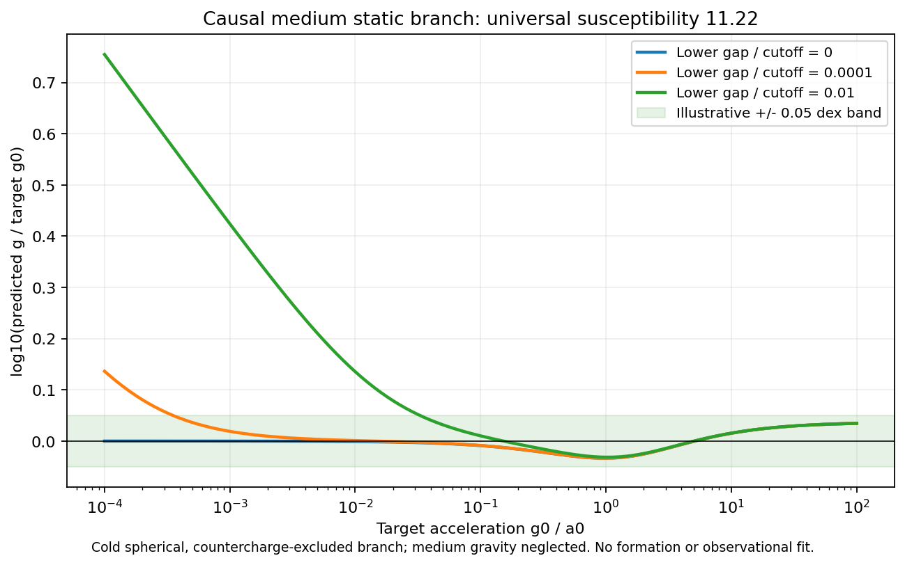

# Causal collective field: working field model, unresolved population mechanism

We replaced the instantaneous nonlinear field with Maxwell's field coupled to
neutral polarizable internal states and explicit positive/negative free carriers.
Field, excitation and carrier kinetic energy share one Hamiltonian. The field
has causal Maxwell characteristics; the negative carriers are allowed to respond.

**This repairs the field-level causality problem and retains repulsion. It does
not yet explain disk/dwarf/cluster mass separation.** The strongest result is a
conditional static acceleration curve plus explicit restrictions on realizing it.

## Verified results

| Test | Result |
|---|---:|
| Largest sampled linear group speed | 0.999993c |
| Independent polariton-spectrum benchmark error | 5.49e-14 |
| Maximum refined nonlinear energy error | 4.18e-9 |
| Maximum refined internal-state norm error | 1.88e-10 |
| 3D force/energy-derivative mismatch | 1.85e-8 |
| Maximum 3D Gauss residual | 6.39e-8 |
| Like / opposite gauge charges | Repel / attract |
| Best critical static-curve maximum residual | 0.03460dex |
| Best critical static-curve RMS residual | 0.01729dex |
| Unit tests | 4 passed |

The causal statement is supported by a local Hamiltonian/principal-characteristic
derivation, not just sampled wave speeds. The nonlinear tests include separate
relativistic momenta for both charge signs. Their strongest fixture reaches
0.989c without exceeding c. No damping, energy rescaling or fixed negative
carrier is used in those homogeneous tests.

The static result uses chi=11.2202, calibrated over 121 target accelerations
g0/a0=1e-4..100. The scan contains 405 susceptibility/gap combinations. This is
comparison with our adopted function, not observational data. It assumes cold
spherical positive carriers, excluded inner countercharge and negligible
medium gravity. None of those assumptions is established by the fit.



## Parameter reductions

1. An ordinary finite-gap analytic medium gives g_b proportional to g³, the wrong
   deep scaling. A critical dipole-weight density proportional to excitation gap
   gives the required g_b proportional to g². The needed exponent is fixed;
   the material producing it remains to be derived.
2. Matching gravity fixes q²/m²=4piG(1+chi). The deep acceleration coefficient
   fixes the field cutoff g_star=chi*a0/(1+chi). These are not independent knobs.
3. A positive oscillator-strength sum rule limits response frequency using the
   actual matter budget. The medium cannot respond arbitrarily fast for free.
4. Neutral internal excitation does not create monopole charge. Free/tethered
   conversion still needs an explicit neutral-to-positive-plus-negative channel.

The static sector has one remaining calibrated susceptibility, not a complete
one-parameter microscopic theory. Mass ratio, spectrum origin, formation/ionization
physics, medium transport and initial conditions remain open.

## The population tests expose physical restrictions

For epsilon=m_minus/m_plus=.1 and the best critical susceptibility, assigning
the entire available dark reservoir to the neutral medium gives these generous
lower bounds on dipole matrix-element length:

| Numeric mass/radius family | Minimum length | Minimum length/system radius |
|---|---:|---:|
| 3e5Msun /0.3kpc | 1.74kpc | 5.80 |
| 1e8Msun /1kpc | 0.193kpc | 0.193 |
| 6e10Msun /3kpc | 8.71pc | 0.00290 |
| 1e14Msun /300kpc | 5.22kpc | 0.0174 |

The smallest dwarf fails the local-dipole approximation under this construction.
That is a consistency failure of that local model, not a prediction that the
galaxy automatically retains free matter. These are individual optimistic
bounds; choosing a different microscopic length in each system is not allowed.
A single uniform medium satisfying all four budgets needs at least 5.22kpc,
which is itself larger than the disk scale used here.

The oscillator-strength bound gives a maximum relevant low-gap response phase
of about 0.0014 radians per dynamical time at g/a0=1e-4, even allocating all local
dark mass to polarization. Static ground-state preparation at that acceleration
cannot simply be assumed during assembly. This is a response bound, not a
computed relaxation or ionization timescale.

Meanwhile, after gravitational normalization, the low-frequency Debye length
and free-carrier plasma response reduce to the previous mass/size-independent
scalings. At epsilon=.1 they give lambda_D/b=.1997 and omega_p*t_dyn=5.0285
in every numeric family. Rotation has not acquired an invented local switch.
Actual differences would have to emerge through transported distributions,
thermal histories, gradients or magnetic dynamics.

## What remains before a galaxy claim

We need a microscopic or collective origin for the critical spectrum that obeys
the mass/oscillator-strength budget, plus transport and gravity of the medium
itself. A specified ionization/formation process must conserve the full energy
and charge inventory. The present Hamiltonian moves energy between neutral
internal excitation and charged currents; it does not change particle species.

Consequently no new tethered/free fractions or live galaxy-formation outcome
are reported. A good static acceleration curve cannot substitute for those
missing dynamics. The prior maximum-D/core bound no longer applies to this
different passive medium; its new restrictions are documented explicitly.

## Files and reproducibility

- [DERIVATION.md](DERIVATION.md): action, causality, spectrum, gravity matching and budgets.
- [AUDIT.md](AUDIT.md): exact scope, conditional assumptions and self-review.
- [medium.py](medium.py): static response, polariton modes and nonlinear energy tests.
- [collective_field.py](collective_field.py): new 3D static field law using existing grid operators.
- [run_collective/results.json](run_collective/results.json): every scan row and test diagnostic.
- [run_collective/manifest.json](run_collective/manifest.json): completed hashed run record.

From the repository root:

```bash
PYTHONDONTWRITEBYTECODE=1 OPENBLAS_NUM_THREADS=1 python3 two_state_mechanism_2026_10_24/causal_collective/test_collective.py
PYTHONDONTWRITEBYTECODE=1 OPENBLAS_NUM_THREADS=1 python3 two_state_mechanism_2026_10_24/causal_collective/experiment.py --output /private/tmp/causal-collective-reproduction.json
```

The bounded run used contract.json, its seven declared execution_artifacts,
a fresh result directory, timeout 240s and one numerical thread. The manifest
records the exact command and hashes. Existing solvers/manifests remain intact.

The general [Maxwell-Bloch framework](https://www.aimsciences.org/article/doi/10.3934/dcds.2003.9.663)
motivates explicit material dynamics. [Live dipolar-dark-matter simulations](https://academic.oup.com/mnras/article/517/1/498/6713968)
also illustrate why static agreement is insufficient; those are a different
theory and their results are not imported as validation of this candidate.
