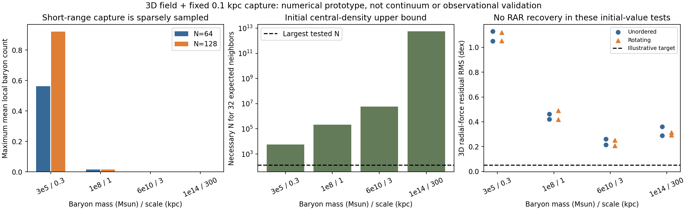

# Full 3D field and fixed-range local capture

**The conservative 3D prototype works numerically, but it does not establish
selective tethered-disk formation or preserve the acceleration relation in these
finite tests. Geometric and temporal encounter locality are implemented; local
mass-density sampling is still inadequate for a continuum conclusion.**

The final evidence consists of **30 formation trajectories**, two additional
nonzero-field transport controls, and field/reaction checks. All completed.
The same physical capture range and rate coefficient are used at every mass and
size. Rotation and flattening are crossed initial conditions, never switches in
the interaction. These are two-initial-dynamical-time synthetic experiments with
one initial seed, not fitted or cosmological galaxies.

## What was built

- An isolated **3D vector field sourced by actual T-particle positions**. Its
  nonlinear energy uses the vector magnitude; no spherical average, enclosed-mass
  replacement or common-center tether force remains. Different configurations
  with the same radii have different energies.
- Forces obtained by differentiating the same energy used for finite F/T
  conversion. Gaussian quadratic energy and isolated nonlinear self-energy are
  integrated over all space; nonlinear interference uses Cartesian quadrature.
- Separate moving F and T particles coupled to live 3D Newtonian gravity.
- A **fixed 0.1 kpc encounter radius**, incoming-flux volume kernel, central
  radiative conversion impulse and explicit energy receiver. Swept-encounter
  checks and rate limits subdivide the time step. Baryon cooling also requires
  a genuinely nearby partner.
- Actual **3D radial-force diagnostics** at 288 locations per snapshot, replacing
  the previous spherical-average RAR diagnostic.

The final field implementation is `field_exact_self.py`; its numerical improvement
is explained in `EXACT_SELF_AMENDMENT.md`. `field.py` contains the original 3D
quadrature and shared Gaussian formulas. `simulate.py` implements transport and
local events; `run_exact_self.py` selects the final evaluator. The original 3D
runs are preserved as numerical history, not pooled with final evidence.

This is a specified **quasistatic longitudinal effective field**, not a solution
of the different nonlinear problem obtained by minimizing over every vector
field with fixed divergence. The spherical law does not uniquely choose between
those extensions. The radiative state conversion is an assumed interaction, not
a microscopic derivation of a permanent tether to an individual baryon.

## Results

| Quantity | Final tested result |
|---|---:|
| Completed formation runs | 30 |
| Largest final global T fraction | **1.5625%** |
| Snapshot-bound free reservoir fraction | **98.4375–100%** |
| Attempted medium conversions / successful captures | 11 / 4 |
| Best final 3D acceleration residual, RMS | **0.1868 dex** |
| Best final maximum absolute acceleration residual | **0.6294 dex** |
| Largest normalized energy error, including active-field controls | **7.18e-6** |
| Largest normalized momentum / angular-momentum drift | 6.49e-7 / 5.39e-8 |

The energy normalization is max(abs(initial potential energy), abs(initial total
mechanical energy)). The radiation receiver is included in the energy audit.
The numerical target for the acceleration diagnostic was an illustrative 0.05 dex;
this is not an observational likelihood or empirical bound quoted from data.

All nonzero final T populations were in the 6e10 Msun / 3 kpc input family:

| Test | Final T | Interpretation |
|---|---:|---|
| N=64, rotating, initially round | 1/64 = 1.5625% | One capture; no release |
| N=64, rotating, initially flattened | 0 | Two proposed captures lacked energy |
| N=128, rotating, initially flattened | 1/128 = 0.78125% | Two captures and one release |
| Refined encounter step, rotating, initially round | 0 | Rare-event count changed |
| Refined encounter step, rotating, initially flattened | 0 | One capture and one release |

Every other final formation run had zero T. The initially round case's apparent
50% inner T fraction is **one T packet among two inner medium packets**. The
N=128 flattened case's 25% inner fraction is one among four. Neither is evidence
of a resolved tethered central component. Changing the event interval changes
random sampling as well as time discretization; these few counts do not estimate
a converged statistical conversion fraction.

The small and cluster-scale inputs retain free mass, but the initial 5.364-times-
baryonic reservoir was assumed. Instantaneous binding is not proof of long-term
retention, correct lensing, or enough mass for observed dwarfs and clusters.
There is no joint formation/RAR success in the tested range.

## What the numerical controls establish

- Final tether-force finite-difference relative error: **7.62e-11**.
- Refining the smooth two-source fixture's mesh from .75 to .375 changes energy
  by 8.17e-7 relatively and force by **0.0150%**.
- Doubling the fixture's box halfwidth changes energy by **0.0225%**.
- The isolated spherical benchmark agrees with a separate radial total-energy
  integral to floating-point precision.
- A deliberately forced close encounter exercises the production collision
  routine, changes F to T, and conserves accounted energy to roundoff. Its huge
  probability interval is only a unit fixture, never used in the live runs.
- Two deliberately seeded-T trajectories verify nonzero-field transport at mesh
  spacings 1 and .5. They are conservation controls, not formation evidence.
- Every final live individual hazard-step product stays below 0.1. All recorded
  accepted encounters respect the physical support; fixed inside/outside and
  swept-crossing unit checks pass.

Mesh and finite-box symmetry errors remain; momentum and angular momentum are
not claimed exact under continuous transport. No velocity rescaling, force
projection or energy correction is used to hide them. Gaussian width is one
initial baryonic scale in formation runs, much wider than the capture radius in
large systems. The field is not resolved down to that microscopic/interaction
scale. Multi-source saturation is checked at mesh nodes, not rigorously bounded
between every node. These tests establish smooth-fixture accuracy, not arbitrary
near-saturation convergence.

## Locality improved; sampling remains the bottleneck

The fixed range replaces the previous system-sized neighbor supports. But
64–128 baryon packets cannot represent the mass distribution within that range
throughout these systems. At saved snapshots, most local neighborhoods are empty.
Snapshot sampling can miss short encounters: the large-system runs did react,
even though their saved neighborhood-count snapshots are empty.

For the smooth initial flattened Plummer target density, a central-density upper
bound implies these *necessary* particle counts to obtain 32 expected neighbors
inside 0.1 kpc even at the most favorable initial location:

| Baryonic mass / scale | Necessary N from smooth-density estimate |
|---|---:|
| 3e5 Msun / 0.3 kpc | 5.75e3 |
| 1e8 Msun / 1 kpc | 2.13e5 |
| 6e10 Msun / 3 kpc | 5.75e6 |
| 1e14 Msun / 300 kpc | 5.75e12 |

This is a sampling diagnostic, not a law that binary collisions require 32
partners. It applies to independent samples of the smooth target before
assembly, not a rigorous count bound for the actual fixed-radius stratified
initializer or the evolved density. It explains why simply doubling N is not a
credible continuum-resolution test at cluster scale.



Figure: the first panel uses saved snapshots and flattened initial conditions;
short encounters between snapshots can be missed by that diagnostic. The middle
panel uses the smooth initial-density estimate above. The last panel shows the
main N=64 suite, not an observational sample.

## Physical conclusion and next obligation

This implementation removes spherical averaging and distant-neighbor capture.
It does **not** find the requested selective physical mechanism. At fixed local
densities and isotropic free velocities, an isotropic binary rate cannot directly
recognize whether baryon velocities form a globally coherent circulation pattern.
Rotation can still affect assembly indirectly through evolving density and
velocity distributions; that possibility is not ruled out here.

A credible next calculation needs an adaptive continuum/kinetic representation
for the local collision term, or another statistically controlled treatment of
rare encounters, with field smoothing and packet-mass convergence. A physical
interaction must then explain durable, preferential T formation and its energy/
angular-momentum transfer. Choosing a more favorable object label, expanding h
until neighbors appear, or deleting self-energy would not resolve those issues.
The unconstrained nonlinear field closure is a distinct open model choice.

## Reproducibility and scope

Read `DERIVATION.md` for equations, `AUDIT.md` for limitations, and `HANDOFF.md`
for continuation. Final suite folders are:

- `run_scan_exact`: 16 mass/rotation/shape combinations, N=64.
- `run_refinement_exact`: 8 mass/rotation combinations, flattened, N=128.
- `run_interval_exact`: 4 smaller-system interval controls.
- `run_encounter_exact`: 2 interval controls in the reacting large-system family.
- `run_checks_exact`, `run_active_exact`: invariant and active-field controls.
- `run_analysis`: consolidated numerical results and the figure.

Each folder has a bounded-run manifest with exact commands, inputs and hashes.
All 12 manifests in this checkpoint, including historical numerical variants and
analysis, validate against the current files. Simulation/check stderr is empty;
analysis stderr contains only Matplotlib's first-time font-cache notice. All
runs have ended. No manuscript integration or Git commit was made.

Direct exploratory reproduction (use a fresh output path):

```bash
PYTHONDONTWRITEBYTECODE=1 OPENBLAS_NUM_THREADS=1 python3 \
  two_state_mechanism_2026_10_24/field3d_capture/run_exact_self.py \
  --suite scan --output /private/tmp/field3d_scan.json
```

For evidence-grade reruns, use the supplied contracts and the bounded runner
recorded in the manifests, with a new run directory. The Zenodo link could not
be retrieved in this turn; the construction extends the repository's prior law
and does not attribute these new assumptions to that paper.
