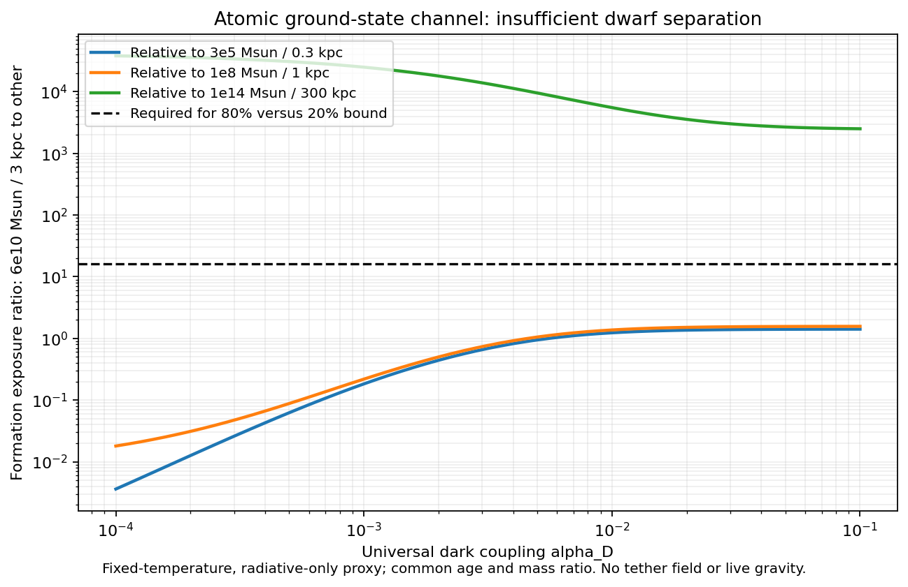

# Microscopic interaction test: calculable chemistry, failed tether completion

We derived and implemented a concrete Coulombic radiative channel
X+C <-> A+gamma_D. Once the universal masses and coupling are specified, the
ground binding energy B=mu*c²*alpha_D²/2, size, photoionization cross section and
inverse recombination rate are linked. Binding energy and forward/reverse rate
normalizations are no longer independent fitted parameters. The masses and
coupling themselves remain inputs; they have not been derived from first principles.

**Result: this candidate does not provide the requested disk/dwarf/cluster
tether mechanism.** There are separate structural and finite-test failures.

## Structural test

The resulting atom is neutral under the U(1) that binds it. It cannot be the
sole positive source of our existing tether field. This is charge conservation,
not an unfavorable parameter fit. A simple additional canonical scalar can
have state-dependent charge, but identical scalar sources attract, whereas the
existing weak-field tether contribution repels. Neither identification works.
See [the field compatibility derivation](FIELD_COMPATIBILITY.md).

The existing 3D solver is preserved unchanged. We did not attach a fictitious
T charge to neutral atoms, omit the binding mass defect from a claimed exact
relativistic model, or insert an arbitrary negative energy into capture. No new
live-gravity result or galaxy acceleration-relation success is claimed.

## Finite environmental test

Using the four existing numeric mass/radius families, a common 10 Gyr age, a common
virial-temperature/mean-density prescription, and no morphology flags:

| Test | Result |
|---|---:|
| Universal parameter combinations | 1,891 |
| Profile evaluations | 7,564 |
| Large-disk proxy >=80% atomic, other three <=20% | 0 combinations |
| Maximum disk / smallest-dwarf formation exposure | 1.41190 |
| Maximum disk / second-dwarf formation exposure | 1.56880 |
| Exposure ratio required by that 80%/20% screen | 16 |
| Largest disk fraction consistent with smallest dwarf <=20%, across sampled couplings and arbitrary common exposure normalization | 26.09% |

The scan covers 61 alpha_D values from 1e-4 to .1 and 31 mC values from 1 keV to 1 GeV,
with mX=10mC. Formation exposures scale as mC^-3 at fixed coupling and mass
ratio, so the dwarf-separation problem cannot be repaired by changing the common
mass scale within this screen. The maximum ratio is a finite sampled result,
not a proof for all couplings. Cluster suppression is much stronger than dwarf
suppression; the dwarfs are the limiting comparison.

These are **ground-state, radiative-only, fixed-temperature one-zone proxies**.
They omit collisional ionization, excited levels, transfer of trapped photons,
gravitational assembly and disk formation. The fixed-temperature screen implies
a thermostat and is distinct from the energy-conserving tests below. Only 24
parameter combinations satisfy a conservative all-neutral threshold-opacity
<.1 screen in all four profiles; even those do not establish all other omitted
processes are negligible. The test therefore excludes the stated simplified
route, not all atomic dark matter. It cannot establish present-day galaxy masses.



## Numerical and energy checks

| Check | Result |
|---|---:|
| Hydrogen binding-energy benchmark | 13.598287eV |
| Hydrogen threshold cross section | 6.31119e-18cm² |
| Maximum relative thermal detailed-balance mismatch | 4.45e-16 |
| Independent speed-space vs energy-space quadrature mismatch | 6.35e-10 |
| Maximum normalized energy drift in eight parcel integrations | 1.20e-9 |
| Maximum bound-fraction change on tolerance refinement | 1.28e-9 |
| Common-flow boost rate ratio | 1.0 |
| Unit tests | 4 passed |

Four escaping-radiation parcels start at T/B=.01,.1,1,10 and run to
tau=n*k_initial*t=10, at two solver tolerances. Their ledger includes thermal,
negative binding, and escaped radiation energy. No restitution coefficient or
energy projection is used. This is leading nonrelativistic energy conservation;
photon recoil is not resolved. In these parcels recombination raises temperature
by preferentially capturing low-relative-energy pairs, despite energy escaping.
Treating every emitted photon as a drop in temperature would be incorrect.

## What has been reduced, and what is next

This calculation replaces an independent gap and two independent rate choices
with one specified Hamiltonian and related matrix elements. It also rejects two
simple mappings to the old field: neutral atoms as its gauge charges, and
identical canonical scalar charges as its repulsive sources.

The next missing input is an action with a consistent field-source inventory.
A charged conversion needs an explicit countercharge carrier or charged anchor;
a collective neutral response needs a derivation of its field energy and source
coupling. Both must recover the acceleration law and conserve the full reaction
energy. Deriving those ingredients comes before another live capture run.

## Files and reproducibility

- [DERIVATION.md](DERIVATION.md): Hamiltonian, spectrum, Milne relation, energy ledger and screen.
- [FIELD_COMPATIBILITY.md](FIELD_COMPATIBILITY.md): gauge and scalar restrictions.
- [AUDIT.md](AUDIT.md): self-review, exact scope and qualifications.
- [atomic.py](atomic.py): reusable microscopic rate and reacting-parcel module.
- [experiment.py](experiment.py): bounded checks and parameter screen.
- [run_channel/results.json](run_channel/results.json): all rows and diagnostics.
- [run_channel/manifest.json](run_channel/manifest.json): completed hashed numerical run.
- [run_figure/manifest.json](run_figure/manifest.json): completed figure provenance.

From the repository root, basic reproduction is:

```bash
PYTHONDONTWRITEBYTECODE=1 OPENBLAS_NUM_THREADS=1 python3 two_state_mechanism_2026_10_24/microscopic_capture/test_atomic.py
PYTHONDONTWRITEBYTECODE=1 OPENBLAS_NUM_THREADS=1 python3 two_state_mechanism_2026_10_24/microscopic_capture/experiment.py --output /private/tmp/microscopic-channel-reproduction.json
```

For a new provenance run, use the computation-audit bounded runner with
`contract.json`, all six `execution_artifacts` as repeated `--input`, a fresh
output directory and its `results.json` as `--result`, timeout 180 s and one thread.
The saved manifest records the actual argv, inputs, versions and limits.
Both manifests were validated against current inputs. Existing solver evidence
was not modified. No publication, commit or independent review is claimed.

## Sources

The Coulomb photoionization matrix element is taken from Eq27 of
[Rosenberg & Fan, Cooling in a dissipative dark sector](https://link.aps.org/accepted/10.1103/PhysRevD.96.123001).
The inverse-rate derivation and numerical balance tests are supplied here.
[Cyr-Racine & Sigurdson](https://arxiv.org/abs/1209.5752) provide atomic-dark-matter
context, not a derivation of our tether field. The original Zenodo URL was
inaccessible to this turn's web tool; this report does not attribute its
microscopic proposal or conclusions to that paper.
