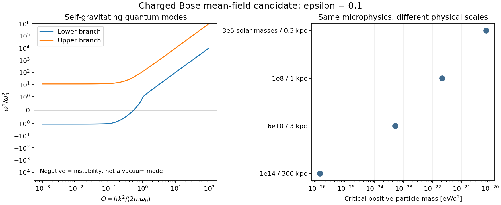

# Interacting quantum medium: spectrum, mass, state and physical-scale test

**A quantum physical scale emerges, but this candidate does not establish the
required critical dipole response or disk/dwarf/cluster population separation.**
This is a derived mean-field candidate with verified finite numerical tests,
not an exact interacting many-body solution or a successful galaxy mechanism.

We use two oppositely charged bosonic fields with masses m and epsilon*m,
equal mean number density n, and Coulomb plus gravitational interactions.
The cold coherent state is explicit but assumed, not dynamically prepared.
All constituent rest mass rho=n*m*(1+epsilon) gravitates. Both charges transport.
No separate medium reservoir, fitted gap distribution or capture rate is added.

[Full derivation](DERIVATION.md) obtains the longitudinal dynamical matrix:

D_st = delta_st*hbar²*k⁴/(4*m_s²)
       + n*q_s*q_t/sqrt(m_s*m_t) - 4*pi*G*n*sqrt(m_s*m_t).

Diagonalizing this matrix gives the frequencies; projecting its eigenvectors
onto the electric dipole vector gives their actual response strengths. The
retarded response and spectral weights follow from the same quadratic Hamiltonian.
A negative frequency squared denotes an unstable state, not a stationary
zero-energy excitation. The interacting quantum calculation is at Gaussian /
Bogoliubov / linearized Hartree order; molecular correlations and nonlinear
quantum depletion are not solved.

## Parameter reduction and remaining assumptions

Conditional vacuum force matching fixes q²/(4*pi)=G*m². This is imposed to match
forces, not derived from gauge symmetry. The microscopic mass m and mass ratio
epsilon remain free. Quantum pressure and the spectrum then follow without an
independent sound speed, spring constant or spectral exponent.

An optional symmetry exchanging the two matter species and reversing the gauge
field sets epsilon=1. That reduces microscopic freedom to m, but has a sharp
consequence: the gravitational branch is electrically dark at every k in this
homogeneous quadratic model, while the charged branch remains gapped. This
symmetry is a model hypothesis, not a reason to assume all countercharges must
have equal mass. For unequal masses there is finite-k mode mixing.

Density, temperature, rotation and preparation are state variables. Here the
cold state is assumed and density uses the same full dark-inventory prescription
for every input. Large phase-space occupation is compatible with a field model;
it does not prove condensation, equilibration or a stable global ground state.
No full medium equation of state, self-consistent halo equilibrium or observed
population distribution has been derived.

## Physical scale: real, but insufficient

Quantum pressure gives k_J²=2*m*omega0*Q_J/hbar, with
omega0²=4*pi*G*rho/(1+epsilon) and Q_J fixed algebraically by epsilon.
This breaks classical mass-size homology. Its location still depends on the
undetermined particle mass. For a common k=pi/b object-scale diagnostic and
rho=5.364*M_b/(4*pi*b³/3), the threshold mass is proportional to 1/sqrt(M_b*b).

At epsilon=.1:

| Baryonic mass (solar masses) | Size (kpc) | Threshold m (eV/c²) |
|---:|---:|---:|
| 3e5 | .3 | 7.236e-21 |
| 1e8 | 1 | 2.171e-22 |
| 6e10 | 3 | 5.117e-24 |
| 1e14 | 300 | 1.253e-26 |

Below the threshold, the chosen longitudinal mode is quantum-pressure-stable;
above it, it is Jeans-unstable. These are local inventory proxies with a chosen
wavelength, not exact finite-galaxy eigenmodes. Baryons supply the inventory and
velocity estimates; their live perturbations are not evolved in this calculation.

For example m=1e-22 eV/c² stabilizes the two smaller inputs while both the
large-disk and cluster scales are unstable. Scanning 723 common (m,epsilon)
points finds zero cases with the smallest dwarf and cluster stable while the
large disk is unstable. Of these points, 378 meet the conservative
hbar*k/(m_minus*c)<.1 condition in all four inputs. The zero count follows
from the analytic threshold ordering, not just the finite scan.

**Stability is not tethering, and instability is not a retained-free-mass
prediction.** This test therefore rules out that particular stability ordering
as the selector; it does not exclude all possible nonlinear outcomes. Rotation,
shear and disk assembly have not been modeled. A uniform bulk velocity only
Doppler-shifts the response. The critical acceleration at the threshold scales
as hbar²/(m²*b³), rather than supplying a size-independent a0. No galaxy
acceleration-relation fit or charged tethered population is established.

## What was verified

- 606 mode spectra, including gravity-on/off cases and epsilon=.01,.1,1.
- Oscillator-strength completeness error: 2.81e-16 relative.
- Modal response versus direct matrix resolvent: 2.42e-16 discrepancy.
- Equal-mass analytic eigenvalues: 2.22e-16 absolute discrepancy.
- Independent Fourier-field linearization agrees within 2.02e-12 at the
  smallest perturbation amplitude; error decreases quadratically with amplitude.
- Twelve stable/unstable quadratic-mode evolutions: finest-tolerance energy
  error at most 5.21e-11 relative to the initial positive energy scale.

[The nonlinear 3D test](WAVE_CONTRACT.md) evolves both charged wavefunctions
with live Coulomb and gravitational potentials in a periodic box. Nine runs use
12³/18³/24³ grids and dt=.01/.005/.0025. Both species numbers are conserved to
7.25e-14. Energy errors, normalized by the initial absolute energy components,
fall from 7.00e-5 to 1.75e-5 to 4.38e-6. Wavefunction timestep differences also
fall by four; final tested density-mode amplitudes agree across grids within
about 1.1e-14. No energy correction or number renormalization is applied.

This is short, weakly nonlinear evolution of a specified mean-field state, not
long-time collapse or quantum many-body convergence. The periodic gravity
zero mode is omitted; it is not an isolated halo calculation. The equations
are Schrödinger/Poisson/electrostatic approximations, not full causal Maxwell
or relativistic gravity evolution. Newtonian gravity includes rest mass but
not the relativistic gravitational effect of field/binding energy.

## Important response distinction

The calculated longitudinal susceptibility already contains the internal Coulomb
interaction. It is a response to an external source, not automatically the
irreducible local constitutive susceptibility used by the predecessor's Maxwell
medium. Feeding it back as that susceptibility would double-count Coulomb forces.
The conversion requires a consistent polarization kernel and nonlinear response.
A Jeans pole, mechanical DOS or finite-k mode mixture does not derive the
previous n(s)d proportional to s distribution of saturable internal dipoles.

The next scientific obligation remains a stable, prepared medium with a derived
nonlinear dipole response. The current candidate has no radiative capture law,
saturable tethering channel or demonstrated disk-specific state transition.
Adding an arbitrary contact coupling or choosing a different particle mass for
each galaxy would evade rather than solve the parameter-reduction requirement.

## Evidence and reproduction

All three manifests have status completed and validate against current inputs:

- [Response/physical scan](run_response/manifest.json), [results](run_response/results.json)
- [3D evolution](run_wave/manifest.json), [results](run_wave/results.json)
- [Independent check and figure](run_audit/manifest.json), [results](run_audit/results.json)

Contracts and manifests retain exact bounded-runner argv, software versions,
input/output hashes and tested ranges. No random inputs are used. The scripts
accept `--output <new-result.json>`; use the recorded bounded-runner invocation
with a fresh output directory for provenance-bearing reruns. Previous-stage
sources and manifests were not edited; no manuscript or publication was changed.

Primary literature context is linked in DERIVATION.md. Those sources describe
related charged Bose and quantum Jeans calculations, not proof of this proposed
dark-matter mechanism.
