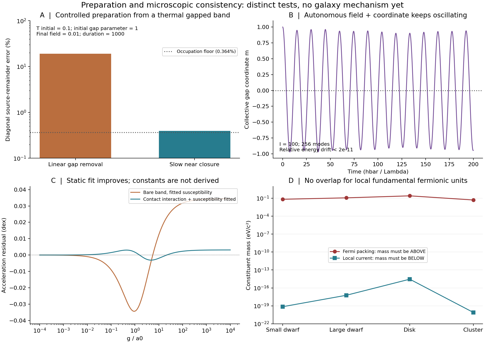

# State preparation improved; the local fundamental-fermion interpretation fails

**The original galaxy mechanism is still unresolved.** This checkpoint does
more than fit another spectrum: it tests preparation, includes a dynamical
collective coordinate and field, derives interaction feedback, and combines
previously separate microscopic mass requirements.

## Strongest new physical restriction

[Combining the same charge, inventory and acceleration scale](COMBINED_BOUNDS.md)
removes the freedom to choose the carrier mass, bandwidth and dipole length
independently. If each nodal-band fermion is a local nonrelativistic dipolar matter
unit built from the tether carriers, the current bound and Fermi packing bound
have **no overlapping mass interval** in all 16 checked combinations of four
profiles, two mass ratios and two static-response parameter sets.

For the generous disk inventory, the original response and epsilon=.1:

- Current identity requires constituent mass m_+ <= **2.859e-15 eV/c^2**.
- Packing the same fundamental fermionic units, even allowing eight internal
  states and momenta up to M*c, requires m_+ >= **0.2545 eV/c^2**.
- The optional canonical oscillator-strength bound tightens the upper value
  to **9.306e-20 eV/c^2**.

The gap between the first two bounds is nearly 14 orders of magnitude. Lowering
the available medium density makes the incompatibility worse. For the displayed
contact-response model, approaching critical coupling tightens the current mass
ceiling by (1-lambda)^4 at fixed effective susceptibility and density.

This rejects a specific microscopic identification, not all quantum media.
Emergent fermionic excitations need not have the rest mass or particle count of
the material carrying them. Bosonic units, different current operators, strongly
relativistic binding and different source couplings also require separate
analysis. The written hypotheses are part of the result.

## A better prepared state is reachable under explicit control

A thermal gapped band, with initial m=1 and kBT/Lambda=.1, can be transformed to
m=0 and field e=.01 by slowing the gap change near closure. The source-relevant
remainder chi*E-P then differs from its cold target by:

| Diagnostic | Relative error |
|---|---:|
| Linear-gap protocol, duration 1000 | 18.98% |
| Angular-gap protocol, diagonal projection | 0.3938% |
| Actual time average over the first 1000 hold units | 0.3542% |
| Actual time average over hold units 1000--2000 | 0.3927% |

The diagonal value is stable from 96 to 768 modes and under timestep halving.
A separate DOP853 calculation checks up to 1536 modes and two tolerances; its
finite holds use exact post-ramp precession, not forced dephasing. Instantaneous
polarization required finer modes than the diagonal observable. No result here
assumes the diagonal ensemble is irreversible cooling.

The protocol requires **positive work**, about 3.097736 in the stated energy
units. The independent continuous-work calculation has final energy/work residual
below 1e-13; the discrete rotation/quench ledger is also checked. The initial
band, its thermal preparation, half filling and the controlled gap trajectory
are still assumptions. This is reachability, not autonomous galaxy assembly.

An exact blockwise invariant explains the gain: quadratic unitary evolution
preserves covariance eigenvalues. At the same initial temperature .1, starting
from a gapless band has a best possible diagonal source error of **1302.7%**;
starting gapped lowers that bound to **0.36394%**. This does not exclude entropy
transfer by interactions or to other degrees of freedom.

## Removing the controller exposes the energy problem

The [autonomous test](DERIVATION.md) couples a massive collective coordinate to
Bloch modes and a live homogeneous Maxwell displacement sector. It has no
prescribed field history, friction or energy sink. The initial state has excess
energy **8.122631**, or **1.44786 per occupied weight**, relative to the reference
nodal ground state.

For inertia I=100, time 200 and 256 modes, the late-time gap-coordinate RMS is
**0.66631**; the mean field is **0.03631** versus reference **0.01**. The results
agree at 128 and 256 modes. Relative energy error is below2e-11 in that refined
case. Smaller and larger inertias also retain excitations in the tested windows.
This is not a proof of infinite-time relaxation failure. It demonstrates that
energy cannot simply disappear when the external control is removed.

The field test is homogeneous. It does not replace or claim to complete the
project's 3D solver, live gravity, radiation escape or countercharge transport.
Spatial energy transport remains a meaningful open continuation.

## Interaction and cooling checks

An explicit attractive contact channel fixes the mean-field ordered mass to
m/Lambda=(lambda^2-1)/(2*lambda) for lambda>1. It creates a gap, rather than
deriving the nodal phase. In a field-coupled channel it also renormalizes the
susceptibility and field scale; omitting this feedback is inconsistent.

A diagnostic two-parameter static fit reaches maximum acceleration residual
**0.003114 dex** against the simple interpolation law on 4001 points spanning
g/a0=1e-4 to1e4, at lambda=.3875 and chi_eff=138.6225. This is **not** an
observational fit or a first-principles determination. It does not cure the
microscopic mass inconsistency; that fit's local current bound is tighter.
The new fit range differs from preceding stages, so compare only results with
the same grid and residual definition.

[Independent vacuum dipole emission](RADIATIVE_GATE.md), using the existing
charge rather than a fitted cooling rate, is far too slow for elementary-mass
emitters in the local-pair realization. Even an optimistic disk bound with
omega*ell/c<=.1 needs m_+ >=9.09e-12 kg for one transition in10 Gyr. For a1 TeV
emitter the lifetime lower bound is2.60e35 years. These rate limits are conditional
on independent local dipoles and vacuum radiation; they do not constrain a
collective emission process with a different current/inventory mapping.

## Collective alternative checked, not presumed successful

[The source check](COLLECTIVE_LITERATURE.md) examines Kitaev spin-liquid routes.
They offer genuine emergent fermions, so the fundamental-unit packing argument
does not transfer automatically. However, physical probe matrix elements can
change a gapped flux sector. In checked electric-field examples, the leading
terms shift nodes, generate chemical-potential pockets, or give an E-even mass;
none supplies our required field-linear mass with its inventory and state.
The pocket contribution has the wrong cubic sign. Other 3D physical electric
operators remain open research routes. A magnetic field is not galaxy rotation.

## Evidence and reproduction

Seven successful bounded manifests accompany scripts, contracts and outputs:
run_prepare, run_autonomous, run_refine, run_radiative, run_combined_v2, run_hold,
and run_figure. `run_combined` is a retained failed invocation: its output
argument had a directory typo. No scientific input changed before the corrected
run. It is not evidence for or against the physical claim.

Each script accepts `--output`; e.g. run `python3 prepare.py --output <new.json>`
from this directory with NumPy/SciPy installed. `refine.py` imports the adjacent
prepare/autonomous modules. `plot.py` reads the saved results and needs
Matplotlib. Bounded-runner contracts pin the complete declared input set;
[validation](VALIDATION.json) records fresh checks. [Audit](AUDIT.md) separates
exact conditional derivations, finite numerical results and unresolved physics.

No common microscopic model yet produces tethered disks and adequate free mass
in dwarfs/clusters while preserving acceleration and lensing constraints. The
next construction must supply collective electric matrix elements, gravitating
inventory, a physical state-preparation path and energy export together.
