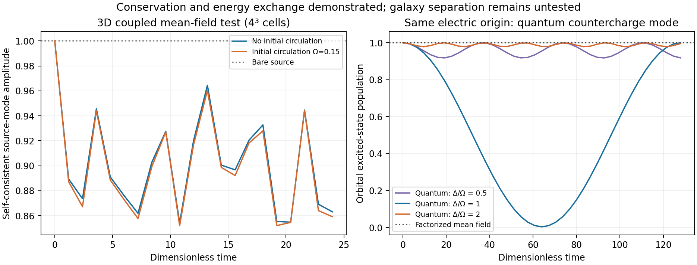

# Coupled orbital field and energy carriers

**The self-consistent coupling is implemented and tested. Disk formation and
free-matter retention in dwarfs/clusters are not demonstrated.** This is a
microscopic lattice checkpoint, not a galaxy simulation.

## What is now coupled

The 3D Hamiltonian evolves orbital wavefunctions, their monopole charge and
internal dipole polarization, the resulting Poisson field, moving ionic
countercharges, and elastic energy carriers. Both site potential and dipole
mass use the same computed field. Counterion forces and electronic forces are
derivatives of the same total energy; no independent capture or damping rate
is introduced. Local charge continuity is checked, not merely global neutrality.

Nineteen trajectories cover common-coefficient initial states, controls,
timestep checks and longer evolution. The main 3x3 initial-state grid varies
occupation temperature .05/.2/.8 and circulation parameter0/.05/.15. No galaxy
label appears in the dynamics. The circulation parameter is a finite periodic
lattice diagnostic, not a simulation of a physical rotating galaxy.

## Results and numerical limits

- For the4³ case at temperature.2, circulation.15, energy error falls
  7.086e-8 ->1.771e-8 ->4.428e-9 when dt halves .02 ->.01 ->.005. This is the
  expected second-order convergence. The finest error is3.18e-11 relative to
  total energy, but1.38e-6 relative to the much smaller initial electric energy;
  the latter is the more stringent useful normalization.
- The local continuity residual is2.39e-16, with an independent finite-difference
  charge-derivative error4.28e-10. Occupation-spectrum preservation is verified
  through the full weighted-orbital Gram matrix.
- At time6 the4³ source-mode field ratio is .876009 without circulation and
  .872753 at circulation.15 (temperature.2, common coefficients). Ionic kinetic
  plus elastic energy is .00025056 versus .00039755. Both respond and exchange
  energy. A no-source circulating control itself generates .00014875 ionic
  energy: the difference must NOT be attributed entirely to field-induced cooling.
- Time24 tests continue to oscillate; final field ratios .863115/.859203. They
  do not establish irreversible relaxation or selective assembly.
- The6³ test gives .817625/.794762 for zero/nonzero circulation at time6.
  It changes box size, probe wavelength and circulating initial state; it is
  NOT a continuum or clean same-wavelength finite-volume convergence test.
  Its rotating energy error also improves by4 on halving dt. No universal
  rotation-dependent response or astrophysical fit is extracted.

## Quantum channel that mean field misses

A fully quantized local countercharge benchmark uses the same electric energy
kappa(D-d sigma_x+Qx)^2/2. That energy fixes BOTH oscillator stiffening and
orbital-mode coupling:

Omega²=(K+kappa Q²)/M,  g_q=-kappa d Q sqrt[hbar/(2M Omega)].

No decay rate is fitted. With M100,K10,kappa1,Q1,d.2, Omega=.33166248 and
|g_q|=.02455652. At resonance the full quantum calculation reduces excited-state
population from1 to .00394325 at time63.9666, while creating about1 phonon.
For this parity-symmetric initial state the mean displacement and mean dipole
remain zero, so factorized Ehrenfest dynamics incorrectly remains stuck.
Energy error is below1.2e-14, and16/24 oscillator-state cutoffs agree within
1.5e-13 on sampled populations. Off-resonance ratiosDelta/Omega=.5 and2 give
minimum excited populations .91777 and .97875. This is reversible finite-mode
exchange, NOT a universal cooling rate or a disk selector.

## What remains unresolved

The positive result is a conserving self-consistent field/countercharge coupling
and an explicit quantum energy-transfer channel. Neither creates a positively
charged tethered species. The reference lattice already assumes bound material,
has no assembly/dissociation process, and cannot form a disk from free matter.
Consequently reporting tether/free fractions from these observables would be
inventing the missing mechanism. Gravity and radiative Maxwell dynamics are
also absent, and all microscopic-to-galactic units remain unspecified.

Free parameters were linked where the Hamiltonian requires it; they were not
all fixed from first principles. The deformation derivative is an explicit
confinement-model assumption. Ionic mass, stiffness, electric strength, orbital
length and band parameters still need a material derivation.

[Hamiltonian and solver](DERIVATION.md) · [Quantum benchmark](QUANTUM_CHECK.md) ·
[Audit](AUDIT.md) · [Continuation](HANDOFF.md) · [Validation](VALIDATION.json)
