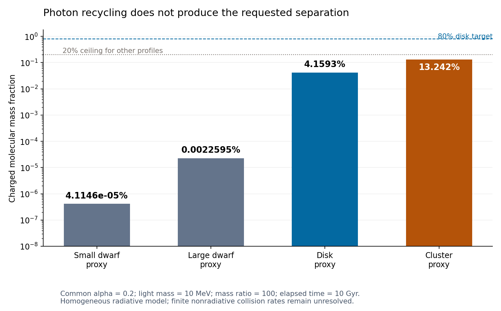

# Photon trapping, recycling and collision limits

**Photon recycling is implemented and tested, but the requested physical
finite-rate collision network is not complete. Neither tested limit produces
the desired disk/dwarf/cluster separation.** No rotating galaxy or acceleration
relation has been simulated in this stage.

The model now follows frequency-resolved photon populations, absorption,
spontaneous and stimulated capture, stored radiation energy and escape. Atomic
photoionization and breakup of all23 charged molecular levels use the existing
Coulomb dipoles and their Milne inverses. Photon flight/absorption/escape moments
come from homogeneous-sphere geometry; there is no fitted opacity or cooling time.
The same equations and microscopic parameters apply to all four mass/radius
profiles. Labels identify outputs; they do not change reactions.

## Recycling changes the result, but does not select disks

The main radiative scan evolves24 trajectories at six shared parameter choices:
alpha=.15/.2, light mass1/10/316.228 MeV, mass ratio100, age10 Gyr. Three choices
pass the stated temperature, dilute-gas, classical and weak-plasma screens in
all four profiles. The opaque cases no longer fail merely because photons do
not escape freely: absorption and re-emission are explicitly followed.

The largest disk molecular fraction among those three choices is at alpha=.2
and light mass10 MeV. Refining the photon quadrature gives:

| Input profile | Charged molecular mass fraction |
|---|---:|
| Small dwarf proxy |4.11457e-7|
| Large dwarf proxy |2.25955e-5|
| Disk proxy |**0.0415933 = 4.15933%**|
| Cluster proxy |**0.132425 = 13.2425%**|

This remains far below the inherited80% disk target, with more molecular mass
in the cluster proxy than the disk proxy. The largest raw disk fraction is
about17.4%, but that common parameter choice fails the low-temperature screen;
it is not counted as an applicable result. No target success occurs in this
finite scan. The80%/20% screen is an inherited operational target, not a new
observationally derived abundance requirement.

A useful newly resolved reaction cycle is

    X+C -> A+photon;  T+photon -> A+X;  net T+C -> 2A.

Atomic capture photons can therefore break charged molecules and deposit the
energy difference in the gas. Its inverse is also present when molecular
capture produces a sufficiently energetic photon. This photon-mediated channel
needs no new collision coefficient. It is distinct from direct nonradiative
dissociative recombination. Recycling can also keep positive carriers available
by reionizing atoms. The earlier irreversible4.42% kinetic cap consequently
does NOT apply here; some computed radiative cases exceed it.

## Missing collisions: a controlled limit, not invented rates

The additional direct channels include impact ionization and its three-body
inverse, molecular impact breakup and its association inverse, dissociative
recombination/associative ionization, and internal-state collisions. Their energy
defects and equilibrium ratios follow from the current spectrum. Their finite
absolute rates require additional scattering amplitudes. Multiplying both
directions by any common positive function preserves conservation and detailed
balance while changing the dynamics; those constraints cannot determine the
missing function.

A separate24-trajectory calculation takes these collisions infinitely fast on
the retained species set X,C,A,T_b. It evolves matter energy and the same photon
reservoir while chemistry stays on the Saha manifold. The initially ionized
state relaxes to that manifold at the same total energy and constituent counts.
This is a singular limit test, not a predicted collision timescale or an
assumption that real halos are in chemical equilibrium.

All six fast-limit choices pass the stated thermodynamic screens; no target is
met. Their largest disk charged-molecule fraction is about1.22e-26. A separate
analytic constraint on this manifold gives **molecular mass fraction<=55.955%**
at every density and temperature, using the23-level spectrum and its total
rotational weight147. Thus neither density nor age can rescue the80% target in
this fast-chemistry model. This bound does not cover finite intermediate rates,
additional species, or the radiative nonequilibrium trajectories.

## What was verified

- Matter kinetic/binding energy + stored photons + escaped radiation is one
  conserved ledger. Main runs have maximum error1.20e-15 E_H per initial pair;
  charge error<=1.12e-16 charges per pair.
- Increasing quadrature order6 to9 changes the selected disk/cluster fractions
  by at most0.0076%. The earlier order3 disk value differs by1.9%, so refined
  values, not the coarse scan value, are quoted above.
- Discrete Planck/Saha stationarity holds to3.7e-15 in the tested channels;
  an independent geometry quadrature verifies the escape formula.
- Analytic Jacobian matches a directional finite difference to2.3e-9 relative.
- The new code agrees with the previous optically thin solver to0.0122% in a
  genuinely thin comparison. The selected fast-limit result changes by0.0230%
  under frequency/time refinement.
- A closed-box run conserves photon/chemical count as well as energy and charge.
  It does not establish thermalization to a full Planck spectrum.

## Remaining scope

The photons use a homogeneous, memoryless transport closure that reproduces
single-flight sphere moments. Spatial radiation gradients, angular transport,
self-gravity and rotation are not evolved. Passing numerical and gas-regime
screens does not validate that spatial closure in an opaque real halo.

Finite direct two-electron collision rates remain **uncomputed**. Neutral
molecules, negative ions, excited atomic states and their reactions/cooling are
also absent. The existing one-electron g/u spectrum cannot supply their
state-resolved scattering matrices. Published ordinary-hydrogen rates were
checked, but were not transplanted to mass ratio100 and labeled first principles.
The two limits tested here do not rigorously bracket all intermediate dynamics.

Mass ratio100, alpha, constituent mass and the common mass inventory remain
hypotheses. There is no new fitted forward/reverse rate, escape time or galaxy-type
switch, but a complete physical model and an explanation of tethered disks are
still open. Charged molecular mass must not be equated with a tethered orbital
population, and non-molecular mass includes neutral atoms.

[Equations](DERIVATION.md) · [Reaction cycles and bounds](REACTIONS.md) ·
[Source check](SOURCES.md) · [Audit](AUDIT.md) · [Handoff](HANDOFF.md) ·
[Validated manifests](VALIDATION.json)
