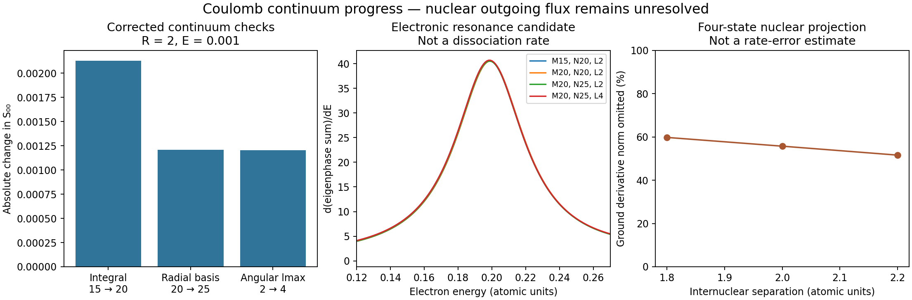

# Continuum amplitudes and nuclear couplings — 26 October 2026

**Computed: fixed-nuclei two-electron Coulomb scattering matrices and finite-basis
radial nuclear derivative couplings. Not computed: physical dissociative
recombination rates or a new photon-coupled disk/dwarf/cluster comparison.**
The requested population separation and galaxy acceleration relation remain
unexplained. No galaxy-type switches or fitted collision normalization were added.

This stage follows [the bound-channel and finite-rate interface](../../two_state_mechanism_2026_10_25/scattering/README.md).
It replaces neither the previous photon transport nor the unresolved nuclear
outgoing-boundary problem with an artificial chemical rate.

## Concrete numerical results

We built UKRmol-in3.3.0 and UKRmol-out3.3.0.1 from authenticated public source.
PySCF supplies the ionic target and independent two-electron CI checks. The
scattering calculation uses singlet Ag symmetry, an18-state aug-cc-pVDZ target,
a20-Bohr inner sphere, and an explicit electronic Coulomb continuum. Ag is not
all molecular symmetries; the result is not a spin-averaged total cross section.

At separation R=2 and incident electron energy E=0.001 (dark atomic units):

| Integral order | B splines | Continuum lmax | Lowest inner pole | S00 |
|---:|---:|---:|---:|---|
|15|20|2|−1.1351932709|0.81507003−0.57648788i|
|20|20|2|−1.1349385878|0.81380933−0.57820411i|
|20|25|2|−1.1350454579|0.81449914−0.57721139i|
|20|25|4|−1.1351739037|0.81522525−0.57625195i|

The respective absolute S00 changes are0.002130,0.001209 and0.001203.
The angular refinement changes the whole eigenphase sum by0.03099 radians:
stability of one matrix element does not establish convergence of the entire
scattering matrix. Matching radius80→160 changes S00 by about1.74e−5 and the
phase sum by5.52e−6 radians, using approximately one-Bohr propagation intervals.
Target-basis, inner-radius, higher partial-wave and threshold convergence remain.

Four corrected300-point scans over E=0.001…0.300 find an eigenphase-derivative
peak at the same grid energy0.199. Peak slopes range40.524…40.700. This is a
fixed-nuclei electronic resonance candidate, at grid resolution0.001; it is
**not a nuclear reaction probability, a fitted resonance width, or a rate**.

At R=2, the moving-basis four-state nuclear calculation gives ground derivative
norm0.1962041, of which55.7279% lies outside the four retained states. Across
R=1.8,2,2.2 the omitted fractions are59.78%,55.73%,51.59%. Halving the derivative
step from0.01 to0.005 reduces antisymmetry errors by approximately four; the ground
metric changes by less than5e−6. This tests differentiation, not electronic-basis
completeness. At nuclear reduced mass50 the radial adiabatic correction is
0.00196204. It is only the radial contribution, not the full finite-mass correction.

## Rejected results are retained, not silently overwritten

The initial mixed-integral multipole cutoff8 produced impossible deep inner
poles (roughly−8 to−31 in several R=2 runs). These matrices were still unitary.
A Gaussian-only Hamiltonian from the same stored integrals agrees with independent
PySCF CI; restoring mixed-integral order15 removes the deep poles, and order20
provides the comparison above. All order8 amplitudes, apparent resonances and
separation-derivative convergence results are rejected. `run_scan` is rejected.
The completed runner status means only that execution finished.

The historical pinned `run_point.py` defaults to that rejected cutoff. Always
supply `--multipole20` in new candidate runs. Do not consume an archived matrix
without its classification in [run_audit/results.json](run_audit/results.json).
The supplied full upstream integral test timed out; no upstream benchmark pass
is claimed. See [AUDIT.md](AUDIT.md) for the evidence boundary.

## Energy, charge, and the missing rate

The electronic calculation uses a Hermitian Coulomb Hamiltonian at conserved
collision energy; all present open channels are elastic at fixed nuclei. Its
unitarity defect is numerical error, not dissociative recombination loss.
For T=X2C+ and C−, recombination into two neutral atoms conserves charge and
constituent number. To obtain its coefficient requires nuclear outgoing flux,
spin weighting and product branching from the same Hamiltonian. These are absent.
The four finite-basis derivative states cannot supply the missing continuum by
a completeness identity: their measured omitted norm is substantial.

The dimensional rate factor remains hbar²/(m_C² c alpha); its dimensionless
reaction probability is unresolved. No independent rate amplitude is introduced.
The earlier energy-conserving photon adapter assumes two ground-state atom
products. Excited atom branches release a different energy and need explicit
state populations and matching inverse reactions before coupling. Existing
charge/energy software checks are not new validation of physical chemistry.
There are zero new physical halo trajectories, no live gravitational assembly,
no rotating-disk morphology calculation, and no new acceleration-relation test.

## Reproduce / continue

- [BUILD.md](BUILD.md), [SOFTWARE.json](SOFTWARE.json): external dependencies and caveats.
- [DERIVATION.md](DERIVATION.md): Hamiltonian conventions, nuclear overlaps and rate boundary.
- [VALIDATION.md](VALIDATION.md): commands and verification results.
- [SOURCES.md](SOURCES.md): primary sources and limitations of imported methods.
- [HANDOFF.md](HANDOFF.md): the exact remaining computational problem.
- `run_*/manifest.json`: pinned inputs, executed commands, results and provenance.
- `audit.py`: reproducible classification and numerical comparisons.

