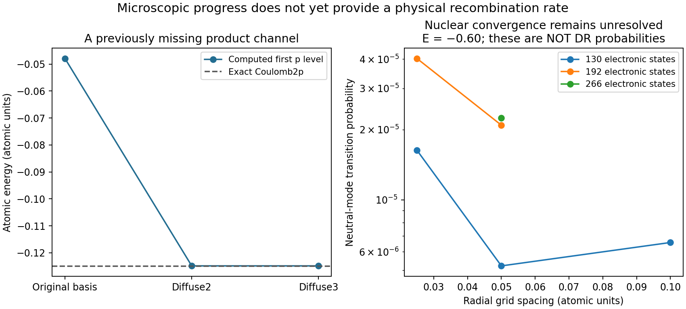

# Nuclear flux and microscopic capture kernels

**The requested full dissociation rates, product branching and photon-coupled
population test are not yet established.** This continuation computed missing
operators, found two concrete sources of false branching, and tested a larger
nuclear calculation. It does not show that disks become tethered or that dwarfs
and clusters retain free matter. No galaxy-type switches or fitted collision
normalization were introduced.

## What was actually computed

1. **Microscopic capture/escape coupling.**Reconstructed the bound and continuum
   blocks of the corrected UKRmol Coulomb Hamiltonian at separations R=2,3,4.
   Eliminating the electronic continuum gives an energy-dependent electronic
   self-energy Sigma and capture-amplitude matrix A. The identity
   i(Sigma−Sigma†)=A A† holds to at worst2.0e−14 relative error in the nine tested
   cases. This fixes capture/escape normalization from the same Hamiltonian.
   It is not the full electron+nuclear dissociation kernel. The pure-Coulomb
   exterior differs from the propagated UKRmol S matrix by0.00146,0.00374,0.00755
   at incident energy0.001 for those separations: outer multipoles remain an error.
2. **Actual outgoing nuclear flux in a restricted model.**Implemented radial
   multichannel scattering with moving-center electronic overlaps, retaining
   up to266 singlet Ag states. The coupled asymptotic boundary has flux and
   reciprocity residuals below8e−10 in the reported comparisons. This is neutral,
   fixed-axis scattering, with no incident-electron source or full rotation.
   It is not a DR rate or DR product-branch calculation.
3. **Independent electronic and numerical checks.**Selected lowest three
   energies agree with PySCF FCI to4.5e−11 or better. The stored-grid and streamed
   nuclear solvers agree in probabilities to1.5e−12. Analytic lattice phases,
   closed channels, electronic sign changes and a coupled-lead boundary-location
   test pass. These check implementation, not physical convergence.
4. **Derived atomic radiation and conservative branch bookkeeping.**The exact
   Coulomb2p->1s electric-dipole coefficient is0.03901844 alpha³/t_D. The augmented
   basis gives0.03881013 alpha³/t_D, within0.54%. Emission, reabsorption and specified
   ground/excited-product events conserve charge, both constituent counts and
   binding+kinetic+photon energy. The line term satisfies Einstein balance.
   Physical DR rates and2s two-photon decay are still absent.

## Two errors that would have contaminated a rate prediction

The old atomic basis puts the2p level at−0.0478646 instead of the Coulomb−0.125.
It incorrectly closes an outgoing product channel in the tested energy range.
Diffuse orbitals bring it to−0.124864 and restore that channel. Their exponents
are numerical basis settings, not fitted astrophysical parameters. The original
basis also gives the wrong2p emission coefficient by about a factor of three.

The first nuclear boundary assumed uncoupled outgoing electronic states. In the
moving basis, asymptotic nuclear transport still couples them. That interface
created artificial transition probabilities despite exact flux conservation.
The revised boundary matches the coupled lattice modes. Raw ideal-boundary
results are retained but rejected for physical interpretation.

## Convergence still prevents a physical branching claim

At total energy−0.60, outer radius30, the probability for an incoming
**ground-dominated neutral mode** to leave in other neutral modes is:

| Electronic basis | Retained states | Radial spacing | Probability |
|---|---:|---:|---:|
|rydberg2|130|0.100|6.57e−6|
|rydberg2|130|0.050|5.21e−6|
|rydberg2|130|0.025|1.63e−5|
|rydberg3|192|0.050|2.09e−5|
|rydberg3|192|0.025|4.03e−5|
|rydberg4|266|0.050|2.24e−5|

These probabilities are **not electron recombination branching fractions**.
They demonstrate unresolved mesh/basis dependence. Individual excited outgoing
modes also mix, so mode labels cannot silently become atomic-state labels.
Moving the boundary30→40 for rydberg2,h0.1 changes the probability6.57e−6→5.44e−6.

The complete retained electronic sector captures about95.3% of the ground-state
radial derivative norm at R2, compared with44.3% for the old four states. The
remaining fraction is not a rate-error estimate. The overlap-based kinetic
operator retains projection/metric terms; it does not falsely impose four-state
completeness. Electronic basis convergence and omitted dynamical channels remain.

## Why no new galaxy curves are supplied

The neutral nuclear propagation and the microscopic electronic capture block
have not yet been joined into a converged nonlocal electron+nuclear scattering
problem. They currently use different finite electronic spaces. Their gauge map,
full nuclear entrance kernel, rotational/spin channels and consistent finite-mass
thresholds are unresolved. Converting neutral reflection probabilities, diagonal
widths or numerical nonunitarity into DR rates would fabricate the crucial input.

Likewise, an excited-product branch releases .125−D as immediate heat, while the
ground-product branch releases .5−D. The remaining .375 in a2p product becomes
radiation upon decay; it is not immediate heating. The new conservative ledger
makes this distinction but has not been integrated into a physical photon/DR
trajectory. There are **zero new physical disk/dwarf/cluster runs**. No new live
gravity, countercharge transport or galaxy acceleration-relation result is claimed.

See [DERIVATION.md](DERIVATION.md), [AUDIT.md](AUDIT.md),
[VALIDATION.md](VALIDATION.md), [SOURCES.md](SOURCES.md) and [HANDOFF.md](HANDOFF.md).
The compact audited results are [run_audit_v2/results.json](run_audit_v2/results.json).
Large raw nuclear grids remain local with recorded hashes and regeneration commands;
all other code, compact results, raw electronic inputs and failure records are saved.

